# Étude comparative du coût architectural des protocoles de communication pour l’ingestion à haute fréquence

**Auteur :** Hugo Vaillant  
**Cours :** MGL870 — Architecture logicielle  
**Format :** Article scientifique — Livrable 2  

## 1. Introduction

Les systèmes distribués qui ingèrent des événements à haute fréquence doivent traiter un grand nombre de messages tout en maintenant une latence faible et prévisible. Dans ce contexte, le choix du protocole de communication entre services ne constitue pas uniquement une décision d’implémentation. Il influence directement la consommation de ressources, le débit atteignable, la stabilité des temps de réponse, la facilité d’exploitation et la capacité des équipes à faire évoluer les contrats entre services.

Plusieurs styles de communication sont couramment utilisés pour ce type d’échange. REST, généralement associé à HTTP et JSON, privilégie la simplicité, l’interopérabilité et la lisibilité des messages. JSON-RPC conserve un format textuel tout en exprimant explicitement des appels de procédures. GraphQL apporte une interface de requêtage dynamique qui permet au client de sélectionner les données ou l’opération souhaitée, au prix d’un traitement supplémentaire du document de requête. gRPC s’appuie sur HTTP/2 et Protocol Buffers afin de fournir des contrats fortement typés et une sérialisation binaire efficace, mais introduit une chaîne d’outillage et d’exploitation plus spécialisée.

Ces choix correspondent à des compromis architecturaux différents. Un protocole textuel peut être plus facile à inspecter, à tester et à intégrer avec des outils génériques, mais son analyse et sa sérialisation peuvent consommer davantage de cycles processeur lorsque la charge augmente. À l’inverse, un protocole binaire peut réduire le volume de données et le coût de désérialisation, mais il impose des contrats plus stricts et rend l’observation directe du trafic moins immédiate. La question pertinente n’est donc pas de déterminer quel protocole est globalement supérieur, mais d’identifier les conditions dans lesquelles un compromis donné devient raisonnable.

Ce rapport présente une évaluation expérimentale de REST, GraphQL, JSON-RPC et gRPC dans un environnement contrôlé. Les quatre interfaces sont implémentées dans des micro-serveurs Rust qui réalisent le même traitement minimal : recevoir une structure représentant un tick de marché, la désérialiser en mémoire et retourner un accusé de succès. L’expérimentation compare un scénario de micro-message unitaire à un scénario d’ingestion par lots de 500 ticks. Les serveurs sont exécutés dans des conteneurs Docker soumis à une limite de `0,25` vCPU afin de faire apparaître les coûts de traitement des protocoles avant que la capacité de calcul ne soit masquée par une machine surdimensionnée.

Les résultats étudiés mettent en évidence un point de bascule plutôt qu’un classement universel. Pour les messages unitaires, REST obtient les meilleurs résultats dans la configuration observée, ce qui indique que les coûts associés à la pile gRPC et au multiplexage HTTP/2 peuvent dépasser le bénéfice de la sérialisation binaire lorsque le payload est très petit. Pour les lots de 500 ticks, gRPC conserve au contraire une latence et un débit nettement plus favorables que les alternatives textuelles, dont le coût de parsing devient dominant sous contrainte CPU. Cette opposition constitue le résultat architectural central de l’étude : le choix du protocole doit être conditionné par le volume de données par requête, la pression sur le processeur et la valeur accordée à l’opérabilité.

La contribution de ce travail est ainsi double. Premièrement, il fournit des mesures reproductibles sur un système volontairement réduit afin d’isoler le coût mécanique de la communication. Deuxièmement, il transforme ces mesures en une analyse de décision architecturale : quand la simplicité et la lisibilité des protocoles textuels restent-elles préférables, et à partir de quelle charge l’efficacité de gRPC justifie-t-elle la complexité supplémentaire de ses contrats et de son outillage? La portée des conclusions demeure liée à l’environnement expérimental et aux scénarios évalués; elles ne prétendent pas établir une supériorité générale d’un protocole.

## 2. Contexte et motivation

### 2.1. Contexte architectural

La communication inter-processus est une décision structurante dans les systèmes distribués. Même lorsque les services exécutent une logique métier simple, chaque requête traverse plusieurs couches : établissement ou réutilisation de la connexion, transport HTTP, encodage du message, transmission réseau, parsing, désérialisation et traitement applicatif. Le coût de ces couches devient significatif lorsque le système doit traiter un grand nombre de requêtes ou lorsqu’il dispose de ressources de calcul limitées.

Dans un système d’ingestion de ticks de marché, les messages sont généralement fréquents et doivent être traités rapidement. Un tick étudié dans ce projet contient quatre champs : un symbole, un prix, un volume et un horodatage. La structure est volontairement minimale. Cette caractéristique permet de distinguer deux situations architecturales importantes :

- un message individuel dont le contenu est faible par rapport au coût fixe du protocole;
- un lot de nombreux messages où le coût de sérialisation, de parsing et de transfert devient proportionnellement plus important.

REST représente la baseline de l’étude. Son modèle orienté ressource, combiné à HTTP et JSON, est largement compris par les bibliothèques, les outils de diagnostic et les équipes d’exploitation. JSON-RPC propose une représentation orientée appel de procédure, tout en conservant les propriétés générales d’un format textuel. GraphQL ajoute une couche de requête dynamique et un moteur capable d’interpréter la structure de la demande. gRPC suit une approche différente : le contrat est défini dans un fichier Protocol Buffers, le message est sérialisé en binaire et l’échange utilise HTTP/2.

Ces différences ne concernent donc pas uniquement le format des octets échangés. Elles modifient également la manière dont les services sont développés, versionnés, testés, observés et débogués. Les formats textuels facilitent habituellement l’inspection manuelle des requêtes et l’utilisation d’outils HTTP génériques. gRPC peut améliorer l’efficacité d’exécution et formaliser davantage les interfaces, mais nécessite des outils adaptés au contrat `.proto`, au transport HTTP/2 et au décodage des messages binaires. La performance observée est par conséquent un attribut parmi plusieurs autres dans la décision architecturale.

### 2.2. Motivation de l’étude

Le choix d’un protocole de communication interne est parfois présenté comme une opposition simplifiée entre la facilité d’utilisation de REST et la performance de gRPC. Une telle présentation masque toutefois les conditions qui déterminent réellement le résultat. Le coût fixe d’un appel, le volume du payload, le degré de concurrence et la capacité CPU disponible peuvent inverser le classement entre deux solutions. De même, GraphQL peut être avantageux lorsque la flexibilité de requêtage réduit les échanges inutiles, mais cette flexibilité a un coût de parsing et d’exécution qui peut devenir défavorable pour une opération d’ingestion répétitive.

La motivation principale de ce projet est donc de rendre ces compromis observables dans un environnement contrôlé. L’étude retire volontairement la logique métier et l’accès à une base de données afin de concentrer l’analyse sur les couches de communication et de sérialisation. Les quatre serveurs sont écrits en Rust, puis exécutés dans des conteneurs distincts. La limite de `0,25` vCPU imposée à chaque serveur crée une contrainte de calcul commune et permet d’observer le comportement des protocoles lorsqu’ils approchent la saturation. Prometheus, Grafana et cAdvisor fournissent les mesures nécessaires pour mettre en relation la latence et le débit avec l’utilisation des ressources.

Cette démarche répond à un besoin de raisonnement architectural fondé sur des preuves. Les résultats doivent permettre de dépasser deux généralisations opposées mais également insuffisantes : considérer que le texte est toujours assez efficace parce que les messages sont petits, ou considérer que le binaire est toujours préférable dès qu’un système est soumis à une charge élevée. L’objectif est plutôt de caractériser les conditions qui rendent chaque décision défendable et d’expliciter les coûts non fonctionnels qui accompagnent cette décision.

### 2.3. Périmètre de l’étude

L’étude porte sur la communication est-ouest entre un générateur de charge et un micro-serveur d’ingestion. Elle mesure principalement la latence de réponse, le débit, le taux d’erreur et la consommation de ressources observée pendant les scénarios. Elle ne cherche pas à évaluer la qualité d’un système financier complet, la performance d’une base de données, la résilience à des pannes distribuées, la sécurité des transports ou la facilité d’évolution sur plusieurs années.

Cette délimitation est nécessaire pour interpréter correctement les résultats. Le protocole expérimental permet d’isoler un coût mécanique utile à la décision, mais il ne capture pas tous les facteurs qui interviennent dans un système de production. Les conclusions du rapport porteront donc sur le compromis entre efficacité d’exécution et coût opérationnel dans le scénario d’ingestion étudié, et non sur une recommandation universelle applicable à toutes les architectures.

## 3. Problème architectural

L’architecte logiciel doit choisir un style de communication capable de soutenir la charge prévue sans introduire un coût opérationnel disproportionné. Cette décision est difficile parce que les attributs de qualité concernés évoluent dans des directions différentes.

D’un côté, REST, JSON-RPC et GraphQL offrent une représentation textuelle ou une interface accessible à un large éventail de clients et d’outils. Cette accessibilité réduit le coût d’intégration et facilite l’observation : une requête peut être inspectée avec des outils HTTP courants, et un incident peut souvent être reproduit sans connaître un schéma binaire spécialisé. Ces avantages sont particulièrement importants pour le diagnostic, la maintenance et l’évolution de systèmes composés de services développés par plusieurs équipes.

De l’autre côté, l’encodage textuel et l’analyse des structures JSON nécessitent du travail processeur et produisent généralement davantage d’octets que l’encodage binaire. GraphQL ajoute à ce coût la lecture et l’exécution d’une requête dynamique. Sous une contrainte CPU forte, ces opérations peuvent réduire le débit et augmenter les percentiles élevés de latence. gRPC vise précisément à réduire une partie de cette surcharge grâce à Protocol Buffers et à un contrat fortement défini, mais cette efficacité potentielle s’accompagne d’un couplage plus explicite entre les producteurs et les consommateurs du contrat, d’une dépendance à un outillage particulier et d’une observabilité moins immédiate du trafic brut.

Le problème architectural étudié peut donc être formulé ainsi : **comment choisir entre la simplicité opérationnelle et la flexibilité des protocoles textuels, d’une part, et l’efficacité mécanique ainsi que le typage contractuel de gRPC, d’autre part, lorsque la taille des messages et la contrainte CPU varient?**

Une réponse fondée uniquement sur les caractéristiques théoriques des protocoles serait insuffisante. Le coût réel dépend de l’interaction entre le format du message, le transport, l’implémentation, la charge imposée et les ressources disponibles. Il est notamment possible qu’un protocole binaire ne compense pas ses coûts fixes pour un micro-message, alors qu’il devienne déterminant lorsque plusieurs centaines d’objets sont regroupés dans une même requête. Le problème n’est donc pas de rechercher le protocole le plus rapide dans l’absolu, mais d’identifier le domaine de validité de chaque compromis architectural.

Dans cette étude, la question est rendue observable par deux scénarios contrôlés : l’ingestion d’un tick par requête et l’ingestion d’un lot de 500 ticks par requête. Les mêmes structures de données et le même traitement applicatif minimal sont utilisés pour les quatre interfaces. Les différences constatées peuvent ainsi être interprétées principalement à la lumière des choix de transport, d’interface et de sérialisation, tout en tenant compte des limites de l’environnement expérimental.

Le rapport cherchera donc à établir une conclusion conditionnelle : les protocoles textuels peuvent demeurer une décision raisonnable lorsque la simplicité, l’interopérabilité et l’opérabilité dominent et que le volume de données par requête est faible; gRPC peut devenir préférable lorsque la charge utile est suffisamment importante et que la contrainte CPU rend le coût du parsing textuel déterminant. Cette conclusion devra être soutenue par les mesures de latence, de débit et de ressources, puis nuancée par l’analyse des limites et des coûts architecturaux qui ne sont pas entièrement mesurables dans ce benchmark.

## 4. Questions de recherche et objectifs

### 4.1. Question de recherche principale

La question centrale de cette étude est la suivante :

> **Dans un environnement d’ingestion soumis à une contrainte CPU, à partir de quel volume de charge utile les gains d’efficacité mécanique de gRPC justifient-ils son coût supplémentaire en opérabilité et en couplage contractuel par rapport à REST, GraphQL et JSON-RPC?**

Cette formulation décrit une décision architecturale conditionnelle. Elle ne cherche pas à établir qu’un protocole est toujours supérieur aux autres. Elle cherche plutôt à relier le choix du protocole à deux variables indépendantes qui peuvent modifier le compromis : la taille du message et la pression exercée sur les ressources de calcul.

### 4.2. Questions secondaires

L’analyse est structurée autour de quatre questions secondaires :

1. **Performance :** comment les protocoles se comparent-ils en matière de latence p50, p95 et p99, de débit et de taux d’erreur lorsque la charge augmente?
2. **Taille du payload :** le classement observé pour un tick unitaire est-il différent de celui observé lorsqu’une requête contient 500 ticks?
3. **Efficacité matérielle :** l’utilisation CPU observée permet-elle d’expliquer les écarts de performance entre les formats textuels et la sérialisation binaire?
4. **Décision architecturale :** dans quelles conditions les gains de performance de gRPC compensent-ils les coûts d’opérabilité, de couplage de contrat et d’outillage spécialisé?

### 4.3. Hypothèses étudiées

Les hypothèses suivantes guident l’interprétation des mesures :

- **H1 — coût des micro-messages :** pour un tick unitaire, le coût fixe de la pile gRPC et du transport HTTP/2 peut réduire ou annuler l’avantage attendu de Protocol Buffers; REST peut donc obtenir une latence ou un débit supérieur dans ce scénario.
- **H2 — effet de la taille :** pour un lot de 500 ticks, le coût du parsing et de la désérialisation des représentations JSON devient proportionnellement plus important, ce qui devrait favoriser gRPC sous contrainte CPU.
- **H3 — saturation :** à mesure que la charge augmente, les protocoles qui consomment davantage de CPU devraient présenter une dégradation plus importante de leurs percentiles élevés de latence et de leur débit utile.
- **H4 — compromis architectural :** même lorsqu’il obtient les meilleures performances, gRPC ne constitue pas automatiquement la meilleure décision; son adoption n’est justifiable que si le gain mesuré est suffisamment important pour compenser le coût d’exploitation et de gestion des contrats.

Ces hypothèses ne sont pas des affirmations universelles sur les protocoles. Elles sont des prédictions limitées aux implémentations, aux charges et aux contraintes décrites dans ce rapport. L’expérimentation peut les confirmer, les contredire ou montrer qu’elles ne sont pas suffisamment étayées par les mesures disponibles.

### 4.4. Objectifs opérationnels

Pour répondre à ces questions, le projet poursuit quatre objectifs :

1. comparer les quatre interfaces avec un traitement applicatif commun et minimal;
2. mesurer l’effet de deux tailles de charge utile représentatives, un tick et 500 ticks;
3. relier les mesures de latence et de débit à l’utilisation CPU observée dans les conteneurs;
4. formuler une recommandation conditionnelle, explicite sur ses preuves, ses hypothèses et ses limites.

La réponse finale sera considérée comme solide seulement si elle distingue les observations directement mesurées des explications causales et des implications architecturales. Par exemple, une latence plus élevée constitue une observation; l’attribuer au parsing JSON constitue une interprétation qui doit être soutenue par les mesures de ressources et par la compréhension du chemin d’exécution.

## 5. Travaux connexes et état de l’art

### 5.1. Les styles d’interface comparés

REST est étudié ici comme une application du style architectural REST à travers une interface HTTP orientée ressource. Le travail de Fielding sur les styles architecturaux du Web met en avant les contraintes qui favorisent la séparation des responsabilités, la visibilité des interactions et l’évolutivité de systèmes distribués [1] (https://ics.uci.edu/~fielding/pubs/dissertation/top.htm). Dans le benchmark, REST fournit une baseline pragmatique : une requête `POST` transporte un objet JSON vers une ressource d’ingestion et le serveur répond par un statut HTTP. Cette baseline ne représente pas toutes les architectures REST possibles, mais elle fournit une référence textuelle et largement outillée.

JSON-RPC 2.0 décrit une convention légère d’appel de procédures à distance au moyen d’objets JSON contenant notamment une version, une méthode, des paramètres et un identifiant de corrélation [2] (https://www.jsonrpc.org/specification). Ce modèle réduit l’ambiguïté entre une opération métier et une ressource, tout en conservant les coûts de représentation et d’analyse du JSON. Dans cette étude, JSON-RPC permet donc d’isoler l’effet d’une interface orientée action sans changer de format de sérialisation textuel.

GraphQL définit un langage de requête et un environnement d’exécution permettant au client de demander une forme précise de résultat [3] (https://spec.graphql.org/October2021/). Cette flexibilité peut réduire les échanges inutiles dans des systèmes où les besoins de lecture sont variables. Elle introduit toutefois une étape d’analyse et d’exécution de la requête. Le cas étudié est volontairement plus contrôlé que les usages généraux de GraphQL : chaque scénario utilise une mutation d’ingestion connue à l’avance. Le protocole conserve néanmoins le coût structurel de l’analyse du document GraphQL, ce qui en fait une alternative pertinente pour l’étude du compromis entre flexibilité et coût de traitement.

gRPC est également une interface orientée appel de procédure, mais elle formalise davantage le contrat entre le client et le serveur. Le service et ses opérations sont décrits explicitement dans un contrat partagé, puis utilisés pour générer les artefacts nécessaires aux clients et aux serveurs [4]. Cette approche peut réduire l’ambiguïté des interfaces et renforcer la vérification des contrats, mais elle augmente aussi la dépendance entre les équipes et l’outillage de génération. Dans le benchmark, gRPC constitue donc l’alternative RPC fortement contractuelle face à JSON-RPC, qui conserve un contrat textuel et une structure de message inspectable directement.

### 5.2. Sérialisation et transport

Les protocoles textuels utilisés dans l’étude représentent les messages au format JSON. JSON est lisible et facilement pris en charge par de nombreux environnements, mais cette représentation doit être parcourue et convertie en structures natives à chaque requête. Le coût dépend du contenu, de l’implémentation du parseur et de la pression CPU. Il ne peut donc pas être déduit uniquement de la taille théorique du document.

gRPC repose sur des contrats définis avec Protocol Buffers et utilise HTTP/2 pour le transport. La documentation officielle de gRPC décrit les appels RPC, les contrats de service, la génération de code et les mécanismes de communication associés [4](https://grpc.io/docs/what-is-grpc/core-concepts/). La documentation de Protocol Buffers décrit pour sa part une représentation structurée et compacte destinée à être encodée et décodée par des implémentations générées [5](https://protobuf.dev/programming-guides/proto3/). Ces mécanismes rendent plausible un avantage pour les messages volumineux, mais ils ne suppriment pas les coûts fixes du transport, de la gestion des connexions et de la pile d’exécution. C’est précisément pourquoi l’étude oppose des messages unitaires à des lots importants.

Les travaux sur les systèmes de données distribuées rappellent également qu’un compromis de performance ne doit pas être séparé des autres propriétés du système. Kleppmann souligne que les choix de représentation, de transport et d’organisation des données doivent être évalués selon la charge de travail et les exigences du système, plutôt qu’à partir d’une caractéristique isolée [6](https://dataintensive.net/). Cette perspective soutient l’approche retenue ici : la performance est analysée avec la contrainte CPU, la taille des messages et les coûts d’exploitation, et non comme un classement abstrait des technologies.

### 5.3. Positionnement de la présente étude

La littérature et la documentation permettent de comprendre les propriétés annoncées des protocoles, mais elles ne suffisent pas à prédire le classement obtenu par quatre implémentations concrètes sous une limite de `0,25` vCPU. Le présent travail complète donc ces sources par une expérience contrôlée. Sa contribution n’est pas de proposer un nouveau protocole ni une nouvelle technique de sérialisation. Elle consiste à examiner une décision architecturale dans un scénario reproductible où la taille du payload et la contrainte de calcul sont explicitement manipulées.

Le benchmark se distingue également d’une comparaison fonctionnelle. Les interfaces ne sont pas évaluées selon le nombre de fonctionnalités proposées, la richesse de l’écosystème ou la popularité de leur communauté. Elles sont comparées selon des scénarios d’ingestion et des attributs de qualité mesurables. Les propriétés de flexibilité, d’opérabilité et de couplage sont utilisées pour interpréter les conséquences architecturales des résultats, mais elles ne sont pas présentées comme des mesures quantitatives équivalentes à la latence ou au débit.

Les sources citées dans cette section seront reprises et complétées dans la section 15, qui constituera la bibliographie finale du rapport.

## 6. Système et contexte étudiés

### 6.1. Système expérimental

Le système étudié est un micro-serveur d’ingestion implémenté en Rust. Il expose quatre interfaces séparées, chacune étant exécutée dans un conteneur Docker distinct : REST, GraphQL, JSON-RPC et gRPC. Les quatre conteneurs sont construits à partir du même projet et utilisent le même modèle conceptuel de données. Cette organisation permet de comparer les interfaces dans des processus séparés tout en appliquant une limite de ressources identique à chaque variante.

Le modèle de données `Tick` contient quatre attributs : `symbol` de type chaîne, `price` de type flottant, `volume` de type entier non signé et `timestamp` de type entier non signé. Le contrat Protocol Buffers représente les mêmes informations dans le message `TickMessage`. Pour les scénarios par lots, les variantes textuelles reçoivent un tableau de ticks et gRPC reçoit un message `TickList` contenant un champ répété `ticks`.

Le traitement applicatif est volontairement minimal. Chaque endpoint reçoit le message, le désérialise vers la structure attendue et retourne un succès. Aucune base de données, logique métier, validation financière ou opération d’écriture persistante n’est exécutée. Ce choix contrôle le bruit expérimental et concentre la comparaison sur le transport, l’analyse de l’interface et la sérialisation. Il signifie aussi que les résultats ne décrivent pas la performance d’une application financière complète; ils décrivent le coût relatif de la frontière de communication dans les conditions étudiées.

### 6.2. Interfaces et points d’entrée

Les points d’entrée évalués sont les suivants :

| Variante | Transport et représentation | Opérations évaluées |
| --- | --- | --- |
| REST | HTTP/1.1 et JSON | `POST /api/ticks`, `POST /api/ticks/batch` |
| GraphQL | HTTP/1.1, document GraphQL et variables JSON | mutations `ingestTick` et `ingestTickBatch` sur `/graphql` |
| JSON-RPC | HTTP/1.1 et objets JSON-RPC 2.0 | méthodes `ingest_tick` et `ingest_tick_batch` sur `/jsonrpc` |
| gRPC | HTTP/2 et Protocol Buffers | `IngestTick` et `IngestTickBatch` sur `TickIngestion` |

Les signatures des opérations sont alignées autant que le permettent les modèles des protocoles. Dans chaque cas, le scénario unitaire transmet un tick et le scénario par lots transmet 500 ticks. Le générateur de charge utilise les mêmes valeurs de données afin d’éviter que les différences de contenu ne deviennent une variable expérimentale supplémentaire.

### 6.3. Déploiement et observabilité

Le déploiement comprend quatre services évalués, un générateur de charge k6 pour les scénarios, Prometheus pour la collecte des métriques, cAdvisor et un composant de métriques Docker pour l’observation des conteneurs, ainsi que Grafana pour l’exploration visuelle. Chaque serveur dispose d’une limite de `0,25` vCPU et de 512 MiB de mémoire. La limite CPU est commune aux variantes et représente une contrainte volontairement stricte : elle augmente la probabilité que le coût de parsing, de sérialisation ou de traitement du transport apparaisse dans les mesures.

Le générateur k6 enregistre la durée des requêtes, le nombre de requêtes, les erreurs et le taux d’erreur avec des métriques séparées par protocole. Les métriques système permettent de relier ces mesures applicatives à l’utilisation des conteneurs. Le diagramme de déploiement documente l’organisation du banc d’essai sur l’hôte Docker : les conteneurs de génération de charge, les quatre conteneurs évalués, le réseau Docker commun et la couche d’observabilité. Le fichier source PlantUML versionné, qui constitue la représentation complète destinée au rendu final, est disponible dans [`docs/figures/architecture.puml`](figures/architecture.puml).

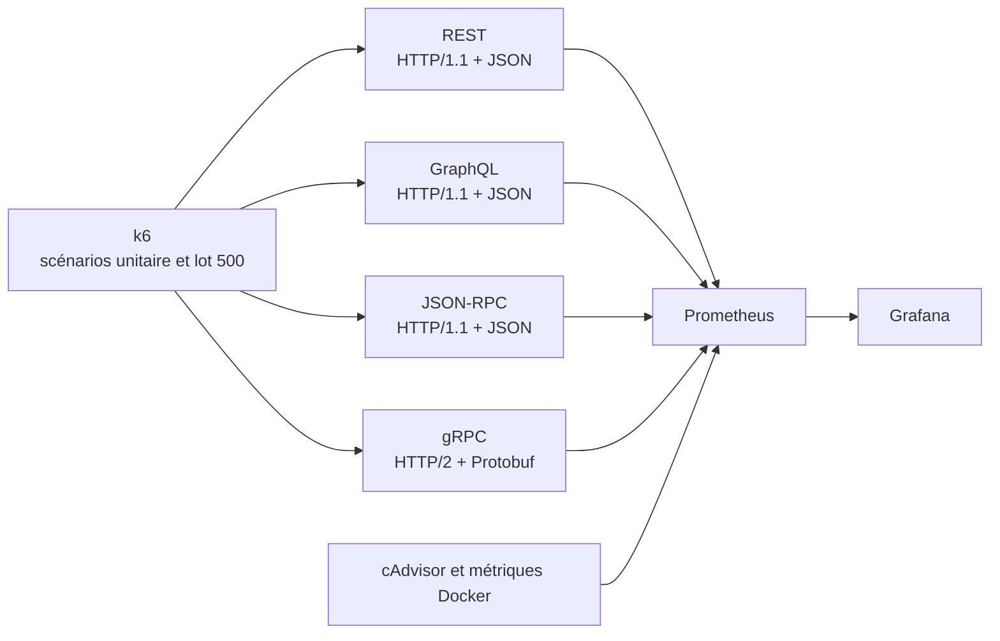

**Figure 1 —** Vue simplifiée du diagramme de déploiement du banc d’essai. Les quatre services évalués sont déployés comme des conteneurs distincts dans le réseau Docker `mgl870-benchmark`, chacun soumis à la même limite CPU; les conteneurs k6 génèrent la charge et la chaîne Prometheus/cAdvisor/Grafana collecte et visualise les mesures.

### 6.4. Contexte d’interprétation

Le système n’a pas été conçu pour simuler toutes les conditions d’un environnement de production. Il sert de banc d’essai contrôlé pour une question ciblée : comment la taille de la charge utile modifie-t-elle le compromis entre formats textuels et sérialisation binaire lorsque le serveur est limité en CPU? La séparation des conteneurs réduit les interférences directes entre les variantes, mais l’exécution demeure influencée par l’hôte, la virtualisation réseau et l’implémentation des bibliothèques utilisées.

Cette distinction entre système étudié et système de production est essentielle. Le benchmark fournit des preuves sur le coût de la frontière d’appel dans un scénario minimal. Il ne permet pas, à lui seul, de conclure sur la sécurité, la résilience, l’évolution de contrats à long terme, la facilité de recrutement ou le coût total d’exploitation. Ces dimensions seront reprises dans l’analyse des compromis et dans les menaces à la validité.

## 7. Architecture et décisions

### 7.1. Vue d’ensemble de l’architecture

L’architecture expérimentale est organisée autour d’un hôte Docker et d’un réseau privé commun nommé `mgl870-benchmark`. Le banc d’essai comporte trois groupes de composants : la génération de charge, les services évalués et l’observabilité. Les quatre services évalués sont construits à partir du même projet Rust, mais sont lancés dans quatre conteneurs distincts afin que la limite CPU puisse être appliquée séparément à chaque variante.

Le scénario k6 unitaire appelle les opérations d’ingestion d’un seul tick. Le scénario k6 par lots appelle les opérations correspondantes avec un tableau ou un message contenant 500 ticks. Les requêtes sont dirigées vers les conteneurs REST, GraphQL, JSON-RPC et gRPC par leurs noms de service Docker. Les services ne communiquent pas entre eux : chaque variante reçoit une charge comparable et produit un résultat indépendant.

La couche d’observabilité est séparée du chemin fonctionnel évalué. k6 enregistre les durées, les requêtes et les erreurs, puis écrit les métriques vers Prometheus. cAdvisor et `docker-metrics` exposent les métriques de ressources des conteneurs. Grafana interroge Prometheus pour afficher la consommation CPU, la mémoire, le réseau, le débit et les percentiles de latence. Cette séparation permet de mettre en relation une mesure applicative avec l’état de la ressource sans ajouter un traitement métier aux serveurs évalués.

Le diagramme de déploiement complet est versionné dans [`docs/figures/architecture.puml`](figures/architecture.puml). Il représente l’hôte Docker, le réseau, les conteneurs, leurs artefacts et les flux de requêtes et de métriques. La vue intégrée en section 6 en est une version simplifiée destinée à rester lisible directement dans le Markdown.

### 7.2. Vue des composants logiciels

Chaque variante possède un adaptateur propre à son protocole et converge vers le même modèle conceptuel de tick et le même traitement minimal. REST utilise le routeur Axum et un extracteur JSON. GraphQL utilise un schéma `async-graphql` composé d’une mutation unitaire et d’une mutation par lots. JSON-RPC utilise un handler HTTP, une enveloppe JSON-RPC 2.0 et `serde_json` pour convertir les paramètres. gRPC utilise un service Tonic généré à partir du contrat Protocol Buffers.

Cette architecture ne constitue pas une abstraction logicielle unique qui normaliserait les quatre protocoles derrière une interface interne commune. La convergence se fait au niveau du modèle et du comportement attendu, tandis que les étapes de transport et de désérialisation restent propres à chaque implémentation. Ce choix est important pour l’expérience : une couche d’adaptation supplémentaire aurait pu réduire les différences observables ou introduire un coût commun non pertinent.

Le diagramme de composants source est disponible dans [`docs/figures/components.puml`](figures/components.puml). Il montre les deux scénarios de charge, les quatre points d’entrée, le modèle `Tick`, le traitement commun et les composants d’observabilité.

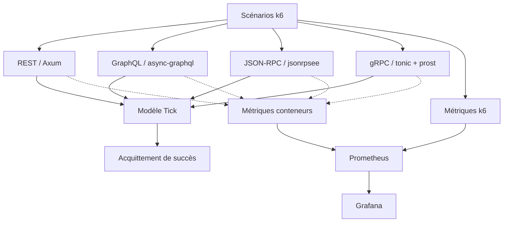

**Figure 2 —** Composants logiciels et convergence vers le modèle de données commun. Les quatre adaptateurs restent distincts jusqu’à la désérialisation, ce qui préserve la comparabilité du coût protocolaire.

### 7.3. Séquence d’une requête

Dans les deux scénarios, k6 construit le payload, l’envoie au point d’entrée, puis mesure le délai jusqu’à la réponse de succès. Pour REST, GraphQL et JSON-RPC, le serveur reçoit une requête HTTP avec une représentation JSON. Pour gRPC, le client invoque une méthode définie dans `tick.proto`; le message est décodé comme un message Protocol Buffers et l’appel retourne un `Ack`.

Après la désérialisation, aucun calcul métier ni accès externe n’est réalisé. Le serveur retourne immédiatement un succès. Cette séquence est volontairement courte : elle permet d’étudier la frontière de communication, mais elle exclut les coûts qui apparaîtraient dans une application complète. Le diagramme de séquence détaillé est versionné dans [`docs/figures/sequence-ingestion.puml`](figures/sequence-ingestion.puml).

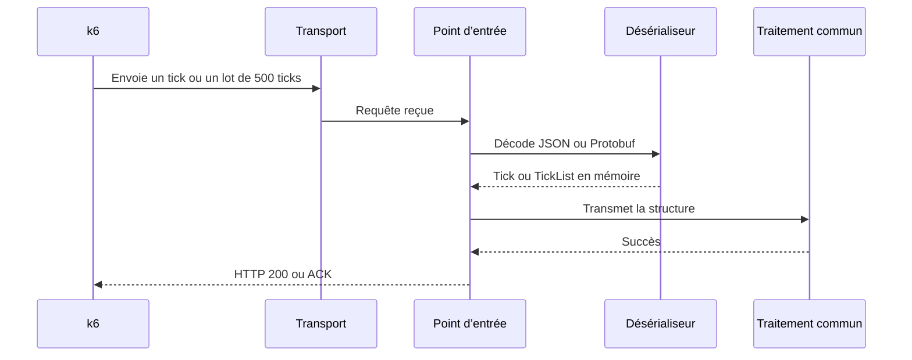

**Figure 3 —** Séquence commune d’une ingestion. Les variantes diffèrent principalement par le transport et le désérialiseur; le traitement applicatif après décodage est volontairement identique et minimal.

### 7.4. Décisions architecturales documentées par ADR

Les décisions importantes sont conservées comme des ADRs dans `docs/adr/`. Elles rendent explicites le contexte, les alternatives et les conséquences plutôt que de présenter l’architecture comme un assemblage de choix techniques implicites.

| ADR | Décision | Raison principale |
| --- | --- | --- |
| [ADR-001](adr/ADR-001-comparaison-de-protocoles.md) | Comparer REST, JSON-RPC, GraphQL et gRPC | Couvrir quatre compromis d’interface et de sérialisation |
| [ADR-002](adr/ADR-002-traitement-minimal-en-rust.md) | Utiliser un traitement minimal commun en Rust | Isoler le coût de communication et de désérialisation |
| [ADR-003](adr/ADR-003-contrainte-de-ressources.md) | Limiter chaque serveur à `0,25` vCPU | Exposer les coûts sous contrainte CPU contrôlée |
| [ADR-004](adr/ADR-004-scenarios-et-observabilite.md) | Utiliser deux scénarios k6 et une observabilité centralisée | Relier la taille du payload, les performances et les ressources |

Ces décisions forment une chaîne cohérente. Le choix des quatre protocoles définit les alternatives; le traitement minimal limite les variables parasites; la contrainte CPU rend les différences observables; les scénarios et l’observabilité produisent les preuves nécessaires à la comparaison.

### 7.5. Conséquences architecturales des décisions

L’architecture favorise la validité interne de la comparaison au prix d’une représentativité réduite d’un système de production. Les variantes sont comparables parce qu’elles exécutent peu de logique et disposent de la même limite de ressources. En revanche, les résultats ne mesurent pas l’effet d’une base de données, d’une logique métier, de la sécurité TLS, de la découverte de services ou d’un déploiement multi-hôtes.

Une autre conséquence est que l’observabilité fait partie de l’architecture expérimentale, mais pas du chemin applicatif évalué. Prometheus, Grafana et cAdvisor rendent les résultats interprétables sans devenir des composants que le protocole devrait traverser pour répondre au client. Cette distinction sera importante dans l’analyse des menaces à la validité.

## 8. Méthodologie

### 8.1. Principe expérimental et répétitions

L’étude adopte une comparaison contrôlée à deux facteurs principaux : le protocole de communication et la taille de la charge utile. Le langage, le modèle de données, le traitement applicatif, le déploiement conteneurisé et la limite de ressources sont maintenus constants entre les variantes. Chaque exécution k6 lance simultanément quatre scénarios nommés `rest`, `graphql`, `jsonrpc` et `grpc`; une répétition compare donc les quatre protocoles dans les mêmes conditions générales.

Deux séries indépendantes de cinq répétitions ont été réalisées : cinq runs du scénario unitaire et cinq runs du scénario par lots. Les fichiers `k6_results_run1.json` à `k6_results_run5.json` et `k6_batch_results_run1.json` à `k6_batch_results_run5.json` sont conservés dans `results/`. Les captures Grafana correspondantes sont classées dans `docs/screenshots/individual_run_1/` à `individual_run_5/` et `docs/screenshots/batch_run_1/` à `batch_run_5/`.

Les répétitions servent à mesurer la stabilité des tendances, et non à prétendre à une inférence statistique générale. Les résultats sont synthétisés par moyenne, médiane, minimum et maximum entre les runs pour les métriques agrégées; les captures représentatives sont choisies selon une règle a priori décrite en section 9. Les résultats par protocole restent issus des séries Grafana, car le résumé JSON n’exporte pas les percentiles de la métrique personnalisée séparément pour chaque tag `protocol`.

### 8.2. Scénario unitaire

Le scénario unitaire transmet toujours le même tick : symbole `SHOP`, prix `115.42`, volume `100` et timestamp `1700000000`. Le profil `ramping-arrival-rate` comprend 2 000 requêtes/s pendant 3 minutes, 4 000 requêtes/s pendant 3 minutes, puis 6 000 requêtes/s pendant 4 minutes. Chaque scénario réserve 4 000 VUs et autorise au maximum 4 000 VUs.

Le script configure des seuils de p95 inférieur à 1 000 ms, de p99 inférieur à 2 000 ms et de taux d’erreur inférieur à 1 %. Les seuils de latence sont dépassés dans les cinq runs sous la charge soutenue; cette violation est un résultat de saturation et non un critère d’exclusion, puisque les checks HTTP/gRPC restent réussis et que le taux d’erreur demeure nul.

### 8.3. Scénario par lots

Le scénario par lots réutilise le même tick et construit une charge de 500 éléments. REST, GraphQL et JSON-RPC transportent le lot dans une représentation JSON; gRPC le transmet dans le champ répété `ticks` du message `TickList` défini dans [`proto/tick.proto`](../proto/tick.proto).

Le profil comprend 100 requêtes/s pendant 1 minute, puis 500 requêtes/s pendant 2 minutes et 500 requêtes/s pendant 4 minutes supplémentaires. La cible de 500 requêtes/s est donc maintenue pendant 6 minutes, ce qui permet d’observer une saturation soutenue plutôt qu’un pic bref. Chaque scénario réserve 1 500 VUs et autorise au maximum 1 500 VUs. Comme une requête contient 500 ticks, le débit de requêtes et le débit de ticks sont rapportés séparément.

### 8.4. Environnement et isolation

Les quatre serveurs sont lancés dans des conteneurs distincts construits à partir du même `Dockerfile`. Docker Compose applique à chaque serveur une limite de `0,25` vCPU et 512 MiB de mémoire. Les ports sont `8081` pour REST, `8082` pour GraphQL, `8083` pour JSON-RPC et `50051` pour gRPC. Les conteneurs partagent le réseau Docker `mgl870-benchmark`, mais chaque variante possède son propre processus serveur.

Avant chaque run, l’environnement est arrêté puis redémarré afin de réduire la contamination entre essais. Les limites CPU ne constituent pas une propriété intrinsèque des protocoles : elles créent une condition expérimentale commune destinée à rendre visibles les coûts de parsing, de désérialisation et de transport. L’exécution reste susceptible d’être influencée par Windows, WSL2/Hyper-V et la virtualisation réseau.

### 8.5. Mesures collectées

Les scripts k6 enregistrent la durée personnalisée (`protocol_request_duration` ou `batch_protocol_request_duration`), le nombre de requêtes, les erreurs et le taux d’erreur. Les métriques natives HTTP et gRPC sont également conservées lorsque k6 les expose. Prometheus reçoit les métriques k6; cAdvisor et `docker-metrics` fournissent l’utilisation CPU, la mémoire et le trafic réseau des conteneurs; Grafana affiche les séries temporelles et les percentiles p50, p95 et p99.

Le p50 décrit le comportement typique, tandis que le p95 et le p99 rendent visibles les files d’attente et la dégradation de la queue de distribution. Pour les lots, le débit de ticks est calculé comme le débit de requêtes multiplié par 500. Les valeurs de débit et de latence lues dans les captures sont des valeurs de régime approximatives; elles ne remplacent pas une extraction numérique complète des séries Prometheus.

### 8.6. Critères de validité et reproductibilité

Un run est conservé lorsqu’il est complet, que les quatre checks applicatifs ont zéro échec, que le taux d’erreur est nul et que les captures couvrent les indicateurs prévus. Les itérations abandonnées ne sont pas considérées comme des erreurs applicatives : elles indiquent que k6 n’a pas pu démarrer toute la charge demandée avec les VUs disponibles. Les seuils de latence k6, eux, sont des objectifs de service et non un filtre d’exclusion du run.

Le protocole est reproductible à partir de [`docker-compose.yml`](../docker-compose.yml), des scripts [`tests/load_test.js`](../tests/load_test.js) et [`tests/load_test_batch.js`](../tests/load_test_batch.js), du contrat [`proto/tick.proto`](../proto/tick.proto), des dashboards Grafana, des dix fichiers JSON et des captures conservées dans le dépôt.

### 8.7. Règle d’interprétation

La section 9 rapporte les observations consolidées sans leur attribuer automatiquement une cause. La section 10 analysera les mécanismes possibles; la section 11 discutera les compromis opérationnels et contractuels. Cette séparation distingue une mesure, une explication et une recommandation architecturale.

## 9. Résultats

### 9.1. Intégrité et couverture des données

Les cinq runs individuels ont duré entre 600,97 et 601,76 secondes. Les cinq runs batch ont duré entre 430,84 et 433,68 secondes. Pour chaque run, les checks REST, GraphQL, JSON-RPC et gRPC ont enregistré zéro échec et le taux d’erreur applicatif est resté nul. Les seuils de latence k6 ont été dépassés, ce qui est cohérent avec la saturation imposée et ne constitue pas une erreur de traitement.

Les JSON exportent principalement des métriques agrégées sur les quatre scénarios. Ils ne permettent pas de calculer directement, pour chaque protocole, les p50/p95/p99 de la métrique personnalisée. Les comparaisons individuelles entre protocoles sont donc fondées sur les séries Grafana et leurs captures; les tableaux ci-dessous décrivent explicitement les agrégats JSON et ne les présentent pas comme des mesures par protocole.

### 9.2. Stabilité agrégée des répétitions unitaires

Le tableau suivant ne compare pas REST, GraphQL, JSON-RPC et gRPC entre eux. Il résume les métriques agrégées par k6 sur les quatre protocoles afin de vérifier la répétabilité et le niveau de saturation des cinq répétitions. Il répond à la question méthodologique : **les runs unitaires ont-ils produit des observations suffisamment comparables pour être analysés ensemble?**

| Métrique agrégée k6 | Moyenne des 5 runs | Minimum | Maximum |
| --- | ---: | ---: | ---: |
| Durée moyenne (`protocol_request_duration`) | 567,1 ms | 530,8 ms | 598,2 ms |
| Médiane | 72,2 ms | 58 ms | 83 ms |
| p90 | 2 491,2 ms | 2 467 ms | 2 546 ms |
| p95 | 2 662,8 ms | 2 599 ms | 2 712 ms |
| Itérations exécutées | 6 410 896 | 6 354 906 | 6 483 177 |
| Itérations abandonnées | 1 264 481 | 1 195 812 | 1 323 266 |

Les cinq runs sont donc relativement cohérents sur la durée agrégée et les percentiles, malgré une saturation importante de l’injecteur. Les valeurs de la colonne « Moyenne des 5 runs » sont des moyennes des résumés de chaque run; elles ne constituent pas un recalcul poolé de toutes les observations individuelles. Les captures Grafana montrent systématiquement que REST conserve le meilleur débit de requêtes et la latence de queue la plus basse dans le scénario unitaire; JSON-RPC suit, tandis que GraphQL et gRPC plafonnent plus tôt dans cette configuration. Cette observation est répétée, mais les valeurs exactes par protocole ne doivent pas être reconstruites à partir de l’agrégat JSON.

Le run individuel 3 est utilisé comme capture représentative, car sa durée agrégée (`566,6 ms`) est la plus proche de la médiane des cinq runs. Les quatre autres répertoires restent disponibles pour audit et comparaison.

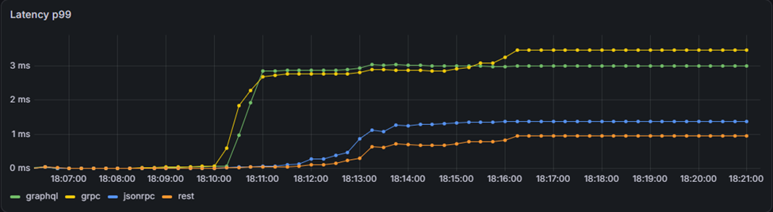

**Figure 4 —** Latence p99 du run individuel représentatif. REST reste le plus bas dans la phase soutenue, alors que GraphQL et gRPC présentent une queue plus élevée.

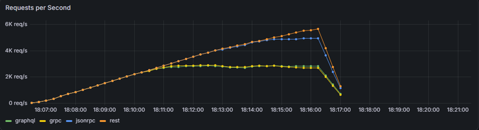

**Figure 5 —** Débit de requêtes du run individuel représentatif. REST atteint le débit de requêtes le plus élevé dans la phase stable visible.

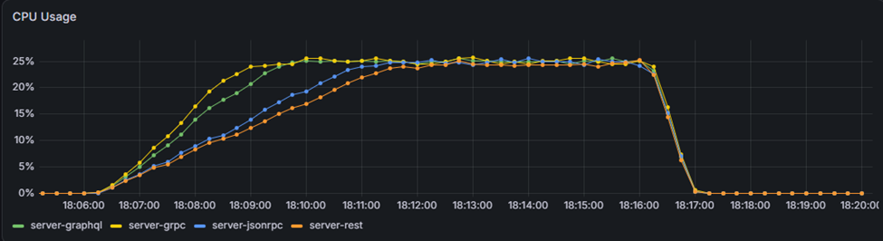

**Figure 6 —** Utilisation CPU du run individuel représentatif. Les quatre services atteignent la zone de la limite `0,25` vCPU.

### 9.3. Stabilité agrégée des répétitions par lots

Comme le tableau précédent, celui-ci ne constitue pas un classement des protocoles. Il décrit la variabilité globale des cinq runs batch et confirme que la charge demandée a produit une saturation soutenue. La comparaison REST/GraphQL/JSON-RPC/gRPC repose sur les séries Grafana présentées ensuite.

| Métrique agrégée k6 | Moyenne des 5 runs | Minimum | Maximum |
| --- | ---: | ---: | ---: |
| Durée moyenne (`batch_protocol_request_duration`) | 2 915,3 ms | 2 640,7 ms | 3 188,8 ms |
| Médiane | 382,4 ms | 317 ms | 487 ms |
| p90 | 10 177,6 ms | 9 760 ms | 10 698 ms |
| p95 | 11 552,9 ms | 10 539 ms | 12 900,3 ms |
| Itérations exécutées | 436 505 | 416 151 | 454 513 |
| Itérations abandonnées | 199 430 | 181 385 | 219 804 |

Les cinq runs batch montrent la même séparation par protocole dans les captures : gRPC atteint environ 250 000 ticks/s, REST environ 200 000 à 245 000 ticks/s, JSON-RPC environ 100 000 à 150 000 ticks/s et GraphQL environ 30 000 à 65 000 ticks/s selon la phase stable et le run. Le classement est nettement plus marqué que dans le scénario unitaire. La latence p99 suit le même ordre : gRPC reste proche de 1 ms, REST se situe autour de quelques millisecondes, JSON-RPC autour d’une dizaine de millisecondes et GraphQL autour de 30 à 50 ms.

Le run batch 2 est utilisé comme représentation, car sa durée agrégée (`2 849,5 ms`) est la plus proche de la médiane des cinq runs. Les captures des runs 1, 3, 4 et 5 sont conservées pour vérifier la répétabilité de la tendance.

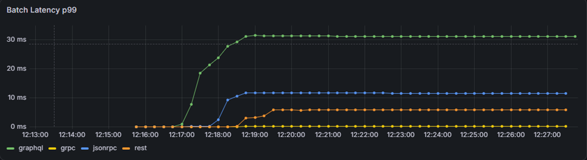

**Figure 7 —** Latence p99 du run batch représentatif pour des requêtes de 500 ticks. La séparation entre gRPC et les protocoles textuels est nette.

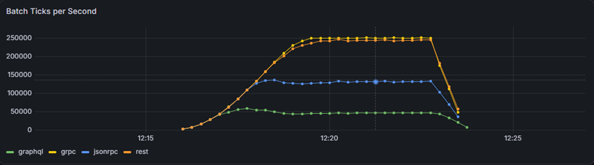

**Figure 8 —** Débit de ticks du run batch représentatif. gRPC traite le plus grand nombre de ticks par seconde à charge CPU comparable.

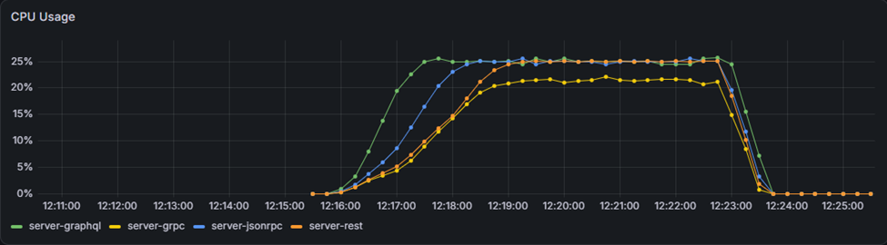

**Figure 9 —** Utilisation CPU du run batch représentatif. Les quatre serveurs atteignent la zone de 25 %, mais leur travail utile par unité de CPU diffère.

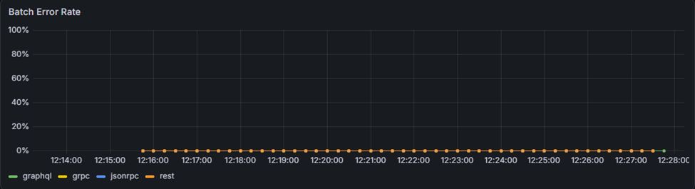

**Figure 10 —** Taux d’erreur du run batch représentatif. Les quatre séries restent à 0 % pendant la période observée.

### 9.4. Résultats de débit et changement de classement

Le résultat le plus important est l’inversion du classement selon le volume de charge utile. Pour un tick unitaire, REST domine les captures de débit et de p99. Pour 500 ticks, gRPC domine nettement le débit de ticks et la latence p99. Les cinq répétitions de chaque scénario reproduisent cette opposition, ce qui réduit la probabilité qu’elle soit due à un seul run aberrant.

Le débit de ticks est la mesure la plus pertinente pour les lots. À 500 ticks par requête, un plateau de 500 requêtes/s correspond théoriquement à 250 000 ticks/s. Les captures montrent que gRPC approche ce plafond, tandis que les autres protocoles plafonnent plus bas. Les itérations abandonnées montrent que la charge cible dépasse la capacité de l’injecteur ou des serveurs pendant certaines phases; elles ne doivent pas être interprétées comme des réponses applicatives en erreur.

### 9.5. Portée des observations

Les résultats établissent une borne expérimentale, et non un seuil continu exact : le classement change entre 1 et 500 ticks par requête. Ils démontrent aussi que les gains de gRPC apparaissent clairement dans le scénario de lots sous contrainte CPU. Ils ne permettent pas de conclure à un seuil universel, ni de séparer parfaitement le coût de chaque couche sans une extraction plus fine des séries Prometheus ou une instrumentation complémentaire.

## 10. Analyse des résultats

### 10.1. Réponse à la question de recherche

La question principale demandait à partir de quel volume de charge utile les gains d’efficacité mécanique de gRPC justifient son coût supplémentaire en opérabilité et en couplage contractuel. Les données ne permettent pas d’identifier un seuil continu exact, puisque seuls deux volumes ont été testés : un tick et un lot de 500 ticks. Elles permettent toutefois d’établir une borne et une inversion de classement clairement répétée.

Pour un tick unitaire, REST constitue la meilleure décision de performance dans l’environnement étudié. Les cinq captures du scénario unitaire montrent que REST conserve le meilleur débit de requêtes et la latence p99 la plus basse dans la phase soutenue. L’avantage attendu de la représentation binaire ne compense donc pas, pour ce micro-message, les coûts fixes associés à la pile gRPC et à son transport. Cette conclusion est locale au scénario : elle ne signifie pas que REST est toujours plus rapide que gRPC.

Pour un lot de 500 ticks, gRPC devient la meilleure décision de performance. Les cinq répétitions montrent un débit d’environ 250 000 ticks/s et une latence p99 proche du bas de l’échelle, alors que les variantes textuelles traitent moins de ticks et présentent une queue de latence plus élevée. Dans ce régime, le volume de données par requête rend l’efficacité de la représentation binaire suffisamment importante pour compenser le coût opérationnel supplémentaire, à condition que la performance et l’efficacité CPU soient prioritaires.

La conclusion défendable est donc conditionnelle : **gRPC est justifiable lorsque la charge utile est suffisamment importante pour rendre le coût de parsing textuel déterminant; pour les micro-messages, REST demeure préférable lorsque la simplicité et l’opérabilité ont une valeur supérieure au gain mécanique potentiel.** Avec les données disponibles, le point de bascule est encadré entre 1 et 500 ticks par requête, mais il n’est pas localisé à l’intérieur de cet intervalle.

### 10.2. Analyse de l’effet de la taille du payload

Le changement de classement entre les deux scénarios est l’observation la plus importante du rapport. Dans le scénario unitaire, le coût fixe de la requête représente une part importante du coût total. La charge utile est trop petite pour que la compacité de Protobuf domine nécessairement l’ensemble du chemin d’exécution. Le transport HTTP/2, la gestion de l’appel RPC et les étapes propres à la pile gRPC peuvent alors peser relativement lourd par rapport au décodage d’un seul tick.

Dans le scénario batch, ces coûts fixes sont amortis sur 500 objets. Le serveur doit analyser et convertir une structure beaucoup plus grande pour les variantes JSON, tandis que gRPC décode un message binaire structuré. Les captures montrent que cette différence devient visible lorsque les conteneurs sont limités à `0,25` vCPU. L’explication par le coût de parsing est cohérente avec l’architecture des implémentations et avec l’amélioration observée de gRPC, mais le benchmark ne mesure pas séparément le temps de parsing, le temps de transport et le temps de traitement. Il faut donc la présenter comme l’interprétation la plus plausible, non comme une décomposition causale directement observée.

### 10.3. Analyse de la contrainte CPU

Les captures CPU montrent que les quatre services atteignent la zone correspondant à leur limite de `0,25` vCPU. Cette saturation est importante pour interpréter les résultats : elle indique que le système n’est pas évalué dans une zone où toutes les variantes disposent de capacité de calcul inutilisée. Les différences de débit utile apparaissent alors malgré une enveloppe CPU identique.

Dans le scénario batch, gRPC traite davantage de ticks avant ou pendant la saturation observée. Cela signifie que son avantage porte surtout sur l’efficacité du travail accompli par unité de ressource, et non sur une consommation CPU absolue plus faible dans toutes les phases. Les quatre conteneurs peuvent atteindre le même plafond tout en produisant des débits différents. L’affirmation défendable est donc : **gRPC offre le meilleur rendement de la capacité CPU dans le scénario de lots étudié**, et non : **gRPC consomme toujours moins de CPU**.

### 10.4. Analyse des protocoles textuels

REST obtient le meilleur résultat parmi les protocoles étudiés pour le scénario unitaire et demeure compétitif dans le scénario batch. Cette performance est cohérente avec son rôle de baseline simple : la requête contient directement la représentation JSON attendue, sans enveloppe RPC complexe ni document de requête dynamique. La simplicité du chemin peut être avantageuse lorsque le payload est petit.

JSON-RPC conserve la lisibilité du JSON, mais ajoute une enveloppe contenant la version, la méthode, les paramètres et l’identifiant. Dans les résultats batch, il se situe entre REST et GraphQL. Cette position est cohérente avec un coût textuel supérieur à la baseline REST, mais inférieur au coût structurel du traitement GraphQL dans le scénario retenu.

GraphQL obtient les résultats les moins favorables dans le scénario batch. La requête contient une mutation, des variables et une structure que le moteur doit analyser avant d’exécuter le résolveur. Le protocole apporte une flexibilité qui n’est pas nécessaire pour cette opération d’ingestion fixe. Le résultat ne condamne pas GraphQL pour les usages où la sélection dynamique des données compense ce coût; il montre plutôt que cette flexibilité est difficile à justifier pour un chemin d’ingestion répétitif et fortement contraint.

### 10.5. Vérification des hypothèses

| Hypothèse | Évaluation | Justification |
| --- | --- | --- |
| H1 — coût des micro-messages | Soutenue dans le scénario étudié | REST domine les captures unitaires malgré l’absence de sérialisation binaire |
| H2 — effet de la taille | Soutenue | Le classement s’inverse pour les lots de 500 ticks et gRPC domine le débit de ticks |
| H3 — saturation | Soutenue avec réserve | Les conteneurs atteignent la limite CPU et les percentiles élevés se dégradent; la causalité précise n’est pas isolée |
| H4 — compromis architectural | Soutenue | gRPC gagne en performance batch, mais la décision dépend de la valeur accordée à l’opérabilité et au couplage |

Les hypothèses sont donc confirmées dans les conditions du benchmark, mais aucune ne doit être reformulée comme une loi générale. Les cinq répétitions renforcent la stabilité de la tendance; elles ne suppriment pas les menaces liées à l’environnement, à l’implémentation et aux deux seules tailles de payload.

### 10.6. Signification des itérations abandonnées

Les itérations abandonnées sont élevées dans les deux scénarios, particulièrement lorsque la charge demandée dépasse la capacité combinée du générateur et des services. Elles indiquent que k6 n’a pas pu démarrer toutes les itérations prévues avec les VUs disponibles. Elles ne constituent pas des réponses HTTP ou gRPC en échec : les checks applicatifs restent à zéro échec et les taux d’erreur restent nuls.

Cette distinction est essentielle. Les résultats répondent à une question de capacité sous charge, et la saturation de la charge fait partie du phénomène observé. En revanche, les itérations abandonnées empêchent d’interpréter le débit demandé comme un débit effectivement servi par tous les protocoles. Le rapport doit donc privilégier le débit observé, les séries Grafana et les checks réussis, tout en rapportant les itérations abandonnées comme une limite du dispositif de génération.

### 10.7. Compromis décisionnel résultant des données

Les mesures ne justifient pas une migration générale vers gRPC. Elles soutiennent plutôt une stratégie de décision par scénario :

- choisir REST lorsque les messages sont petits, que l’interopérabilité et le diagnostic rapide dominent, et que le débit unitaire observé est suffisant;
- considérer JSON-RPC lorsque l’orientation appel de procédure est utile sans accepter un contrat binaire;
- réserver GraphQL aux situations où sa flexibilité de requêtage apporte une valeur réelle, et non à une ingestion fixe où son coût devient visible;
- choisir gRPC pour les échanges internes fortement volumineux et répétitifs lorsque le gain de débit et de latence justifie l’outillage spécialisé et la gestion stricte du contrat.

Ces règles ne remplacent pas une mesure dans le contexte cible. Elles constituent des heuristiques transférables dérivées de la comparaison observée, et non des prescriptions indépendantes des charges de travail.

### 10.8. Ce que les données ne permettent pas d’affirmer

Les données ne permettent pas d’affirmer que gRPC est toujours plus efficace, que GraphQL est toujours inadéquat pour l’ingestion, ni que REST est toujours préférable pour les messages courts. Elles ne permettent pas non plus d’identifier la contribution exacte de HTTP/2, de Protocol Buffers, du parsing JSON ou du moteur GraphQL sans instrumentation plus fine.

Elles permettent néanmoins d’affirmer trois résultats importants : le traitement applicatif de succès est resté fiable pour les quatre protocoles; le comportement change nettement lorsque le payload passe d’un tick à 500 ticks; et ce changement est répété dans cinq runs unitaires et cinq runs batch. C’est cette combinaison de résultats, de répétitions et de limites explicites qui rend la conclusion architecturale défendable.

## 11. Compromis architecturaux

### 11.1. Nature du compromis

Les résultats montrent qu’une décision de protocole ne peut pas être réduite à un classement de latence. REST domine le scénario unitaire observé, tandis que gRPC domine le scénario par lots. Cette inversion indique que la performance dépend de la charge de travail, mais elle ne suffit pas à décider seule de l’architecture. Un protocole est aussi une interface de développement, un contrat entre équipes et un composant d’exploitation.

Dans cette section, les performances sont donc considérées comme des preuves expérimentales, tandis que l’opérabilité, la flexibilité et le couplage sont analysés qualitativement à partir des propriétés des technologies, de la documentation de référence et des décisions ADR. Le benchmark ne mesure pas directement le temps nécessaire pour diagnostiquer un incident ou modifier un contrat. Il serait donc incorrect de présenter les coûts opérationnels comme des valeurs quantitatives équivalentes aux p95 mesurés.

### 11.2. Performance contre opérabilité

L’opérabilité désigne ici la facilité avec laquelle une équipe peut déployer, observer, diagnostiquer, tester et maintenir la communication en production. Elle comprend notamment la visibilité du trafic, la disponibilité des outils, la simplicité de reproduction d’un appel et la capacité à comprendre une erreur sans connaître toute la pile technique.

REST bénéficie d’une opérabilité élevée dans le contexte général de l’étude. Les requêtes HTTP et les payloads JSON peuvent être inspectés avec des outils génériques, enregistrés dans des journaux lisibles et rejoués avec des clients largement disponibles. Cette propriété ne garantit pas une meilleure performance, mais elle réduit le coût de diagnostic pour les micro-messages, domaine où REST obtient déjà le meilleur résultat observé.

JSON-RPC conserve une grande partie de cette lisibilité tout en exprimant explicitement une opération et ses paramètres. Son enveloppe ajoute de la structure et un contrat de méthode, mais les messages restent inspectables comme JSON. Il constitue ainsi un compromis entre le modèle orienté ressource de REST et un appel de procédure plus explicite.

GraphQL dispose d’un écosystème d’outils riche, mais l’observation d’une requête demande de comprendre le schéma, la mutation, les variables et le chemin d’exécution du résolveur. Cette complexité peut être justifiée lorsqu’elle permet aux clients de contrôler précisément les données demandées. Dans le scénario d’ingestion fixe étudié ici, cette flexibilité apporte peu de valeur et son coût d’exécution devient visible dans les résultats batch.

gRPC apporte des outils spécialisés, la génération de code et un contrat de service explicite, mais le trafic binaire n’est pas immédiatement lisible dans un proxy ou un journal HTTP ordinaire. L’équipe doit disposer d’outils capables de charger le contrat `.proto`, d’interpréter les messages et de comprendre HTTP/2. La documentation officielle de gRPC décrit ces mécanismes et leurs outils [4]; elle soutient l’analyse de cette dépendance à une chaîne d’outillage spécialisée, sans fournir une mesure du coût opérationnel dans l’organisation étudiée.

### 11.3. Flexibilité contre coût de traitement

GraphQL maximise la flexibilité de la forme de la requête. Cette flexibilité est pertinente lorsqu’un même service doit répondre à des besoins de lecture variables ou éviter une multiplication d’endpoints spécialisés. Elle est moins pertinente pour une opération d’ingestion répétitive dont le schéma est connu à l’avance. Dans le benchmark, les quatre scénarios utilisent des opérations fixes; GraphQL conserve donc le coût de son analyse dynamique sans que son principal bénéfice fonctionnel soit sollicité.

REST offre une interface plus explicite et moins dynamique pour le scénario retenu. JSON-RPC formalise l’action sans introduire un langage de requête. gRPC formalise également l’action, mais à travers un contrat fortement typé et des artefacts générés. Le choix entre ces alternatives doit donc tenir compte de la variabilité des consommateurs : plus les besoins de requête sont dynamiques, plus GraphQL peut justifier sa complexité; plus le schéma est stable et le volume élevé, plus un contrat RPC efficace peut être avantageux.

### 11.4. Couplage contractuel et modifiabilité

Le couplage contractuel décrit ici la dépendance entre le client et le serveur pour comprendre, générer et faire évoluer l’interface. Il ne faut pas confondre couplage fort avec mauvaise architecture : un contrat explicite peut réduire les ambiguïtés et détecter des incompatibilités avant l’exécution. En contrepartie, il exige une gouvernance de versionnement et une coordination plus rigoureuse.

Avec gRPC, le fichier `.proto` constitue une source contractuelle partagée. La génération de code améliore la cohérence des types et rend les opérations disponibles plus explicites, mais une évolution du contrat doit respecter les règles de compatibilité de Protocol Buffers et être propagée aux consommateurs concernés [5]. Le couplage est donc visible et outillé, mais il devient une responsabilité architecturale à gérer.

REST peut aussi être couplé à un schéma ou à des conventions, mais son format JSON et ses outils génériques permettent souvent une évolution plus tolérante au niveau de la représentation. Cette souplesse peut réduire la coordination initiale, mais elle peut aussi déplacer les erreurs vers l’exécution lorsque le contrat est implicite ou insuffisamment documenté. JSON-RPC se trouve entre les deux : les noms de méthodes et les paramètres forment un contrat, mais la représentation demeure dynamique et textuelle.

GraphQL centralise une partie du contrat dans le schéma. Le schéma explicite les opérations et les types, tout en permettant des requêtes variables à l’intérieur de cet espace. Il réduit certains problèmes de sur- ou sous-récupération, mais introduit une gouvernance du schéma et des enjeux de compatibilité liés à l’évolution des champs et des résolveurs.

### 11.5. Matrice qualitative des compromis

Les évaluations suivantes sont qualitatives et servent à rendre les décisions explicites; elles ne constituent pas des mesures expérimentales. Elles synthétisent les propriétés documentées et les conséquences observées dans le banc d’essai.

| Protocole | Performance unitaire observée | Performance batch observée | Opérabilité | Couplage contractuel | Flexibilité | Coût architectural dominant |
| --- | --- | --- | --- | --- | --- | --- |
| REST | Meilleure dans le scénario étudié | Compétitive, derrière gRPC | Élevée | Faible à modéré | Modérée | Parsing JSON et conventions à gouverner |
| JSON-RPC | Intermédiaire | Inférieure à REST et gRPC | Élevée à modérée | Modéré | Modérée | Enveloppe RPC et parsing textuel |
| GraphQL | Inférieure dans le scénario étudié | La moins favorable | Modérée | Modéré à élevé via le schéma | Élevée | Parsing et exécution dynamique |
| gRPC | Inférieure à REST dans le scénario étudié | Meilleure dans le scénario étudié | Modérée à faible sans outillage spécialisé | Élevé et explicite | Faible à modérée | Contrats `.proto`, génération et diagnostic binaire |

La matrice doit être lue conjointement avec les résultats. « Élevée » en opérabilité ne signifie pas « meilleure dans tous les systèmes », et « élevé » en couplage ne signifie pas « mauvais ». Il s’agit de coûts et de bénéfices qui prennent une valeur différente selon les contraintes du système.

### 11.6. Quand le gain de gRPC justifie-t-il sa complexité?

Les cinq runs batch fournissent le cas le plus favorable à gRPC : le débit de ticks est nettement supérieur et la latence p99 est beaucoup plus faible que pour les protocoles textuels sous la même contrainte CPU. Dans un service interne où le volume est élevé, où les consommateurs sont connus et où la performance est un attribut critique, ce gain peut justifier la gestion des contrats `.proto`, la génération de code et l’outillage d’observation.

Le choix est moins évident pour les micro-messages. Les cinq runs unitaires montrent que REST domine la performance dans la configuration étudiée, tout en offrant une inspection plus simple. Adopter gRPC dans ce cas imposerait le coût de son contrat et de sa chaîne d’exploitation sans bénéfice mesuré dans ce benchmark. La décision gRPC ne devient raisonnable que si d’autres exigences non évaluées, par exemple la compatibilité avec un écosystème gRPC existant ou des besoins de streaming, compensent ce résultat.

Le point de bascule doit donc être défini comme une décision économique et opérationnelle, pas uniquement comme une taille de payload. La taille est le facteur manipulé dans l’expérience; la justification finale dépend aussi de la criticité du débit, du nombre d’équipes, de la stabilité du contrat, de la maturité des outils et du coût acceptable d’un diagnostic.

### 11.7. Règle de décision proposée

Une équipe devrait commencer par caractériser le scénario réel : taille et fréquence des messages, criticité de la latence, nombre de consommateurs, fréquence des changements de contrat et capacité des équipes à exploiter des outils spécialisés. Elle devrait ensuite reproduire une mesure représentative, car les résultats de ce projet ne remplacent pas une mesure dans le contexte cible.

L’arbre de décision PlantUML correspondant est disponible dans [`docs/figures/decision-tradeoffs.puml`](figures/decision-tradeoffs.puml). Il formalise les règles suivantes :

1. pour un payload petit et une forte priorité donnée à la lisibilité, commencer par REST;
2. pour un appel de procédure textuel et inspectable, considérer JSON-RPC;
3. pour des besoins de requêtage réellement dynamiques, considérer GraphQL après mesure du coût d’exécution;
4. pour un volume élevé, un contrat stable et une contrainte CPU forte, évaluer gRPC;
5. adopter gRPC seulement si le gain mesuré compense le coût d’opérabilité et de couplage dans l’organisation cible.

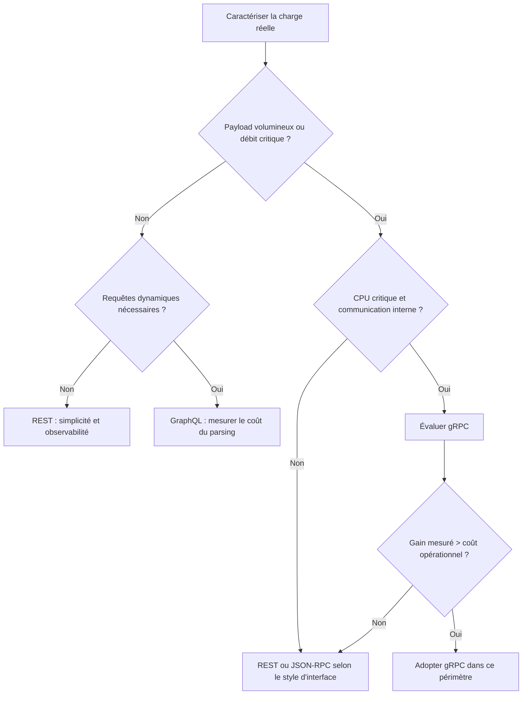

**Figure 11 —** Règle de décision qualitative dérivée des résultats. Elle ne remplace pas une mesure dans le contexte cible et ne transforme pas le benchmark en seuil universel.

### 11.8. Limite de cette analyse

L’opérabilité et le couplage n’ont pas été mesurés par une étude d’utilisateurs, une analyse de tickets d’incident, un suivi du temps de maintenance ou une comparaison du nombre de changements de contrat. Les conclusions de cette section sont donc des implications architecturales argumentées, non des résultats quantitatifs supplémentaires.

Cette limite ne réduit pas leur pertinence; elle définit leur statut épistémique. Les mesures expérimentales répondent à la dimension performance et efficacité matérielle. Les sources techniques, les ADRs et la structure des interfaces soutiennent l’analyse qualitative des coûts. Une étude future pourrait compléter cette analyse par des scénarios de modification, des exercices de diagnostic et une mesure du coût d’exploitation dans plusieurs équipes.

## 12. Menaces à la validité et limites

Une expérimentation de performance ne produit pas une vérité indépendante de son environnement. Elle produit des observations dans un protocole donné, avec une implémentation donnée et une charge de travail donnée. Cette section explicite les menaces qui peuvent limiter la portée des conclusions. La distinction entre validité interne, validité de construit, validité externe et validité des conclusions suit une pratique courante des études expérimentales en génie logiciel [7].

### 12.1. Validité interne

La validité interne concerne la possibilité d’attribuer les différences observées aux facteurs étudiés plutôt qu’à une autre cause.

**Différences d’implémentation.** Les quatre variantes utilisent le même langage, le même modèle de données et un traitement métier minimal, mais elles n’utilisent pas exactement la même bibliothèque ni exactement le même chemin d’exécution. Axum, async-graphql, jsonrpsee et tonic ont chacun leurs propres mécanismes internes. Les résultats portent donc sur la combinaison protocole, bibliothèque et configuration testée, et non sur une implémentation abstraite de chaque standard.

**Contamination entre exécutions.** Les services sont séparés dans des conteneurs, et l’environnement est redémarré entre les runs. Cela réduit la contamination par l’état des processus, mais ne supprime pas les effets de l’hôte, du système de fichiers, du cache, de la température ou des autres processus Windows. Les cinq répétitions permettent d’observer la variabilité résiduelle sans l’éliminer.

**Générateur de charge partagé.** Les quatre scénarios sont exécutés simultanément par k6. Cette décision garantit une pression temporelle comparable, mais elle crée une ressource partagée : CPU, mémoire, connexions et VUs du générateur. Les itérations abandonnées montrent que k6 n’a pas pu lancer toute la charge demandée. Elles doivent donc être rapportées comme une limite de capacité du dispositif et non attribuées automatiquement à un serveur particulier.

**Ordre et concurrence des scénarios.** Les protocoles sont sollicités dans une même exécution, mais les variations de planification peuvent ne pas être parfaitement identiques entre les séries temporelles. Une étude complémentaire pourrait exécuter chaque protocole séparément avec exactement le même profil, au prix d’une comparabilité temporelle moins directe. La présente étude limite ce risque par cinq répétitions et par l’utilisation d’une configuration identique.

**Saturation réseau ou CPU.** La limite de `0,25` vCPU vise à faire apparaître la contrainte de calcul, mais l’environnement Windows/WSL2/Hyper-V peut aussi introduire un plafond réseau. Les métriques CPU et les captures Grafana montrent que les conteneurs atteignent leur limite, ce qui soutient l’interprétation computationnelle; elles ne prouvent toutefois pas que le réseau n’a jamais contribué à la latence.

### 12.2. Validité de construit

La validité de construit concerne la correspondance entre les concepts étudiés et les mesures utilisées.

**Performance.** La latence, le débit et le taux d’erreur sont des indicateurs pertinents pour l’ingestion à haute fréquence. Le p50 décrit le comportement central, tandis que le p95 et le p99 rendent visibles les files d’attente et les dégradations de la queue. Le débit de ticks est plus pertinent que le seul débit de requêtes pour le scénario batch, car chaque requête contient 500 objets.

**Efficacité matérielle.** L’utilisation CPU des conteneurs est un indicateur de pression sur les ressources, mais elle ne constitue pas un profil détaillé du coût de parsing, de sérialisation ou de transport. Le benchmark montre une différence de travail utile sous une même limite CPU; il ne mesure pas directement le nombre de cycles, les allocations, les instructions exécutées ou le temps exact de chaque étape.

**Opérabilité.** L’opérabilité est analysée à partir des propriétés documentées des interfaces et de leur outillage. Elle n’est pas mesurée par des temps de diagnostic, des enquêtes auprès d’équipes ou des données d’incidents. Les affirmations de la section 11 doivent donc rester qualitatives.

**Couplage et modifiabilité.** Le fichier `.proto`, le schéma GraphQL, les méthodes JSON-RPC et les conventions REST matérialisent différents types de contrat. Toutefois, le benchmark ne mesure ni le nombre de changements requis pour faire évoluer ces contrats ni le délai de coordination entre équipes. La comparaison décrit un risque architectural plausible, pas un coût organisationnel universel.

**Métriques par protocole.** Les fichiers JSON exportés par k6 agrègent certaines métriques personnalisées sur les quatre tags `protocol`. Les classements par protocole reposent donc sur les séries Grafana et leurs captures, dont les valeurs sont lues à l’échelle des graphiques. Cette limite interdit de présenter ces lectures comme des mesures numériques aussi précises que les valeurs agrégées du JSON.

### 12.3. Validité externe

La validité externe concerne la transférabilité des résultats à d’autres environnements.

**Taille et forme du payload.** L’étude utilise un tick minimal composé de quatre champs et un lot de 500 copies de ce tick. Les résultats peuvent changer avec des chaînes plus longues, des structures imbriquées, des champs optionnels, des données moins répétitives ou des lots de taille intermédiaire. Le seuil observé est donc encadré entre 1 et 500 ticks, et non généralisé à toutes les charges.

**Environnement logiciel.** Les serveurs sont écrits en Rust et exécutés avec les bibliothèques présentes dans ce dépôt. Un autre langage, une autre version de bibliothèque, TLS, un proxy, un service mesh ou une topologie multi-hôtes pourraient modifier le classement.

**Environnement matériel.** La contrainte de `0,25` vCPU est utile pour rendre visibles les différences, mais elle ne représente pas toutes les configurations de production. Avec davantage de CPU, le point de saturation pourrait disparaître ou être déplacé; avec un réseau distant, le coût du transport pourrait devenir dominant.

**Nature de l’application.** Le serveur ne contient ni base de données, ni logique métier, ni validation financière, ni persistance. Les conclusions portent sur la frontière de communication et la désérialisation dans un micro-service minimal. Elles ne prédisent pas directement la performance d’un système financier complet.

**Profil de communication.** Les tests évaluent des appels synchrones d’ingestion. Ils ne couvrent pas le streaming bidirectionnel, les longues connexions, les retries, le contrôle de flux, les erreurs partielles, la sécurité ou la résilience. Une décision pour un système réel doit donc reproduire les scénarios opérationnels pertinents.

### 12.4. Validité des conclusions

Les cinq répétitions par scénario renforcent la crédibilité de la tendance, mais elles ne constituent pas une preuve de significativité statistique générale. Le rapport ne calcule pas d’intervalle de confiance par protocole et ne réalise pas de test statistique entre distributions. Les termes « nettement », « domine » ou « meilleure » doivent donc être compris dans le domaine expérimental défini par les captures et les scénarios, et non comme des affirmations universelles.

La métrique agrégée contient aussi des itérations abandonnées. Une itération abandonnée signifie que k6 n’a pas démarré le travail prévu; elle ne représente pas nécessairement une réponse reçue en erreur. Les conclusions de performance privilégient donc les requêtes effectivement observées, les checks applicatifs et les séries temporelles, tout en rapportant la pression exercée sur l’injecteur.

Enfin, les captures Grafana sont représentatives, mais elles ne remplacent pas les données sources. Leur fonction est de montrer le comportement temporel et la saturation; les JSON servent à vérifier les compteurs et la stabilité inter-runs. Cette complémentarité doit être conservée dans la version finale du rapport.

### 12.5. Limites de mesure et de reproductibilité

La reproductibilité logicielle est bien soutenue par le dépôt : code, Docker Compose, scripts k6, contrat Protocol Buffers, dashboards, JSON et captures sont conservés. La reproductibilité exacte des temps de réponse reste toutefois conditionnée par l’hôte, la version de Docker, la virtualisation et les conditions de charge. Une personne extérieure peut reproduire le protocole et comparer les tendances, mais elle ne doit pas s’attendre à retrouver chaque valeur au milliseconde près.

Les timestamps des captures, la configuration de l’hôte et les versions exactes des images Docker devraient être archivés avec la remise finale si ces informations sont disponibles. Cette documentation réduirait encore l’ambiguïté sur les conditions d’exécution.

### 12.6. Effet des limites sur la conclusion

Ces menaces ne rendent pas l’étude invalide; elles définissent ce qu’elle permet raisonnablement de conclure. Les preuves soutiennent une inversion de classement entre un message unitaire et un lot de 500 ticks sous contrainte CPU, répétée cinq fois pour chaque scénario. Elles ne soutiennent pas un seuil universel, une supériorité absolue de gRPC ou une mesure quantitative du coût organisationnel.

La conclusion est donc proportionnée aux preuves : les résultats justifient une décision conditionnelle dans un contexte d’ingestion interne similaire, mais une équipe devrait reproduire l’expérience avec ses payloads, ses bibliothèques, son réseau et ses exigences d’exploitation avant de généraliser le choix.

## 13. Implications pour les architectes logiciels

### 13.1. Leçon principale

La principale implication est qu’un protocole de communication doit être choisi en fonction d’un scénario de charge et d’un ensemble d’attributs de qualité, pas en fonction d’un classement technologique général. Dans ce projet, la même architecture obtient deux réponses différentes selon que la requête contient un tick ou 500 ticks. La taille du payload et la contrainte CPU sont donc des variables de décision architecturale, et non de simples détails de benchmark.

La recommandation transférable est la suivante : **mesurer le protocole dans la forme de charge réellement critique, puis comparer le gain de performance au coût d’opérabilité, de couplage et d’évolution du contrat.** Cette règle est cohérente avec l’idée qu’une décision d’architecture doit être justifiée par les qualités prioritaires du système et par des scénarios mesurables [8].

### 13.2. Quand privilégier REST

REST est une décision raisonnable lorsque les payloads sont petits, que les clients sont variés, que l’interopérabilité compte et que les outils HTTP génériques ont une forte valeur opérationnelle. Les résultats unitaires renforcent cette option dans le contexte étudié : REST obtient le meilleur débit de requêtes et la meilleure latence de queue observée.

REST ne doit toutefois pas être choisi uniquement parce qu’il est familier. Pour un volume élevé, le parsing JSON et la taille des messages peuvent devenir un coût mesurable. L’architecte devrait alors vérifier le débit de ticks, la consommation CPU et les p99 dans une charge représentative plutôt que d’extrapoler à partir du scénario unitaire.

### 13.3. Quand considérer JSON-RPC

JSON-RPC est pertinent lorsque le domaine est naturellement exprimé par des appels de procédure et que la lisibilité du JSON reste importante. Il peut constituer un compromis lorsque l’équipe veut un nom de méthode et une enveloppe de paramètres explicites sans adopter immédiatement un contrat binaire.

Les résultats batch montrent cependant que le maintien d’une représentation textuelle conserve un coût sous forte contrainte CPU. JSON-RPC devrait donc être retenu pour sa clarté d’interface ou son interopérabilité, et non comme une optimisation de débit par rapport à une représentation binaire.

### 13.4. Quand considérer GraphQL

GraphQL est adapté lorsque la flexibilité de requêtage est une exigence réelle : plusieurs consommateurs ont des besoins de données différents, la réduction des échanges est importante et l’équipe peut gouverner un schéma partagé. Cette valeur fonctionnelle n’est pas exercée par une mutation d’ingestion fixe comme celle du benchmark.

L’implication n’est pas d’exclure GraphQL des systèmes à forte charge. Elle est de vérifier que la flexibilité justifie le coût du parsing, de l’exécution des résolveurs, de la gouvernance du schéma et de l’observabilité. Pour un chemin d’ingestion répétitif dont le contrat est stable, l’étude fournit un signal défavorable à l’adoption de GraphQL sous contrainte CPU.

### 13.5. Quand considérer gRPC

gRPC devient une option forte lorsque la communication est interne, que les consommateurs sont identifiés, que les contrats sont suffisamment stables et que la performance de lots ou de flux volumineux est critique. Les cinq runs batch montrent que son avantage est particulièrement visible lorsque 500 ticks sont regroupés et que chaque serveur est limité à `0,25` vCPU.

Avant d’adopter gRPC, l’architecte devrait néanmoins prévoir :

- une gouvernance du fichier `.proto` et des règles de compatibilité;
- la génération et la publication des artefacts clients;
- des outils de diagnostic capables de décoder les messages;
- des métriques et traces adaptées aux appels RPC;
- une stratégie de versionnement, de dépréciation et de migration;
- une documentation destinée aux équipes qui ne manipulent pas quotidiennement HTTP/2 et Protocol Buffers.

Le gain de performance ne justifie gRPC que si ces coûts sont acceptables dans l’organisation cible. La documentation officielle de gRPC et de Protocol Buffers décrit les mécanismes techniques [4][5], mais elle ne peut pas déterminer à la place d’une équipe si son coût opérationnel est acceptable.

### 13.6. Procédure de décision recommandée

Une décision réutilisable peut suivre les étapes suivantes :

1. définir le scénario critique : taille du payload, fréquence, débit de données et p99 attendu;
2. identifier les clients, le nombre d’équipes et la fréquence probable des changements de contrat;
3. choisir une baseline lisible, généralement REST ou JSON-RPC, puis mesurer les alternatives;
4. limiter les ressources selon la contrainte réelle du système et surveiller le serveur ainsi que l’injecteur;
5. répéter les mesures et conserver les données brutes;
6. comparer le gain de performance avec les coûts d’outillage, de diagnostic, de versionnement et de migration;
7. consigner la décision et ses conditions de réévaluation dans un ADR.

Cette procédure reprend l’esprit des ADRs du projet : une technologie n’est pas choisie isolément, mais dans un contexte, avec des options, des conséquences et des preuves disponibles.

### 13.7. Implications pour l’observabilité et les SLO

Le choix du protocole doit être lié aux objectifs de service. Un SLO de latence p99 très strict pour un flux volumineux peut justifier un protocole plus spécialisé, tandis qu’un objectif plus modeste peut rendre préférable une interface plus facile à diagnostiquer. Les métriques doivent être étiquetées par protocole, taille de payload et scénario; sinon, une moyenne agrégée peut masquer une dégradation d’une variante particulière.

L’expérience montre aussi qu’il faut surveiller l’injecteur. Un taux d’erreur nul ne signifie pas que toute la charge demandée a été exécutée : les itérations abandonnées peuvent révéler que k6 ou les VUs disponibles ont atteint une limite. Dans une évaluation réelle, l’architecte devrait donc instrumenter à la fois le client de charge, le serveur, le réseau et les ressources de l’hôte.

### 13.8. Portée de la transférabilité

Les leçons sont transférables à des communications internes où les messages et les ressources ressemblent aux scénarios étudiés. Elles sont moins directement transférables à des APIs publiques, à des systèmes multi-régions, à des communications sécurisées par TLS, à des flux asynchrones ou à des applications dominées par la base de données.

La bonne pratique consiste à transférer la méthode de raisonnement plutôt que le classement brut : identifier les attributs prioritaires, établir une baseline, mesurer la charge critique, documenter les compromis et vérifier les hypothèses dans le contexte cible. C’est cette méthode, plus que la préférence pour REST ou gRPC, qui constitue la contribution architecturale principale du projet.

## 14. Conclusion

### 14.1. Ce que cette étude a appris

Cette étude montre que le choix d’un protocole de communication est une décision conditionnelle à la charge de travail. Il n’existe pas, dans le contexte étudié, de protocole dominant simultanément pour les micro-messages et pour les lots volumineux.

Pour l’ingestion d’un tick par requête, REST obtient le meilleur comportement observé en matière de débit de requêtes et de latence de queue. Sa simplicité de transport et son opérabilité plus immédiate sont cohérentes avec un scénario où le contenu du message est faible et où le coût fixe de la pile de communication représente une part importante du travail total.

Pour l’ingestion de lots de 500 ticks, gRPC obtient le meilleur débit de ticks et la meilleure latence p99 observée. Sous la limite commune de `0,25` vCPU, son efficacité devient suffisamment importante pour dépasser les alternatives textuelles. GraphQL présente le coût le plus élevé dans ce scénario, tandis que JSON-RPC conserve une position intermédiaire.

La conclusion ne doit toutefois pas être formulée comme « gRPC est meilleur que REST ». La conclusion défendable est plutôt : **REST est préférable dans le scénario de micro-messages observé, tandis que gRPC est préférable pour les lots volumineux et répétitifs lorsque la performance CPU est prioritaire et que l’organisation peut absorber son coût opérationnel.**

### 14.2. Preuves soutenant la conclusion

La conclusion repose sur plusieurs éléments convergents :

- cinq répétitions du scénario unitaire et cinq répétitions du scénario batch;
- zéro échec dans les checks REST, GraphQL, JSON-RPC et gRPC;
- un taux d’erreur applicatif nul dans les runs conservés;
- une saturation répétée des conteneurs autour de la limite de `0,25` vCPU;
- une inversion du classement entre le scénario d’un tick et celui de 500 ticks;
- des captures Grafana montrant la stabilité temporelle des tendances;
- des fichiers JSON conservant les compteurs, les durées agrégées et les itérations abandonnées;
- une implémentation, une configuration Docker et un protocole d’expérience versionnés dans le dépôt.

Les données encadrent le point de bascule entre 1 et 500 ticks par requête. Elles ne localisent pas le seuil exact à l’intérieur de cet intervalle et ne mesurent pas directement le coût d’opérabilité, de diagnostic ou de gouvernance des contrats. Ces limites font partie de la conclusion plutôt que de l’annuler.

### 14.3. Importance pour l’architecte logiciel

L’importance architecturale de ce résultat est de remplacer une préférence technologique par une règle de décision fondée sur les attributs de qualité. Une équipe qui choisit gRPC uniquement parce qu’il est réputé rapide risque d’ajouter du couplage et de l’outillage sans bénéfice pour ses petits messages. Une équipe qui conserve REST uniquement parce qu’il est simple risque, à l’inverse, de subir un coût CPU important lorsque le volume par requête augmente.

La démarche recommandée est donc de caractériser la charge critique, d’établir une baseline, de mesurer les alternatives dans un environnement représentatif et de documenter les conséquences non fonctionnelles du choix. Le résultat transférable n’est pas un classement universel des protocoles, mais une méthode pour défendre une décision architecturale par des preuves et des hypothèses explicites.

### 14.4. Réponse finale et perspectives

La réponse finale à la question de recherche est la suivante : dans l’environnement et les scénarios étudiés, le gain mécanique de gRPC ne justifie pas son coût supplémentaire pour le micro-message unitaire; il devient défendable pour un lot de 500 ticks sous contrainte CPU, car le gain de débit et de latence est alors nettement visible. Le seuil précis reste à mesurer avec des tailles intermédiaires, par exemple 10, 50, 100 et 250 ticks, si une localisation plus fine est nécessaire.

Une étude future pourrait également extraire directement les séries Prometheus par protocole, mesurer séparément les étapes de parsing et de désérialisation, comparer plusieurs environnements matériels et évaluer l’opérabilité au moyen de scénarios de diagnostic et d’évolution de contrats. Ces extensions renforceraient la portée des résultats, mais elles ne sont pas nécessaires pour soutenir la conclusion conditionnelle du présent rapport.

## Déclaration d’utilisation de l’IA

Des outils d’intelligence artificielle générative ont été utilisés comme assistants dans ce projet. Leur utilisation a porté sur l’exploration de formulations, la structuration du rapport, la révision linguistique, la génération et la vérification de scripts auxiliaires, ainsi que l’organisation de l’analyse des résultats.

L’IA n’a pas constitué une source de preuve expérimentale. Les mesures présentées dans ce rapport proviennent des exécutions k6, des fichiers JSON conservés dans le dépôt et des métriques/captures Grafana. Les références ont été vérifiées séparément à partir des documents et pages officielles citées. L’auteur demeure responsable du code, du protocole, de l’interprétation des données, des décisions architecturales et de la rédaction finale, et doit être en mesure de défendre chacun de ces éléments.

## 15. Références

[1] Fielding, R. T. (2000). *Architectural Styles and the Design of Network-based Software Architectures*. Doctoral dissertation, University of California, Irvine. https://ics.uci.edu/~fielding/pubs/dissertation/top.htm

[2] JSON-RPC Working Group. (2010). *JSON-RPC 2.0 Specification*. https://www.jsonrpc.org/specification

[3] GraphQL Foundation. (2021). *GraphQL Specification, October 2021 edition*. https://spec.graphql.org/October2021/

[4] gRPC Authors. (s. d.). *Core concepts, architecture and lifecycle*. Documentation officielle de gRPC. Consulté le 14 octobre 2026. https://grpc.io/docs/what-is-grpc/core-concepts/

[5] Protocol Buffers Authors. (s. d.). *Language Guide (proto3)*. Documentation officielle de Protocol Buffers. Consulté le 14 octobre 2026. https://protobuf.dev/programming-guides/proto3/

[6] Kleppmann, M. (2017). *Designing Data-Intensive Applications: The Big Ideas Behind Reliable, Scalable, and Maintainable Systems*. O’Reilly Media. https://dataintensive.net/

[7] Wohlin, C., Runeson, P., Höst, M., Ohlsson, M. C., Regnell, B., & Wesslén, A. (2012). *Experimentation in Software Engineering*. Springer. https://doi.org/10.1007/978-3-642-29044-2

[8] Bass, L., Clements, P., & Kazman, R. (2021). *Software Architecture in Practice* (4th ed.). Addison-Wesley Professional. https://www.informit.com/store/software-architecture-in-practice-9780136886099

