# Étude comparative du coût architectural des protocoles de communication pour l’ingestion à haute fréquence

**Auteur :** Hugo Vaillant<br>
**Cours :** MGL870 — Architecture logicielle<br>
**Format :** Article scientifique — Livrable 2<br>

## Résumé

Le choix d’un protocole de communication interne met en tension la performance, l’efficacité matérielle, l’opérabilité et le couplage des contrats. Cette étude évalue dans quelles conditions l’efficacité mécanique de gRPC justifie son coût architectural supplémentaire par rapport à REST, GraphQL et JSON-RPC. Quatre interfaces équivalentes ont été implémentées dans un même artefact Rust, puis déployées dans des conteneurs isolés limités chacun à `0,25` vCPU. Deux charges ont été comparées : un tick de marché par requête et un lot de 500 ticks. La campagne officielle comprend cinq répétitions de chaque scénario, des mesures k6 et Prometheus, une télémétrie des ressources et 75 contrôles automatisés de cohérence. Pour les micro-messages, REST présente le meilleur comportement observé, avec 3 163,5 req/s et une p99 moyenne de 1 024,8 ms. Pour les lots, gRPC atteint environ 251 800 ticks/s en pointe, une p99 moyenne de 266,2 ms et toute la cadence demandée sans itération abandonnée. L’étude met ainsi en évidence une inversion de classement plutôt qu’un protocole universellement supérieur. Dans le contexte évalué, gRPC devient défendable lorsque la charge utile rend ses gains de débit, de latence et d’efficacité CPU suffisamment importants pour compenser un outillage plus spécialisé et un contrat plus couplé. Le résultat transférable est une règle de décision conditionnelle, soutenue par un protocole reproductible et explicitement limitée aux implémentations, charges et ressources étudiées.

## Sommaire

1. [Introduction](#1-introduction)
2. [Contexte et motivation](#2-contexte-et-motivation)
3. [Problème architectural](#3-problème-architectural)
4. [Questions de recherche et objectifs](#4-questions-de-recherche-et-objectifs)
5. [Travaux connexes et état de l’art](#5-travaux-connexes-et-état-de-lart)
6. [Système et contexte étudiés](#6-système-et-contexte-étudiés)
7. [Architecture et décisions](#7-architecture-et-décisions)
8. [Méthodologie](#8-méthodologie)
9. [Résultats](#9-résultats)
10. [Analyse des résultats](#10-analyse-des-résultats)
11. [Compromis architecturaux](#11-compromis-architecturaux)
12. [Menaces à la validité et limites](#12-menaces-à-la-validité-et-limites)
13. [Implications pour les architectes logiciels](#13-implications-pour-les-architectes-logiciels)
14. [Conclusion](#14-conclusion)
15. [Références](#15-références)

## 1. Introduction

Les systèmes distribués qui ingèrent des événements à haute fréquence doivent traiter un grand nombre de messages tout en maintenant une latence faible et prévisible. Dans ce contexte, le choix du protocole de communication entre services ne constitue pas uniquement une décision d’implémentation. Il influence directement la consommation de ressources, le débit atteignable, la stabilité des temps de réponse, la facilité d’exploitation et la capacité des équipes à faire évoluer les contrats entre services.

Plusieurs styles de communication sont couramment utilisés pour ce type d’échange. REST, généralement associé à HTTP et JSON, privilégie la simplicité, l’interopérabilité et la lisibilité des messages. JSON-RPC conserve un format textuel tout en exprimant explicitement des appels de procédures. GraphQL apporte une interface de requêtage dynamique qui permet au client de sélectionner les données ou l’opération souhaitée, au prix d’un traitement supplémentaire du document de requête. gRPC s’appuie sur HTTP/2 et Protocol Buffers afin de fournir des contrats fortement typés et une sérialisation binaire efficace, mais introduit une chaîne d’outillage et d’exploitation plus spécialisée.

Ces choix correspondent à des compromis architecturaux différents. Un protocole textuel peut être plus facile à inspecter, à tester et à intégrer avec des outils génériques, mais son analyse et sa sérialisation peuvent consommer davantage de cycles processeur lorsque la charge augmente. À l’inverse, un protocole binaire peut réduire le volume de données et le coût de désérialisation, mais il impose des contrats plus stricts et rend l’observation directe du trafic moins immédiate. La question pertinente n’est donc pas de déterminer quel protocole est globalement supérieur, mais d’identifier les conditions dans lesquelles un compromis donné devient raisonnable.

Ce rapport présente une évaluation expérimentale de REST, GraphQL, JSON-RPC et gRPC dans un environnement contrôlé. Les quatre interfaces sont implémentées dans des micro-serveurs Rust qui réalisent le même traitement minimal : recevoir une structure représentant un tick de marché, la désérialiser en mémoire et retourner un accusé de succès. L’expérimentation compare un scénario de micro-message unitaire à un scénario d’ingestion par lots de 500 ticks. Les serveurs sont exécutés dans des conteneurs Docker soumis à une limite de `0,25` vCPU afin de faire apparaître les coûts de traitement des protocoles avant que la capacité de calcul ne soit masquée par une machine surdimensionnée.

Les résultats étudiés mettent en évidence un point de bascule plutôt qu’un classement universel. Pour les messages unitaires, REST obtient les meilleurs résultats dans la configuration observée, ce qui indique que les coûts associés à la pile gRPC et au multiplexage HTTP/2 peuvent dépasser le bénéfice de la sérialisation binaire lorsque le payload est très petit. Pour les lots de 500 ticks, gRPC conserve au contraire une latence et un débit nettement plus favorables que les alternatives textuelles. Ce résultat est compatible avec un coût accru de parsing, de sérialisation et d’exécution des piles textuelles sous contrainte CPU, sans isoler expérimentalement la contribution exacte de chaque étape. Cette opposition constitue le résultat architectural central de l’étude : le choix du protocole doit être conditionné par le volume de données par requête, la pression sur le processeur et la valeur accordée à l’opérabilité.

La contribution de ce travail est ainsi double. Premièrement, il fournit des mesures reproductibles sur un système volontairement réduit afin d’isoler le coût mécanique de la communication. Deuxièmement, il transforme ces mesures en une analyse de décision architecturale : quand la simplicité et la lisibilité des protocoles textuels restent-elles préférables, et dans quelles conditions de charge l’efficacité de gRPC justifie-t-elle la complexité supplémentaire de ses contrats et de son outillage? La portée des conclusions demeure liée à l’environnement expérimental et aux scénarios évalués; elles ne prétendent pas établir une supériorité générale d’un protocole.

## 2. Contexte et motivation

### 2.1. Contexte architectural

La communication inter-processus est une décision structurante dans les systèmes distribués. Même lorsque les services exécutent une logique métier simple, chaque requête traverse plusieurs couches : établissement ou réutilisation de la connexion, transport HTTP, encodage du message, transmission réseau, parsing, désérialisation et traitement applicatif. Le coût de ces couches devient significatif lorsque le système doit traiter un grand nombre de requêtes ou lorsqu’il dispose de ressources de calcul limitées.

Dans un système d’ingestion de ticks de marché, les messages sont généralement fréquents et doivent être traités rapidement. Un tick étudié dans ce projet contient quatre champs : un symbole, un prix, un volume et un horodatage. La structure est volontairement minimale. Cette caractéristique permet de distinguer deux situations architecturales importantes :

- un message individuel dont le contenu est faible par rapport au coût fixe du protocole;
- un lot de nombreux messages où le coût de sérialisation, de parsing et de transfert devient proportionnellement plus important.

REST représente la baseline de l’étude. Son modèle orienté ressource, combiné à HTTP et JSON, est largement compris par les bibliothèques, les outils de diagnostic et les équipes d’exploitation. JSON-RPC propose une représentation orientée appel de procédure, tout en conservant les propriétés générales d’un format textuel. GraphQL ajoute une couche de requête dynamique et un moteur capable d’interpréter la structure de la demande. gRPC suit une approche différente : le contrat est défini dans un fichier Protocol Buffers, le message est sérialisé en binaire et l’échange utilise HTTP/2.

Ces différences ne concernent donc pas uniquement le format des octets échangés. Elles modifient également la manière dont les services sont développés, versionnés, testés, observés et débogués. Les formats textuels facilitent habituellement l’inspection manuelle des requêtes et l’utilisation d’outils HTTP génériques. gRPC peut améliorer l’efficacité d’exécution et formaliser davantage les interfaces, mais nécessite des outils adaptés au contrat `.proto`, au transport HTTP/2 et au décodage des messages binaires. La performance observée est par conséquent un attribut parmi plusieurs autres dans la décision architecturale.

### 2.2. Motivation de l’étude

Le choix d’un protocole de communication interne est parfois présenté comme une opposition simplifiée entre la facilité d’utilisation de REST et la performance de gRPC. Une telle présentation masque toutefois les conditions qui déterminent réellement le résultat. Le coût fixe d’un appel, le volume du payload, le degré de concurrence et la capacité CPU disponible peuvent inverser le classement entre deux solutions. De même, GraphQL peut être avantageux lorsque la flexibilité de requêtage réduit les échanges inutiles, mais cette flexibilité a un coût de parsing et d’exécution qui peut devenir défavorable pour une opération d’ingestion répétitive.

La motivation principale de ce projet est donc de rendre ces compromis observables dans un environnement contrôlé. L’étude retire volontairement la logique métier et l’accès à une base de données afin de concentrer l’analyse sur les couches de communication et de sérialisation. Les quatre serveurs sont écrits en Rust, puis exécutés dans des conteneurs distincts. La limite de `0,25` vCPU imposée à chaque serveur crée une contrainte de calcul commune et permet d’observer le comportement des protocoles lorsqu’ils approchent la saturation. Prometheus, Grafana et cAdvisor fournissent les mesures nécessaires pour mettre en relation la latence et le débit avec l’utilisation des ressources.

Cette démarche répond à un besoin de raisonnement architectural fondé sur des preuves. Les résultats doivent permettre de dépasser deux généralisations opposées mais également insuffisantes : considérer que le texte est toujours assez efficace parce que les messages sont petits, ou considérer que le binaire est toujours préférable dès qu’un système est soumis à une charge élevée. L’objectif est plutôt de caractériser les conditions qui rendent chaque décision défendable et d’expliciter les coûts non fonctionnels qui accompagnent cette décision.

### 2.3. Périmètre de l’étude

L’étude porte sur la communication est-ouest entre un générateur de charge et un micro-serveur d’ingestion. Elle mesure principalement la latence de réponse, le débit, le taux d’erreur et la consommation de ressources observée pendant les scénarios. Elle ne cherche pas à évaluer la qualité d’un système financier complet, la performance d’une base de données, la résilience à des pannes distribuées, la sécurité des transports ou la facilité d’évolution sur plusieurs années.

Cette délimitation est nécessaire pour interpréter correctement les résultats. Le protocole expérimental permet d’isoler un coût mécanique utile à la décision, mais il ne capture pas tous les facteurs qui interviennent dans un système de production. Les conclusions du rapport porteront donc sur le compromis entre efficacité d’exécution et coût opérationnel dans le scénario d’ingestion étudié, et non sur une recommandation universelle applicable à toutes les architectures.

## 3. Problème architectural

L’architecte logiciel doit choisir un style de communication capable de soutenir la charge prévue sans introduire un coût opérationnel disproportionné. Cette décision est difficile parce que les attributs de qualité concernés évoluent dans des directions différentes.

D’un côté, REST, JSON-RPC et GraphQL offrent une représentation textuelle ou une interface accessible à un large éventail de clients et d’outils. Cette accessibilité réduit le coût d’intégration et facilite l’observation : une requête peut être inspectée avec des outils HTTP courants, et un incident peut souvent être reproduit sans connaître un schéma binaire spécialisé. Ces avantages sont particulièrement importants pour le diagnostic, la maintenance et l’évolution de systèmes composés de services développés par plusieurs équipes.

De l’autre côté, l’encodage textuel et l’analyse des structures JSON nécessitent du travail processeur et produisent généralement davantage d’octets que l’encodage binaire. GraphQL ajoute à ce coût la lecture et l’exécution d’une requête dynamique. Sous une contrainte CPU forte, ces opérations peuvent réduire le débit et augmenter les percentiles élevés de latence. gRPC vise précisément à réduire une partie de cette surcharge grâce à Protocol Buffers et à un contrat fortement défini, mais cette efficacité potentielle s’accompagne d’un couplage plus explicite entre les producteurs et les consommateurs du contrat, d’une dépendance à un outillage particulier et d’une observabilité moins immédiate du trafic brut.

Le problème architectural étudié peut donc être formulé ainsi : **comment choisir entre la simplicité opérationnelle et la flexibilité des protocoles textuels, d’une part, et l’efficacité mécanique ainsi que le typage contractuel de gRPC, d’autre part, lorsque la taille des messages et la contrainte CPU varient?**

Une réponse fondée uniquement sur les caractéristiques théoriques des protocoles serait insuffisante. Le coût réel dépend de l’interaction entre le format du message, le transport, l’implémentation, la charge imposée et les ressources disponibles. Il est notamment possible qu’un protocole binaire ne compense pas ses coûts fixes pour un micro-message, alors qu’il devienne déterminant lorsque plusieurs centaines d’objets sont regroupés dans une même requête. Le problème n’est donc pas de rechercher le protocole le plus rapide dans l’absolu, mais d’identifier le domaine de validité de chaque compromis architectural.

Dans cette étude, la question est rendue observable par deux scénarios contrôlés : l’ingestion d’un tick par requête et l’ingestion d’un lot de 500 ticks par requête. Les mêmes structures de données et le même traitement applicatif minimal sont utilisés pour les quatre interfaces. Les différences constatées peuvent ainsi être interprétées principalement à la lumière des choix de transport, d’interface et de sérialisation, tout en tenant compte des limites de l’environnement expérimental.

Le rapport cherchera donc à établir une conclusion conditionnelle : les protocoles textuels peuvent demeurer une décision raisonnable lorsque la simplicité, l’interopérabilité et l’opérabilité dominent et que le volume de données par requête est faible; gRPC peut devenir préférable lorsque la charge utile est suffisamment importante et que la contrainte CPU rend le coût du parsing textuel déterminant. Cette conclusion devra être soutenue par les mesures de latence, de débit et de ressources, puis nuancée par l’analyse des limites et des coûts architecturaux qui ne sont pas entièrement mesurables dans ce benchmark.

### 3.1. Parties prenantes et attributs de qualité

La décision intéresse plusieurs parties prenantes qui n’accordent pas la même priorité aux attributs de qualité. Les scénarios ci-dessous rendent leurs préoccupations explicites et distinguent les propriétés mesurées des propriétés analysées qualitativement.

| Partie prenante | Préoccupation architecturale | Attribut de qualité | Scénario ou preuve retenue |
| --- | --- | --- | --- |
| Architecte logiciel | Choisir un protocole adapté au volume de données | Performance et scalabilité | p50, p95, p99, débit et saturation pour 1 et 500 ticks |
| Équipe SRE / exploitation | Diagnostiquer une saturation et établir des SLO | Observabilité et opérabilité | Métriques k6, Prometheus, Grafana, cAdvisor et itérations abandonnées |
| Développeurs producteurs et consommateurs | Faire évoluer et intégrer les contrats | Modifiabilité et couplage | Analyse des contrats REST, GraphQL, JSON-RPC et `.proto`; ADRs |
| Responsable de plateforme | Utiliser efficacement les ressources disponibles | Efficacité matérielle et coût | CPU, mémoire et trafic réseau sous une limite commune de `0,25` vCPU |
| Responsable du système d’ingestion | Maintenir un service correct sous charge | Fiabilité fonctionnelle | Checks sémantiques, taux d’erreur et tests automatisés des quatre interfaces |

La performance et l’efficacité CPU sont évaluées quantitativement. L’observabilité et la reproductibilité sont soutenues par les artefacts et les contrôles automatisés. L’opérabilité, la modifiabilité et le couplage restent des conséquences architecturales argumentées : le projet ne les présente pas comme des mesures expérimentales équivalentes à la latence ou au débit.

## 4. Questions de recherche et objectifs

### 4.1. Question de recherche principale

La question centrale de cette étude est la suivante :

> **Dans un environnement d’ingestion soumis à une contrainte CPU, dans quelles conditions de volume de charge utile les gains d’efficacité mécanique de gRPC deviennent-ils suffisants pour justifier son coût supplémentaire en opérabilité et en couplage contractuel par rapport à REST, GraphQL et JSON-RPC?**

Cette formulation décrit une décision architecturale conditionnelle. Elle ne cherche pas à établir qu’un protocole est toujours supérieur aux autres. Elle cherche plutôt à relier le choix du protocole à deux variables indépendantes qui peuvent modifier le compromis : la taille du message et la pression exercée sur les ressources de calcul.

### 4.2. Questions secondaires

L’analyse est structurée autour de quatre questions secondaires :

1. **Performance :** comment les protocoles se comparent-ils en matière de latence p50, p95 et p99, de débit et de taux d’erreur lorsque la charge augmente?
2. **Taille du payload :** le classement observé pour un tick unitaire est-il différent de celui observé lorsqu’une requête contient 500 ticks?
3. **Efficacité matérielle :** l’utilisation CPU observée permet-elle d’expliquer les écarts de performance entre les formats textuels et la sérialisation binaire?
4. **Décision architecturale :** dans quelles conditions les gains de performance de gRPC compensent-ils les coûts d’opérabilité, de couplage de contrat et d’outillage spécialisé?

### 4.3. Hypothèses étudiées

Les hypothèses suivantes guident l’interprétation des mesures :

- **H1 — coût des micro-messages :** pour un tick unitaire, le coût fixe de la pile gRPC et du transport HTTP/2 peut réduire ou annuler l’avantage attendu de Protocol Buffers; REST peut donc obtenir une latence ou un débit supérieur dans ce scénario.
- **H2 — effet de la taille :** pour un lot de 500 ticks, le coût du parsing et de la désérialisation des représentations JSON devient proportionnellement plus important, ce qui devrait favoriser gRPC sous contrainte CPU.
- **H3 — saturation :** à mesure que la charge augmente, les protocoles qui consomment davantage de CPU devraient présenter une dégradation plus importante de leurs percentiles élevés de latence et de leur débit utile.
- **H4 — compromis architectural :** même lorsqu’il obtient les meilleures performances, gRPC ne constitue pas automatiquement la meilleure décision; son adoption n’est justifiable que si le gain mesuré est suffisamment important pour compenser le coût d’exploitation et de gestion des contrats.

Ces hypothèses ne sont pas des affirmations universelles sur les protocoles. Elles sont des prédictions limitées aux implémentations, aux charges et aux contraintes décrites dans ce rapport. L’expérimentation peut les confirmer, les contredire ou montrer qu’elles ne sont pas suffisamment étayées par les mesures disponibles.

### 4.4. Objectifs opérationnels

Pour répondre à ces questions, le projet poursuit quatre objectifs :

1. comparer les quatre interfaces avec un traitement applicatif commun et minimal;
2. mesurer l’effet de deux tailles de charge utile représentatives, un tick et 500 ticks;
3. relier les mesures de latence et de débit à l’utilisation CPU observée dans les conteneurs;
4. formuler une recommandation conditionnelle, explicite sur ses preuves, ses hypothèses et ses limites.

La réponse finale sera considérée comme solide seulement si elle distingue les observations directement mesurées des explications causales et des implications architecturales. Par exemple, une latence plus élevée constitue une observation; l’attribuer au parsing JSON constitue une interprétation qui doit être soutenue par les mesures de ressources et par la compréhension du chemin d’exécution.

## 5. Travaux connexes et état de l’art

### 5.1. Les styles d’interface comparés

REST est étudié ici comme une application du style architectural REST à travers une interface HTTP orientée ressource. Le travail de Fielding sur les styles architecturaux du Web met en avant les contraintes qui favorisent la séparation des responsabilités, la visibilité des interactions et l’évolutivité de systèmes distribués [1]. Dans le benchmark, REST fournit une baseline pragmatique : une requête `POST` transporte un objet JSON vers une ressource d’ingestion et le serveur répond par un statut HTTP. Cette baseline ne représente pas toutes les architectures REST possibles, mais elle fournit une référence textuelle et largement outillée.

JSON-RPC 2.0 décrit une convention légère d’appel de procédures à distance au moyen d’objets JSON contenant notamment une version, une méthode, des paramètres et un identifiant de corrélation [2]. Ce modèle réduit l’ambiguïté entre une opération métier et une ressource, tout en conservant les coûts de représentation et d’analyse du JSON. Dans cette étude, JSON-RPC permet donc d’isoler l’effet d’une interface orientée action sans changer de format de sérialisation textuel.

GraphQL définit un langage de requête et un environnement d’exécution permettant au client de demander une forme précise de résultat [3]. Cette flexibilité peut réduire les échanges inutiles dans des systèmes où les besoins de lecture sont variables. Elle introduit toutefois une étape d’analyse et d’exécution de la requête. Le cas étudié est volontairement plus contrôlé que les usages généraux de GraphQL : chaque scénario utilise une mutation d’ingestion connue à l’avance. Le protocole conserve néanmoins le coût structurel de l’analyse du document GraphQL, ce qui en fait une alternative pertinente pour l’étude du compromis entre flexibilité et coût de traitement.

gRPC est également une interface orientée appel de procédure, mais elle formalise davantage le contrat entre le client et le serveur. Le service et ses opérations sont décrits explicitement dans un contrat partagé, puis utilisés pour générer les artefacts nécessaires aux clients et aux serveurs [4]. Cette approche peut réduire l’ambiguïté des interfaces et renforcer la vérification des contrats, mais elle augmente aussi la dépendance entre les équipes et l’outillage de génération. Dans le benchmark, gRPC constitue donc l’alternative RPC fortement contractuelle face à JSON-RPC, qui conserve un contrat textuel et une structure de message inspectable directement.

### 5.2. Sérialisation et transport

Les protocoles textuels utilisés dans l’étude représentent les messages au format JSON. JSON est lisible et facilement pris en charge par de nombreux environnements, mais cette représentation doit être parcourue et convertie en structures natives à chaque requête. Le coût dépend du contenu, de l’implémentation du parseur et de la pression CPU. Il ne peut donc pas être déduit uniquement de la taille théorique du document.

gRPC repose sur des contrats définis avec Protocol Buffers et utilise HTTP/2 pour le transport. La documentation officielle de gRPC décrit les appels RPC, les contrats de service, la génération de code et les mécanismes de communication associés [4]. La documentation de Protocol Buffers décrit pour sa part une représentation structurée et compacte destinée à être encodée et décodée par des implémentations générées [5]. Ces mécanismes rendent plausible un avantage pour les messages volumineux, mais ils ne suppriment pas les coûts fixes du transport, de la gestion des connexions et de la pile d’exécution. C’est précisément pourquoi l’étude oppose des messages unitaires à des lots importants.

Les travaux sur les systèmes de données distribuées rappellent également qu’un compromis de performance ne doit pas être séparé des autres propriétés du système. Kleppmann souligne que les choix de représentation, de transport et d’organisation des données doivent être évalués selon la charge de travail et les exigences du système, plutôt qu’à partir d’une caractéristique isolée [6]. Cette perspective soutient l’approche retenue ici : la performance est analysée avec la contrainte CPU, la taille des messages et les coûts d’exploitation, et non comme un classement abstrait des technologies.

### 5.3. Études empiriques comparables

Kamiński et al. ont comparé REST, WebSocket, gRPC et GraphQL au moyen de serveurs Python et d’opérations contrôlées de création et de lecture [9]. Leur étude mesure notamment le temps et le volume de données transférées; elle rapporte une forte efficacité de gRPC et un coût plus élevé de GraphQL dans son environnement. Cette convergence avec le classement batch observé ici est utile, mais elle ne permet pas de généraliser le résultat : le langage, les bibliothèques, les opérations et les profils de charge diffèrent.

Bolanowski et al. ont étudié REST et gRPC dans des écosystèmes de microservices et concluent que l’efficacité relative dépend de la classe de tâche de communication [10]. Leur résultat soutient directement l’idée qu’un protocole ne doit pas être choisi à partir d’une réputation générale de performance. La présente étude poursuit ce raisonnement en manipulant explicitement la taille de la charge utile et en reliant le débit et la latence à la saturation CPU.

La comparaison ne doit toutefois pas réduire l’architecture à la seule performance. Brito et Valente ont mené une expérience contrôlée sur l’effort nécessaire pour implémenter des requêtes REST et GraphQL [11]. Leurs résultats montrent que GraphQL peut réduire l’effort pour certaines requêtes complexes grâce à ses abstractions et à son outillage. Cette perspective nuance les résultats du présent benchmark : GraphQL est défavorable pour la mutation répétitive étudiée, mais sa flexibilité peut demeurer utile sur le plan architectural lorsque les besoins de lecture et les formes de réponse varient.

### 5.4. Positionnement de la présente étude

La littérature et la documentation permettent de comprendre les propriétés annoncées des protocoles, mais elles ne suffisent pas à prédire le classement obtenu par quatre implémentations concrètes sous une limite de `0,25` vCPU. Le présent travail complète donc ces sources par une expérience contrôlée. Sa contribution n’est pas de proposer un nouveau protocole ni une nouvelle technique de sérialisation. Elle consiste à examiner une décision architecturale dans un scénario reproductible où la taille du payload et la contrainte de calcul sont explicitement manipulées.

Par rapport aux travaux empiriques recensés, le protocole réunit cinq caractéristiques : un même artefact Rust pour réduire les différences de langage, quatre interfaces comparées simultanément, une limite identique de `0,25` vCPU par serveur, deux tailles de charge utile séparées par un facteur de 500 et cinq répétitions accompagnées d’une télémétrie des ressources. Ce dispositif ne rend pas les résultats universels; il rend plus explicite le domaine dans lequel la décision est défendable.

Le benchmark se distingue également d’une comparaison fonctionnelle. Les interfaces ne sont pas évaluées selon le nombre de fonctionnalités proposées, la richesse de l’écosystème ou la popularité de leur communauté. Elles sont comparées selon des scénarios d’ingestion et des attributs de qualité mesurables. Les propriétés de flexibilité, d’opérabilité et de couplage sont utilisées pour interpréter les conséquences architecturales des résultats, mais elles ne sont pas présentées comme des mesures quantitatives équivalentes à la latence ou au débit.

Les sources citées dans cette section sont regroupées dans la bibliographie finale à la section 15.

## 6. Système et contexte étudiés

### 6.1. Système expérimental

Le système étudié est un micro-serveur d’ingestion implémenté en Rust. Il expose quatre interfaces séparées, chacune étant exécutée dans un conteneur Docker distinct : REST, GraphQL, JSON-RPC et gRPC. Les quatre conteneurs sont construits à partir du même projet et utilisent le même modèle conceptuel de données. Cette organisation permet de comparer les interfaces dans des processus séparés tout en appliquant une limite de ressources identique à chaque variante.

Le modèle de données `Tick` contient quatre attributs : `symbol` de type chaîne, `price` de type flottant, `volume` de type entier non signé et `timestamp` de type entier non signé. Le contrat Protocol Buffers représente les mêmes informations dans le message `TickMessage`. Pour les scénarios par lots, les variantes textuelles reçoivent un tableau de ticks et gRPC reçoit un message `TickList` contenant un champ répété `ticks`.

Le traitement applicatif est volontairement minimal. Chaque endpoint reçoit le message, le désérialise vers la structure attendue et retourne un succès. Aucune base de données, logique métier, validation financière ou opération d’écriture persistante n’est exécutée. Ce choix contrôle le bruit expérimental et concentre la comparaison sur le transport, l’analyse de l’interface et la sérialisation. Il signifie aussi que les résultats ne décrivent pas la performance d’une application financière complète; ils décrivent le coût relatif de la frontière de communication dans les conditions étudiées.

### 6.2. Interfaces et points d’entrée

Les points d’entrée évalués sont les suivants :

| Variante | Transport et représentation | Opérations évaluées |
| --- | --- | --- |
| REST | HTTP/1.1 et JSON | `POST /api/ticks`, `POST /api/ticks/batch` |
| GraphQL | HTTP/1.1, document GraphQL et variables JSON | mutations `ingestTick` et `ingestTickBatch` sur `/graphql` |
| JSON-RPC | HTTP/1.1 et objets JSON-RPC 2.0 | méthodes `ingest_tick` et `ingest_tick_batch` sur `/jsonrpc` |
| gRPC | HTTP/2 et Protocol Buffers | `IngestTick` et `IngestTickBatch` sur `TickIngestion` |

Les signatures des opérations sont alignées autant que le permettent les modèles des protocoles. Dans chaque cas, le scénario unitaire transmet un tick et le scénario par lots transmet 500 ticks. Le générateur de charge utilise les mêmes valeurs de données afin d’éviter que les différences de contenu ne deviennent une variable expérimentale supplémentaire.

### 6.3. Déploiement et observabilité

Le déploiement comprend quatre services évalués, un générateur de charge k6 pour les scénarios, Prometheus pour la collecte des métriques, cAdvisor et un composant de métriques Docker pour l’observation des conteneurs, ainsi que Grafana pour l’exploration visuelle. Chaque serveur dispose d’une limite de `0,25` vCPU et de 512 MiB de mémoire. La limite CPU est commune aux variantes et représente une contrainte volontairement stricte : elle augmente la probabilité que le coût de parsing, de sérialisation ou de traitement du transport apparaisse dans les mesures.

Le générateur k6 enregistre la durée des requêtes, le nombre de requêtes, les erreurs et le taux d’erreur avec des métriques séparées par protocole. Les métriques système permettent de relier ces mesures applicatives à l’utilisation des conteneurs. Le diagramme de déploiement documente l’organisation du banc d’essai sur l’hôte Docker : les conteneurs de génération de charge, les quatre conteneurs évalués, le réseau Docker commun et la couche d’observabilité. Le fichier source PlantUML versionné, qui constitue la représentation complète destinée au rendu final, est disponible dans [`docs/figures/architecture.puml`](figures/architecture.puml).

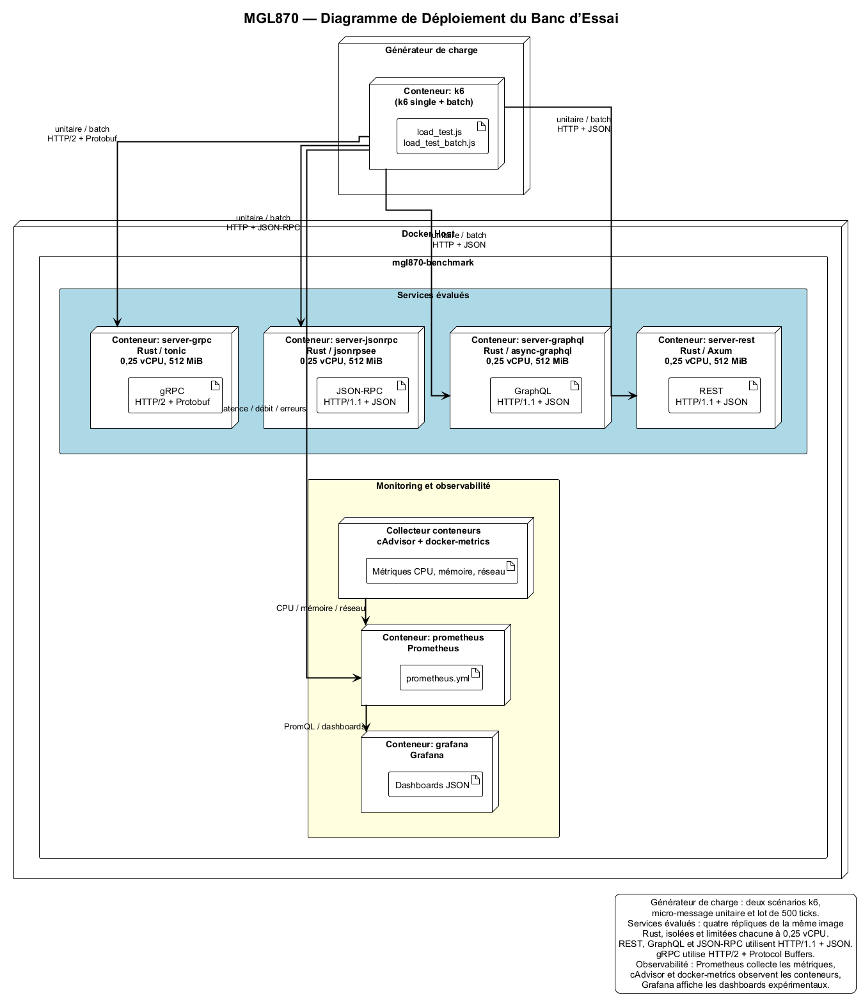

**Figure 1 —** Diagramme de déploiement du banc d’essai. Le générateur k6 se trouve en amont des quatre répliques isolées de la même image; le réseau Docker les regroupe avec la chaîne d’observabilité. Les flèches de requêtes distinguent les endpoints REST, GraphQL, JSON-RPC et gRPC, tandis que les flèches de métriques montrent le chemin vers Prometheus et Grafana. Cette figure est l’export du fichier source [`docs/figures/architecture.puml`](figures/architecture.puml).

### 6.4. Contexte d’interprétation

Le système n’a pas été conçu pour simuler toutes les conditions d’un environnement de production. Il sert de banc d’essai contrôlé pour une question ciblée : comment la taille de la charge utile modifie-t-elle le compromis entre formats textuels et sérialisation binaire lorsque le serveur est limité en CPU? La séparation des conteneurs réduit les interférences directes entre les variantes, mais l’exécution demeure influencée par l’hôte, la virtualisation réseau et l’implémentation des bibliothèques utilisées.

Cette distinction entre système étudié et système de production est essentielle. Le benchmark fournit des preuves sur le coût de la frontière d’appel dans un scénario minimal. Il ne permet pas, à lui seul, de conclure sur la sécurité, la résilience, l’évolution de contrats à long terme, la facilité de recrutement ou le coût total d’exploitation. Ces dimensions seront reprises dans l’analyse des compromis et dans les menaces à la validité.

## 7. Architecture et décisions

### 7.1. Vue d’ensemble de l’architecture

L’architecture expérimentale est organisée autour d’un hôte Docker et d’un réseau privé commun nommé `mgl870-benchmark`. Le banc d’essai comporte trois groupes de composants : la génération de charge, les services évalués et l’observabilité. Les quatre services évalués sont des répliques du même artefact Rust, lancées dans quatre conteneurs distincts afin que la limite CPU puisse être appliquée séparément à chaque variante. Le binaire contient les quatre adaptateurs; dans chaque réplique, seul celui ciblé par k6 reçoit la charge, tandis que les autres listeners restent inactifs. Cette symétrie évite que des images ou des chemins de construction distincts deviennent une variable supplémentaire.

Le scénario k6 unitaire appelle les opérations d’ingestion d’un seul tick. Le scénario k6 par lots appelle les opérations correspondantes avec un tableau ou un message contenant 500 ticks. Les requêtes sont dirigées vers les conteneurs REST, GraphQL, JSON-RPC et gRPC par leurs noms de service Docker. Les services ne communiquent pas entre eux : chaque variante reçoit une charge comparable et produit un résultat indépendant.

La couche d’observabilité est séparée du chemin fonctionnel évalué. k6 enregistre les durées, les requêtes et les erreurs, puis écrit les métriques vers Prometheus. cAdvisor et `docker-metrics` exposent les métriques de ressources des conteneurs. Grafana interroge Prometheus pour afficher la consommation CPU, la mémoire, le réseau, le débit et les percentiles de latence. Cette séparation permet de mettre en relation une mesure applicative avec l’état de la ressource sans ajouter un traitement métier aux serveurs évalués.

Le diagramme de déploiement complet est versionné dans [`docs/figures/architecture.puml`](figures/architecture.puml) et présenté en Figure 1. L’image exportée est la vue de référence du rapport; le fichier PlantUML reste la source modifiable.

Un diagramme de packages complète cette vue de déploiement en décrivant l’organisation interne du binaire Rust. Il montre que `main.rs` assemble les routeurs HTTP et démarre le service gRPC. REST et JSON-RPC désérialisent vers le type Rust `Tick`; GraphQL utilise son propre `TickInput`, tandis que gRPC utilise les types générés depuis `tick.proto`. Ces représentations portent les mêmes champs sans introduire une couche d’adaptation artificielle. La source est disponible dans [`docs/figures/packages.puml`](figures/packages.puml).

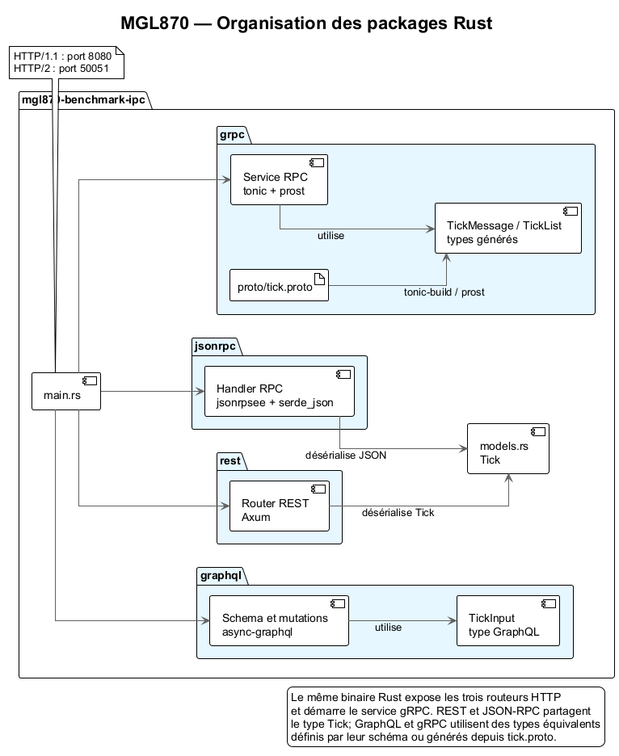

**Figure 2 —** Organisation des packages Rust du serveur expérimental. `main.rs` assemble les routeurs HTTP et démarre le service gRPC; chaque module conserve ses types de frontière, avec un modèle commun à REST et JSON-RPC et des types propres à GraphQL et gRPC. Cette figure explique la structure logicielle interne qui soutient l’architecture déployée.

### 7.2. Vue des composants logiciels

Chaque variante possède un adaptateur propre à son protocole et converge vers le même modèle conceptuel de tick et le même traitement minimal. REST utilise le routeur Axum et un extracteur JSON. GraphQL utilise un schéma `async-graphql` composé d’une mutation unitaire et d’une mutation par lots. JSON-RPC utilise un handler HTTP, une enveloppe JSON-RPC 2.0 et `serde_json` pour convertir les paramètres. gRPC utilise un service Tonic généré à partir du contrat Protocol Buffers.

Cette architecture ne constitue pas une abstraction logicielle unique qui normaliserait les quatre protocoles derrière une interface interne commune. La convergence se fait au niveau du modèle et du comportement attendu, tandis que les étapes de transport et de désérialisation restent propres à chaque implémentation. Ce choix est important pour l’expérience : une couche d’adaptation supplémentaire aurait pu réduire les différences observables ou introduire un coût commun non pertinent.

Le diagramme de composants source est disponible dans [`docs/figures/components.puml`](figures/components.puml) et présenté en Figure 3. Sa disposition sépare les adaptateurs, le contrat expérimental, le traitement commun et l’observabilité afin de limiter les croisements visuels.

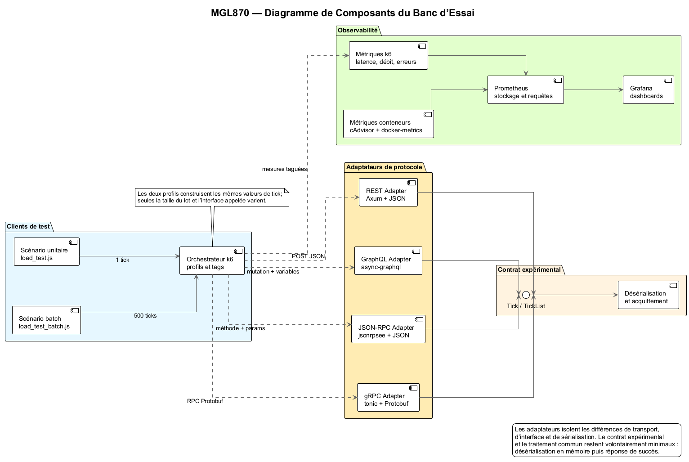

**Figure 3 —** Diagramme de composants du banc d’essai. Les deux profils alimentent un orchestrateur k6 commun, qui appelle quatre adaptateurs séparés; ceux-ci convergent vers le même contrat conceptuel et le même traitement minimal. La chaîne d’observabilité est isolée afin de ne pas confondre le chemin fonctionnel évalué avec la collecte des métriques. Cette figure est l’export du fichier source [`docs/figures/components.puml`](figures/components.puml).

### 7.3. Séquence d’une requête

Dans les deux scénarios, k6 construit le payload, l’envoie au point d’entrée, puis mesure le délai jusqu’à la réponse de succès. Pour REST, GraphQL et JSON-RPC, le serveur reçoit une requête HTTP avec une représentation JSON. Pour gRPC, le client invoque une méthode définie dans `tick.proto`; le message est décodé comme un message Protocol Buffers et l’appel retourne un `Ack`.

Après la désérialisation, aucun calcul métier ni accès externe n’est réalisé. Le serveur retourne immédiatement un succès. Cette séquence est volontairement courte : elle permet d’étudier la frontière de communication, mais elle exclut les coûts qui apparaîtraient dans une application complète. Le diagramme de séquence détaillé est versionné dans [`docs/figures/sequence-ingestion.puml`](figures/sequence-ingestion.puml).

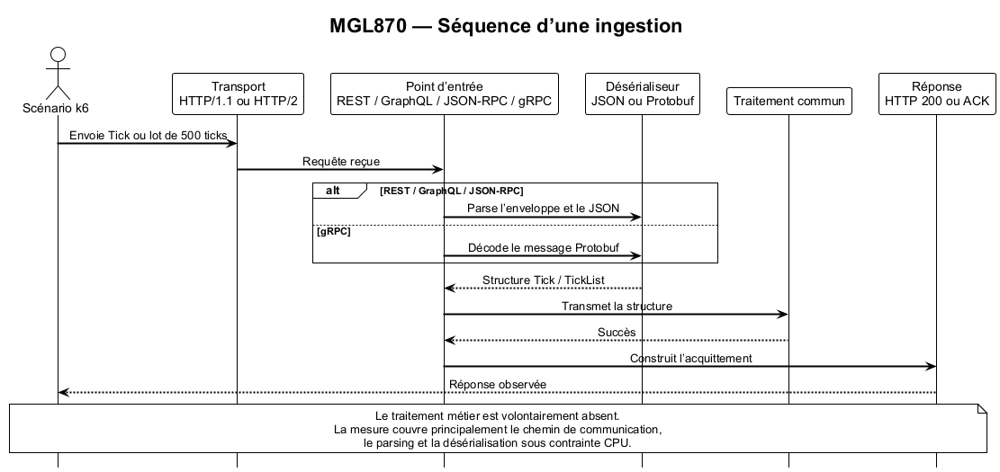

**Figure 4 —** Diagramme de séquence d’une ingestion. k6 envoie un tick ou un lot, le transport remet la requête au point d’entrée, puis le désérialiseur produit une structure en mémoire avant l’acquittement. L’alternative distingue le parsing JSON des variantes textuelles du décodage Protobuf de gRPC. Cette figure est l’export du fichier source [`docs/figures/sequence-ingestion.puml`](figures/sequence-ingestion.puml).

Ces trois vues architecturales sont complémentaires : le déploiement montre où les éléments s’exécutent, les packages montrent comment le code est organisé, et la séquence montre comment une requête traverse le système. Elles répondent ainsi à des questions différentes sans répéter le même schéma.

### 7.4. Décisions architecturales documentées par ADR

Les décisions importantes sont conservées comme des ADRs dans `docs/adr/`. Elles rendent explicites le contexte, les alternatives et les conséquences plutôt que de présenter l’architecture comme un assemblage de choix techniques implicites.

| ADR | Décision | Raison principale |
| --- | --- | --- |
| [ADR-001](adr/ADR-001-comparaison-de-protocoles.md) | Comparer REST, JSON-RPC, GraphQL et gRPC | Couvrir quatre compromis d’interface et de sérialisation |
| [ADR-002](adr/ADR-002-traitement-minimal-en-rust.md) | Utiliser un traitement minimal commun en Rust | Isoler le coût de communication et de désérialisation |
| [ADR-003](adr/ADR-003-contrainte-de-ressources.md) | Limiter chaque serveur à `0,25` vCPU | Exposer les coûts sous contrainte CPU contrôlée |
| [ADR-004](adr/ADR-004-scenarios-et-observabilite.md) | Utiliser deux scénarios k6 et une observabilité centralisée | Relier la taille du payload, les performances et les ressources |
| [ADR-005](adr/ADR-005-choix-de-rust.md) | Utiliser Rust pour les quatre serveurs | Réduire les variations d’environnement d’exécution |
| [ADR-006](adr/ADR-006-profiles-de-charge-k6.md) | Utiliser des profils k6 progressifs et soutenus | Observer la montée en saturation et la stabilité |
| [ADR-007](adr/ADR-007-observabilite-et-reproductibilite.md) | Centraliser les métriques et conserver les artefacts | Rendre les observations auditables et reproductibles |
| [ADR-008](adr/ADR-008-unites-et-source-de-verite.md) | Expliciter les unités et privilégier les données numériques | Éviter qu’une métadonnée d’affichage altère l’interprétation |
| [ADR-009](adr/ADR-009-artefact-commun-conteneurs-isoles.md) | Répliquer un artefact commun dans quatre conteneurs isolés | Conserver une base logicielle identique tout en isolant les ressources |

Ces décisions forment une chaîne cohérente. Le choix des quatre protocoles définit les alternatives; le traitement minimal limite les variables parasites; l’artefact commun contrôle la base logicielle; les conteneurs et la contrainte CPU isolent les ressources; les scénarios et l’observabilité produisent les preuves nécessaires à la comparaison.

### 7.5. ADRs complets

Les ADRs sont conservés séparément dans `docs/adr/` pour faciliter leur maintenance, mais leur contenu complet est reproduit ici afin que le rapport final soit autonome.

#### ADR-001 — Comparer quatre protocoles d’ingestion

**Statut :** Acceptée. **Date :** 2026-10-07. **Décideurs :** Projet MGL870.

**Contexte.** Le projet doit étudier une décision architecturale mesurable concernant la communication inter-processus dans un scénario d’ingestion à haute fréquence. Une seule technologie ne permettrait pas d’observer les compromis entre interface orientée ressource, appel de procédure, requêtage dynamique, sérialisation textuelle et sérialisation binaire.

**Décision.** Comparer REST, JSON-RPC, GraphQL et gRPC dans un même banc d’essai, avec un traitement applicatif minimal et deux tailles de charge utile : un tick unitaire et un lot de 500 ticks.

**Options considérées.** Évaluer uniquement REST et gRPC; comparer les quatre protocoles retenus; ajouter d’autres technologies comme WebSocket ou un broker de messages.

**Justification.** REST fournit la baseline textuelle orientée ressource, JSON-RPC représente l’appel de procédure textuel, GraphQL une interface dynamique, et gRPC l’appel fortement contractuel et binaire. Cette couverture reste réalisable.

**Conséquences.** La comparaison est plus informative, mais exige de contrôler les implémentations, les charges, les ressources et les métriques. Les conclusions restent limitées aux protocoles, bibliothèques et scénarios étudiés.

**Preuves attendues.** Résultats k6, mesures Prometheus/cAdvisor et captures Grafana.

#### ADR-002 — Isoler le coût de communication par un traitement minimal en Rust

**Statut :** Acceptée. **Date :** 2026-10-07. **Décideurs :** Projet MGL870.

**Contexte.** Une logique métier, une base de données ou une persistance durable pourraient masquer les différences entre protocoles.

**Décision.** Implémenter les quatre variantes dans le même projet Rust, sans base de données ni logique métier. Chaque endpoint désérialise un tick ou un lot et retourne un succès.

**Options considérées.** Application métier complète; traitement minimal commun; applications différentes propres à chaque protocole.

**Justification.** Le traitement minimal réduit les variables parasites et rend les écarts plus directement attribuables à la communication.

**Conséquences.** La validité interne est favorisée, mais les résultats ne représentent pas un système financier complet ni les coûts d’une base de données ou d’une validation métier.

**Preuves attendues.** Code source, modèle `Tick`, contrat `tick.proto` et scripts k6.

#### ADR-003 — Imposer une limite commune de 0,25 vCPU

**Statut :** Acceptée. **Date :** 2026-10-07. **Décideurs :** Projet MGL870.

**Contexte.** Les tests initiaux pouvaient être limités par la virtualisation réseau plutôt que par le coût de traitement; une machine non contrainte pouvait masquer les différences.

**Décision.** Limiter chaque conteneur à `0,25` vCPU et 512 MiB dans Docker Compose, avec suivi par cAdvisor et les métriques Docker.

**Options considérées.** Aucune limite; limite élevée; limite stricte et identique aux quatre variantes.

**Justification.** Une limite commune crée une saturation contrôlée et rend les coûts relatifs visibles sans favoriser un protocole.

**Conséquences.** La configuration est utile pour un environnement contraint, mais Windows, WSL2/Hyper-V et la virtualisation réseau restent des menaces à la validité.

**Preuves attendues.** `docker-compose.yml` et captures Grafana montrant la limite commune, son atteinte par les services saturés et la marge éventuelle d’un service qui maintient la cible.

#### ADR-004 — Utiliser deux scénarios k6 et une observabilité centralisée

**Statut :** Acceptée. **Date :** 2026-10-07. **Décideurs :** Projet MGL870.

**Contexte.** La question porte sur l’effet du volume de charge utile. Il faut comparer un appel individuel et une ingestion par lot, tout en observant la latence, le débit, les erreurs et les ressources.

**Décision.** Utiliser `load_test.js` pour un tick et `load_test_batch.js` pour 500 ticks. Le lot de 500 constitue un contraste expérimental volontairement important : il amortit le coût fixe d’une requête sur plusieurs objets et rend visible le coût d’une charge utile volumineuse, tout en demeurant exécutable avec la mémoire et le générateur disponibles. Les scénarios utilisent `ramping-arrival-rate` et un `testid` unique. Chaque run conserve un résumé k6, un export Prometheus et un manifeste; `docker-metrics` et Grafana complètent l’observabilité.

**Options considérées.** Appels unitaires seulement; lots seulement; deux tailles fortement contrastées avec télémétrie commune; série complète de tailles intermédiaires, par exemple 1, 10, 50, 100, 250 et 500 ticks.

**Justification.** Les deux tailles permettent de tester un changement de compromis dans le temps disponible tout en conservant cinq répétitions. La taille de 500 n’est ni une taille universelle ni une prévision exacte d’une charge financière de production; elle crée un régime où sérialisation, parsing et transfert prennent davantage de place. Tester toutes les tailles aurait mieux localisé le point de bascule, mais aurait multiplié la durée de campagne ou réduit les répétitions. Pour le batch, le débit est exprimé en requêtes/s et en ticks/s afin qu’un lot ne soit pas interprété comme une seule unité de travail utile.

**Conséquences.** Le classement peut être comparé entre deux régimes, mais les tailles intermédiaires ne sont pas couvertes. Le point de bascule est donc borné entre 1 et 500 ticks, sans être précisément localisé. Une étude du seuil devrait ajouter les tailles intermédiaires sans modifier les autres facteurs.

**Preuves attendues.** Scripts k6, résumés, exports Prometheus, manifestes, dashboards et captures Grafana.

#### ADR-005 — Utiliser Rust pour les serveurs évalués

**Statut :** Acceptée. **Date :** 2026-10-16. **Décideurs :** Projet MGL870.

**Contexte.** Le langage peut introduire du bruit par la gestion mémoire, le ramasse-miettes, l’exécution et les bibliothèques.

**Décision.** Utiliser Rust pour les quatre serveurs, avec Axum, async-graphql, jsonrpsee et tonic/prost.

**Options considérées.** Langage différent par protocole; même langage système; langage géré avec ramasse-miettes.

**Justification.** Un langage commun réduit les variations; Rust fournit une exécution native sans ramasse-miettes et les bibliothèques nécessaires.

**Conséquences.** Les résultats ne se généralisent pas automatiquement à Java, Go, C# ou d’autres bibliothèques. Le langage est une constante, pas une variable étudiée.

**Preuves disponibles.** Code source, `Cargo.toml`, `Cargo.lock`, `Dockerfile` et modules des serveurs.

#### ADR-006 — Définir des profils de charge soutenue avec k6

**Statut :** Acceptée. **Date :** 2026-10-16. **Décideurs :** Projet MGL870.

**Contexte.** La question porte sur le comportement des protocoles lorsque la taille du payload et la pression CPU augmentent. Un pic instantané ne distingue pas une variation transitoire d’une saturation soutenue, et un nombre fixe de VUs rendrait la cadence dépendante des temps de réponse.

**Décision.** Utiliser `ramping-arrival-rate` : unitaire de 0 à 2 000, puis 4 000 et 6 000 req/s sur 10 minutes; batch de 0 à 100, puis 500 req/s, suivi d’un plateau de quatre minutes à 500. Les plafonds sont de 4 000 VUs par scénario unitaire et 1 500 VUs par scénario batch. Les cibles sont définies par protocole : les quatre scénarios parallèles demandent donc au maximum 24 000 req/s agrégées en unitaire et 2 000 req/s en batch. Ces valeurs sont des cadences offertes, pas des débits garantis.

**Options considérées.** Nombre fixe de VUs; charge constante; pic court; cadence d’arrivée progressive suivie d’un plateau soutenu.

**Justification.** `ramping-arrival-rate` sépare la charge demandée de la vitesse des réponses et comptabilise les itérations que les VUs ne peuvent pas démarrer. Les cibles de 6 000 et 500 req/s par protocole ne sont ni des prévisions de production ni des SLO. Les exécutions préliminaires ont vérifié qu’elles traversaient une zone allant du fonctionnement stable à la saturation sur l’hôte disponible. La montée montre l’apparition de la dégradation; le plateau batch de quatre minutes vérifie sa persistance. Les plafonds de VUs protègent l’hôte et rendent l’incapacité à suivre la cadence observable plutôt que de déplacer indéfiniment la file dans le générateur.

**Conséquences.** Les profils mesurent une capacité soutenue, et non une rafale, une capacité maximale absolue ou un seuil continu exact. Les cadences offertes doivent être distinguées du débit servi. Leur niveau dépend de l’hôte, de la limite CPU, des bibliothèques et des VUs; une autre plateforme devrait recalibrer les cibles tout en conservant le principe de traverser la saturation.

**Preuves disponibles.** Scripts k6, dix résumés, dix exports Prometheus, dix manifestes, captures représentatives et ADRs.

#### ADR-007 — Centraliser l’observabilité et conserver les artefacts

**Statut :** Acceptée. **Date :** 2026-10-16. **Décideurs :** Projet MGL870.

**Contexte.** Une comparaison est difficile à défendre sans relier latence et débit aux ressources ni conserver les données sources.

**Décision.** Utiliser k6, Prometheus, cAdvisor, `docker-metrics` et Grafana, observer aussi le générateur, et conserver pour chaque run le résumé k6, l’export Prometheus et le manifeste, ainsi que les scripts, captures, dashboards et sources PlantUML.

**Options considérées.** Résumés k6 seulement; captures manuelles seulement; combinaison des sources et de la télémétrie.

**Justification.** La combinaison vérifie les checks, la saturation, les itérations abandonnées, les tendances temporelles et la stabilité inter-runs. Une règle déterministe sélectionne les captures représentatives.

**Conséquences.** Le dépôt contient plus d’artefacts, mais les captures illustrent tandis que JSON et séries Prometheus vérifient quantitativement.

**Preuves disponibles.** `results/rerun_20261119-104900/`, `docs/screenshots/rerun/`, `grafana/`, `tests/`, `proto/`, `docs/figures/` et `docs/adr/`; l’ancienne campagne numérique est séparée dans `results/archive/legacy_pre_validation/` et ses captures dans `docs/screenshots/archive/legacy_pre_validation/`.

#### ADR-008 — Expliciter les unités et privilégier les données numériques

**Statut :** Acceptée. **Date :** 2026-11-18. **Décideurs :** Projet MGL870.

**Contexte.** Les résumés k6 expriment les tendances temporelles en millisecondes, tandis que la sortie Prometheus remote write les stocke en secondes. Les premiers dashboards déclaraient incorrectement l’unité `ms`; les courbes et leur classement étaient cohérents, mais les valeurs absolues étaient affichées avec une unité erronée.

**Décision.** Déclarer les panneaux Grafana en secondes, conserver les percentiles par protocole dans les résumés k6 en millisecondes et archiver les séries Prometheus avec leur unité native. Les fichiers numériques sont les sources de vérité; les captures illustrent le comportement temporel.

**Options considérées.** Conserver les anciens dashboards et corriger seulement le texte; convertir les requêtes PromQL en millisecondes; déclarer l’unité native, documenter la conversion et conserver les deux sources.

**Justification.** La dernière option élimine une conversion implicite et permet un audit croisé. Un test synthétique d’une seconde a confirmé qu’une tendance k6 de `1000` ms est écrite comme `1` dans Prometheus, tandis qu’une tendance sans unité conserve `1000`.

**Conséquences.** Les résultats absolus doivent être corrigés, mais le classement et les formes temporelles de l’ancienne campagne restent comparables. Cette campagne est archivée et la campagne validée du 19 novembre devient la preuve officielle.

**Preuves disponibles.** [`docs/validation/latency-units.md`](validation/latency-units.md), `results/validation/latency_unit_validation_summary.json`, dashboards corrigés, résumés k6, exports Prometheus et captures officielles.

#### ADR-009 — Répliquer un artefact commun dans quatre conteneurs isolés

**Statut :** Acceptée. **Date :** 2026-11-19. **Décideurs :** Projet MGL870.

**Contexte.** La comparaison doit éviter deux biais opposés : un processus partagé créerait de la contention entre protocoles, tandis que quatre applications indépendantes pourraient diverger par leur code, leur construction et leur environnement.

**Décision.** Construire un seul binaire et une seule image contenant les adaptateurs REST, GraphQL, JSON-RPC et gRPC ainsi que le modèle commun `Tick`, puis répliquer cette image dans quatre conteneurs. k6 dirige chaque protocole vers son conteneur dédié. Chaque réplique démarre le même binaire, mais seul l’adaptateur ciblé reçoit la charge; les autres listeners restent inactifs. Chaque conteneur possède sa limite de `0,25` vCPU, ses 512 MiB et ses métriques.

**Options considérées.** Quatre protocoles dans un conteneur partageant ses ressources; quatre applications et images indépendantes; artefact commun répliqué dans quatre conteneurs; quatre binaires spécialisés construits à partir d’un noyau commun.

**Justification.** L’artefact commun maintient identiques le compilateur, les dépendances partagées, le modèle, le traitement de succès, l’image de base et les options de compilation. Les quatre répliques isolent simultanément CPU, mémoire et réseau, de sorte que les métriques puissent être attribuées à un protocole. Des binaires spécialisés auraient supprimé les adaptateurs inactifs, mais ajouté plusieurs cibles de compilation et un risque de divergence. Le faible coût des listeners inactifs est accepté pour maximiser la symétrie.

**Conséquences.** La validité interne et l’uniformité du déploiement sont renforcées. En contrepartie, les conteneurs ne représentent pas quatre images de production minimales : chacun contient des bibliothèques et listeners non sollicités. Leur coût de repos est symétrique, mais non nul; les résultats portent sur cette architecture expérimentale commune.

**Preuves disponibles.** `src/main.rs`, `Dockerfile`, `docker-compose.yml`, les diagrammes `components.puml` et `architecture.puml`, les métriques par conteneur et les manifestes officiels.

### 7.6. Conséquences architecturales des décisions

L’architecture favorise la validité interne de la comparaison au prix d’une représentativité réduite d’un système de production. Les variantes sont comparables parce qu’elles proviennent du même artefact, exécutent peu de logique dans des conteneurs séparés et disposent de la même limite de ressources. En revanche, chaque réplique contient aussi les adaptateurs inactifs de l’artefact commun, et les résultats ne mesurent pas l’effet d’une base de données, d’une logique métier, de TLS, de la découverte de services ou d’un déploiement multi-hôtes.

Une autre conséquence est que l’observabilité fait partie de l’architecture expérimentale, mais pas du chemin applicatif évalué. Prometheus, Grafana et cAdvisor rendent les résultats interprétables sans devenir des composants que le protocole devrait traverser pour répondre au client. Cette distinction sera importante dans l’analyse des menaces à la validité.

## 8. Méthodologie

### 8.1. Principe expérimental et répétitions

L’étude adopte une comparaison contrôlée à deux facteurs principaux : le protocole de communication et la taille de la charge utile. Le langage, le modèle de données, le traitement applicatif, le déploiement conteneurisé et la limite de ressources sont maintenus constants entre les variantes. Chaque exécution k6 lance simultanément quatre scénarios nommés `rest`, `graphql`, `jsonrpc` et `grpc`; une répétition compare donc les quatre protocoles dans les mêmes conditions générales.

Deux séries de cinq répétitions ont été réalisées le 19 novembre 2026 : cinq runs unitaires et cinq runs batch, alternés afin de répartir une éventuelle dérive temporelle de l’hôte. La campagne officielle est isolée dans [`results/rerun_20261119-104900/`](../results/rerun_20261119-104900/). Chaque run possède son dossier avec `k6_summary.json`, `prometheus.json` et `manifest.json`. Les captures officielles se trouvent dans [`docs/screenshots/rerun/`](screenshots/rerun/); les données et captures de l’ancienne campagne sont clairement séparées dans leurs répertoires `archive/legacy_pre_validation/` respectifs.

Une couche de validation fonctionnelle précède la mesure de performance. Les tests Rust vérifient la sérialisation du modèle, l’acceptation et le rejet de payloads REST, les mutations GraphQL, les enveloppes JSON-RPC et les deux appels gRPC. Ils ne constituent pas une preuve de performance et n’ont pas servi à produire les résultats historiques; leur rôle est de détecter une régression du contrat avant une nouvelle campagne. Les checks k6 valident ensuite la sémantique des réponses pendant la charge réelle.

Les répétitions servent à mesurer la stabilité des tendances, et non à prétendre à une inférence statistique générale. Les résultats sont synthétisés par moyenne, minimum, maximum et coefficient de variation (CV) entre les runs. Des seuils tagués forcent k6 à conserver les compteurs et percentiles séparément pour chaque protocole; les exports Prometheus fournissent en plus les séries temporelles. Pour chaque workload, le run représentatif est choisi automatiquement comme celui dont la moyenne des quatre p99 est la plus proche de la médiane des cinq moyennes de run.

Le workflow expérimental complet est documenté dans [`docs/figures/experiment-workflow.puml`](figures/experiment-workflow.puml). Il montre la succession des étapes : tests fonctionnels, construction, application des limites, attribution d’un `testid`, redémarrage et vérification des serveurs, exécution des quatre protocoles, export des trois artefacts par run, validation, alternance des scénarios, consolidation des cinq répétitions et sélection déterministe des captures représentatives.

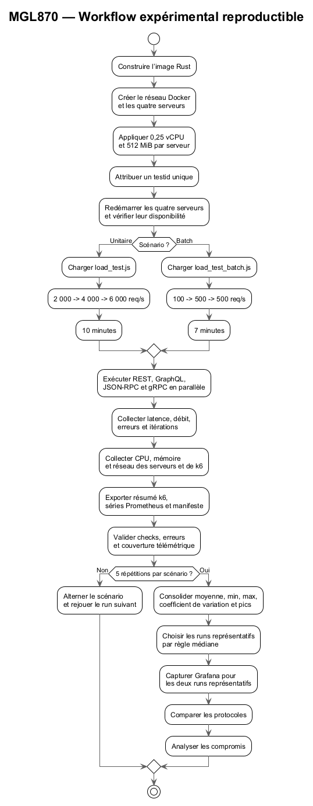

**Figure 5 —** Workflow expérimental reproductible. La figure montre que chaque scénario passe par la même séquence de préparation, exécution, collecte, archivage et répétition avant la consolidation des résultats.

### 8.2. Scénario unitaire

Le scénario unitaire transmet toujours le même tick : symbole `SHOP`, prix `115.42`, volume `100` et timestamp `1700000000`. Pour chacun des quatre protocoles, le profil `ramping-arrival-rate` monte de 0 à 2 000 requêtes/s sur 3 minutes, puis à 4 000 sur 3 minutes et à 6 000 sur 4 minutes. La cible agrégée maximale est donc de 24 000 requêtes/s, réparties entre quatre scénarios indépendants. Chaque scénario réserve 4 000 VUs et autorise au maximum 4 000 VUs. La cible est une cadence demandée; le débit effectivement servi et les itérations abandonnées sont rapportés séparément.

Le script configure des seuils de p95 inférieur à 1 000 ms, de p99 inférieur à 2 000 ms et de taux d’erreur inférieur à 1 %. Les seuils de latence sont dépassés dans les cinq runs sous la charge soutenue; cette violation est un résultat de saturation et non un critère d’exclusion, puisque les checks HTTP/gRPC restent réussis et que le taux d’erreur demeure nul.

### 8.3. Scénario par lots

Le scénario par lots réutilise le même tick et construit une charge de 500 éléments. REST, GraphQL et JSON-RPC transportent le lot dans une représentation JSON; gRPC le transmet dans le champ répété `ticks` du message `TickList` défini dans [`proto/tick.proto`](../proto/tick.proto).

Pour chacun des quatre protocoles, le profil monte de 0 à 100 requêtes/s sur 1 minute, puis à 500 sur 2 minutes et maintient 500 requêtes/s pendant 4 minutes. La cible agrégée maximale est donc de 2 000 requêtes batch/s; chaque scénario réserve et autorise au maximum 1 500 VUs. Comme une requête contient 500 ticks, le débit de requêtes et le débit de ticks sont rapportés séparément. Les cibles servent à traverser la saturation sur l’hôte expérimental; elles ne représentent ni une prévision de production ni un SLO.

### 8.4. Environnement et isolation

Les quatre serveurs sont lancés dans des conteneurs distincts construits à partir du même `Dockerfile`. Docker Compose applique à chaque serveur une limite de `0,25` vCPU et 512 MiB de mémoire. Les ports sont `8081` pour REST, `8082` pour GraphQL, `8083` pour JSON-RPC et `50051` pour gRPC. Les conteneurs partagent le réseau Docker `mgl870-benchmark`, mais chaque variante possède son propre processus serveur.

Avant chaque run, les quatre conteneurs serveurs sont redémarrés, leurs ports sont vérifiés et une pause de stabilisation est appliquée. Prometheus et Grafana restent actifs afin de conserver la continuité des données, tandis qu’un `testid` unique empêche le mélange des séries. Les limites CPU ne constituent pas une propriété intrinsèque des protocoles : elles créent une condition commune destinée à rendre visibles les coûts relatifs. L’exécution reste susceptible d’être influencée par Windows, WSL2/Hyper-V et la virtualisation réseau.

### 8.5. Mesures collectées

Les scripts k6 enregistrent la durée personnalisée (`protocol_request_duration` ou `batch_protocol_request_duration`), le nombre de requêtes, les erreurs et le taux d’erreur par protocole. Les checks valident aussi la sémantique des réponses GraphQL et JSON-RPC, et non seulement leur statut HTTP. Prometheus reçoit les métriques k6; `docker-metrics` fournit l’utilisation CPU, la mémoire et le trafic réseau des serveurs ainsi que les ressources du générateur k6. Grafana affiche les séries temporelles et les percentiles p50, p95 et p99.

Les résumés k6 expriment les durées en millisecondes. Le remote write k6 exprime les tendances temporelles en secondes dans Prometheus; les dashboards déclarent donc l’unité `s` et Grafana adapte automatiquement l’échelle en `ms` lorsque nécessaire. Cette convention a été vérifiée par le test synthétique documenté dans [`docs/validation/latency-units.md`](validation/latency-units.md). Chaque `prometheus.json` conserve explicitement `latency_unit: seconds`.

Le p50 décrit le comportement typique, tandis que le p95 et le p99 rendent visibles les files d’attente et la dégradation de la queue de distribution. Pour les lots, le débit de ticks est le débit de requêtes multiplié par 500. Le **débit moyen** provient du compteur k6 divisé par la durée complète du profil, rampes comprises; il ne représente donc pas un plateau stationnaire isolé. Le **débit de pointe** est la valeur maximale du `rate` Prometheus calculé sur une fenêtre glissante d’une minute et échantillonné toutes les cinq secondes. Les tableaux utilisent les résumés numériques et les exports Prometheus; les captures servent uniquement à montrer la dynamique temporelle.

### 8.6. Critères de validité et reproductibilité

Un run est conservé lorsqu’il est complet, que les quatre checks applicatifs ont zéro échec, que les taux d’erreur sont nuls, que les métriques par protocole sont présentes et que les requêtes Prometheus essentielles contiennent des séries. Les itérations abandonnées ne sont pas des erreurs applicatives : elles indiquent que k6 n’a pas pu démarrer toute la charge demandée avec les VUs disponibles. Les seuils de latence k6 sont des objectifs de saturation et non un filtre d’exclusion.

Les tests unitaires et d’interface s’exécutent avec `cargo test`. Ils couvrent les chemins de succès unitaires et batch des quatre adaptateurs ainsi que des cas de rejet REST, GraphQL, JSON-RPC et de désérialisation. Cette validation complète les checks de campagne sans modifier les mesures déjà produites.

Le validateur [`tests/validate_benchmark_suite.ps1`](../tests/validate_benchmark_suite.ps1) vérifie automatiquement les artefacts, les identités, les checks, les erreurs, la couverture télémétrique, le commit, la version Docker et l’hôte. La campagne officielle passe **75 contrôles sur 75**; le rapport produit se trouve dans [`summary/validation_report.md`](../results/rerun_20261119-104900/summary/validation_report.md).

### 8.7. Reproductibilité expérimentale

La reproduction commence par la validation fonctionnelle du binaire :

```powershell
cargo test
```

La campagne complète nécessite ensuite Docker Desktop et une seule commande PowerShell lancée à la racine du dépôt :

```powershell
powershell -NoProfile -ExecutionPolicy Bypass -File tests\run_all_benchmarks.ps1
```

Le script construit l’environnement, alterne les dix runs, redémarre les serveurs, assigne les `testid`, exporte les données, vérifie chaque exécution et consolide les résultats. Le protocole détaillé, l’arborescence et la stratégie de captures sont décrits dans [`docs/benchmark-rerun.md`](benchmark-rerun.md). Les images Docker sont figées par digest; les manifestes consignent le commit `b94ba5352de06c167473d725d4a64bc6d0368223`, Docker `28.0.4`, Windows 11, le processeur Intel i5-10400, 12 processeurs logiques et 34 005 622 784 octets de mémoire.

La reproductibilité doit être comprise à deux niveaux. Le protocole, les scripts, les limites de ressources et les métriques peuvent être reproduits directement. Les valeurs exactes de latence peuvent varier selon l’hôte, la version de Docker, Windows/WSL2 et la virtualisation; la propriété attendue est donc la reproduction des tendances et du raisonnement, pas l’égalité à la milliseconde près.

### 8.8. Règle d’interprétation

La section 9 rapporte les observations consolidées sans leur attribuer automatiquement une cause. La section 10 analysera les mécanismes possibles; la section 11 discutera les compromis opérationnels et contractuels. Cette séparation distingue une mesure, une explication et une recommandation architecturale.

## 9. Résultats

### 9.1. Intégrité et couverture des données

Les dix runs officiels sont présents, utilisent le profil complet et ont été exécutés sur le même hôte, avec le même commit et la même version de Docker. Les runs unitaires durent de 601,4 à 601,7 secondes; les runs batch, de 429,8 à 431,9 secondes. Les **6,39 millions** d’itérations unitaires et **428 598** itérations batch exécutées en moyenne ont produit zéro échec sémantique et un taux d’erreur nul. Les 75 contrôles automatisés de couverture et de cohérence passent.

| Workload | Runs | Itérations exécutées moyennes | Abandons moyens | Taux d’abandon moyen | Étendue du taux | Checks échoués | Taux d’erreur |
| --- | ---: | ---: | ---: | ---: | ---: | ---: | ---: |
| Unitaire | 5 | 6 388 911 | 1 282 386 | 16,72 % | 15,25–18,25 % | 0 | 0 % |
| Batch | 5 | 428 598 | 207 344 | 32,60 % | 31,06–35,21 % | 0 | 0 % |

Les itérations abandonnées sont importantes, mais elles ne sont pas des réponses en erreur : elles n’ont jamais été démarrées. Elles montrent que le profil atteint intentionnellement une zone de capacité. Toutes les comparaisons ci-dessous utilisent le débit effectivement servi, et non la cadence demandée.

### 9.2. Scénario unitaire : REST et JSON-RPC dominent les micro-messages

| Protocole | Débit moyen (req/s) | Pic moyen (req/s) | CV du débit | p50 moyen | p95 moyen | p99 moyen | Étendue p99 |
| --- | ---: | ---: | ---: | ---: | ---: | ---: | ---: |
| REST | 3 163,5 | 5 551,5 | 0,7 % | 11,6 ms | 800,8 ms | 1 024,8 ms | 947–1 171 ms |
| JSON-RPC | 3 057,6 | 4 962,6 | 1,2 % | 36,4 ms | 1 203,6 ms | 1 356,2 ms | 1 291–1 457 ms |
| GraphQL | 2 191,5 | 2 856,6 | 2,5 % | 117,2 ms | 2 838,4 ms | 3 076,8 ms | 2 885–3 379 ms |
| gRPC | 2 207,7 | 2 958,7 | 2,7 % | 134,6 ms | 2 918,6 ms | 3 545,0 ms | 2 879–4 165 ms |

Le classement de débit est identique dans les cinq répétitions : REST, JSON-RPC, puis gRPC et GraphQL. Les CV de 0,7 à 2,7 % indiquent une forte répétabilité. Le run 1 est représentatif selon la règle médiane définie précédemment (`testid` `20261119-104900-individual-run1`).

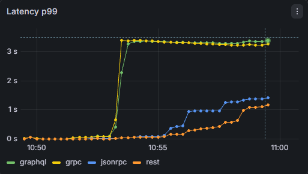

**Figure 6 —** Latence p99 du run unitaire représentatif. GraphQL et gRPC entrent plus tôt dans une file d’attente d’environ trois secondes; REST et JSON-RPC conservent une queue plus basse.

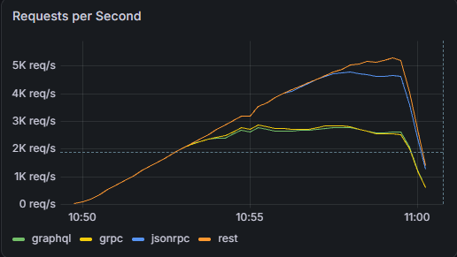

**Figure 7 —** Débit servi du run unitaire représentatif. Le profil monte jusqu’à 6 000 req/s demandées, mais le débit effectivement atteint dépend du protocole.

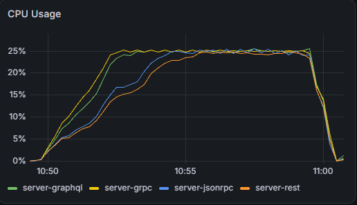

**Figure 8 —** Utilisation CPU du run unitaire représentatif. Les quatre serveurs atteignent progressivement la limite d’environ `0,25` vCPU.

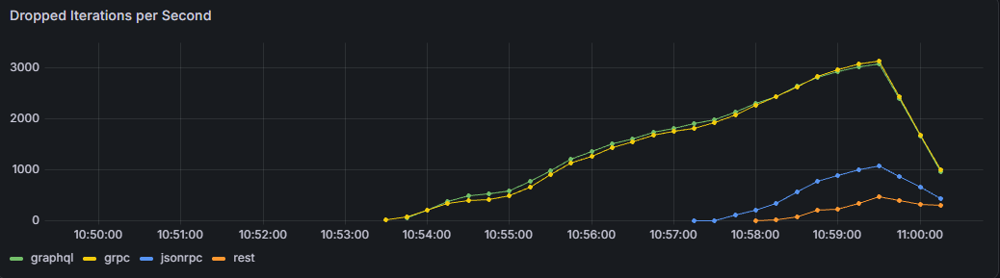

**Figure 9 —** Itérations unitaires non démarrées. Leur apparition suit la saturation; GraphQL et gRPC atteignent leur capacité plus tôt que JSON-RPC et REST.

### 9.3. Scénario batch : gRPC atteint le plafond de charge

| Protocole | Débit moyen (req/s) | Pic moyen (req/s) | Débit utile moyen (ticks/s) | Pic moyen (ticks/s) | CV du débit |
| --- | ---: | ---: | ---: | ---: | ---: |
| gRPC | 368,9 | 503,6 | 184 455 | 251 797 | 0,2 % |
| REST | 328,1 | 447,8 | 164 073 | 223 895 | 3,1 % |
| JSON-RPC | 209,0 | 272,3 | 104 489 | 136 146 | 3,6 % |
| GraphQL | 88,5 | 120,5 | 44 244 | 60 239 | 4,0 % |

| Protocole | p50 moyen | p95 moyen | p99 moyen | Étendue p99 | CV p99 |
| --- | ---: | ---: | ---: | ---: | ---: |
| gRPC | 13,4 ms | 124,4 ms | 266,2 ms | 161–439 ms | 36,6 % |
| REST | 786,2 ms | 6 874,2 ms | 7 588,7 ms | 7 121–8 299 ms | 5,9 % |
| JSON-RPC | 1 441,6 ms | 12 317,6 ms | 13 395,1 ms | 12 382–15 255 ms | 7,8 % |
| GraphQL | 4 164,2 ms | 34 101,3 ms | 36 423,7 ms | 31 714–39 107 ms | 7,6 % |

gRPC atteint dans chaque run le plafond demandé de 500 req/s, soit environ 250 000 ticks/s, sans série d’itérations abandonnées. REST, JSON-RPC et GraphQL abandonnent des itérations dans les cinq runs. La p99 gRPC varie davantage en proportion, mais même son maximum de 439 ms reste très inférieur au minimum REST de 7 121 ms. Le run 1 est représentatif (`testid` `20261119-104900-batch-run1`).

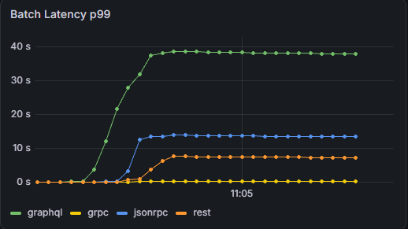

**Figure 10 —** Latence p99 du run batch représentatif. Les secondes affichées sont l’unité correcte en régime de surcharge; gRPC reste sous la seconde.

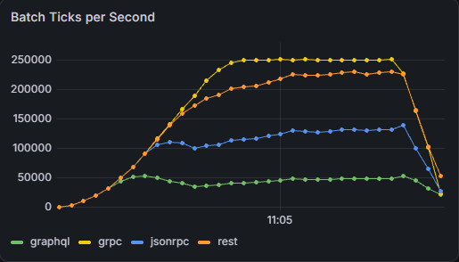

**Figure 11 —** Débit utile du run batch représentatif. gRPC maintient environ 250 000 ticks/s, devant REST, JSON-RPC et GraphQL.

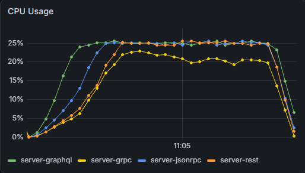

**Figure 12 —** Utilisation CPU du run batch représentatif. Les variantes textuelles approchent `0,25` vCPU; gRPC atteint la charge maximale avec une consommation stable plutôt autour de `0,20` vCPU.

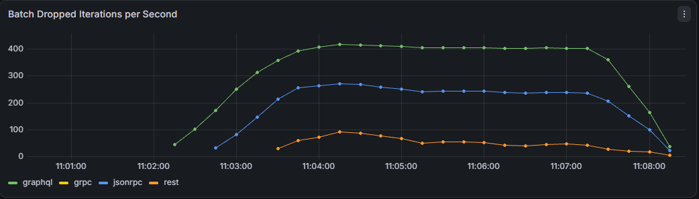

**Figure 13 —** Itérations batch non démarrées. GraphQL, JSON-RPC et REST dépassent leur capacité; l’absence de courbe gRPC confirme qu’il exécute toute la cadence demandée.

### 9.4. Ressources et observabilité croisée

Les serveurs restent largement sous la limite mémoire de 512 MiB : les maxima observés se situent entre 139 et 199 MiB selon le run. Dans le batch représentatif, gRPC utilise aussi moins de mémoire serveur que les variantes textuelles. Le réseau reçoit davantage de données pour REST (environ 16 MiB/s au maximum) que pour gRPC (environ 6,5 MiB/s), ce qui est compatible avec une représentation binaire plus compacte sans constituer une mesure isolée du coût de sérialisation.

Le générateur k6 atteint au maximum environ 6,1 cœurs et 9,4 GiB dans le scénario unitaire, puis 8,7 cœurs et 5,8 GiB en batch, sur un hôte de 12 processeurs logiques et 34 GiB. Il exerce donc une pression notable et demeure une ressource partagée. Toutefois, sa capacité à maintenir 500 req/s pour gRPC batch, l’absence d’épuisement mémoire et la saturation visible des serveurs textuels n’indiquent pas que l’injecteur explique à lui seul le classement.

### 9.5. Reproduction de l’ancienne campagne

La nouvelle campagne reproduit presque exactement le débit global de la campagne archivée : `−0,4 %` en unitaire (10 620,2 contre 10 657,8 req/s) et `−1,6 %` en batch (994,5 contre 1 010,6 req/s). La durée moyenne agrégée passe de 567,1 à 558,6 ms en unitaire (`−1,5 %`) et de 2 915,3 à 3 075,7 ms en batch (`+5,5 %`). Les formes temporelles et les classements sont donc reproduits.

La différence majeure concerne l’affichage des unités : les anciennes captures étiquetaient comme millisecondes des tendances Prometheus stockées en secondes. Par exemple, un plateau GraphQL batch proche de `31` représentait environ 31 secondes, et non 31 ms. Cette erreur de métadonnée n’altérait pas l’ordre relatif, mais invalidait l’interprétation absolue. La campagne officielle corrige l’unité et fournit les percentiles exacts par protocole dans les résumés k6.

### 9.6. Portée des observations

Les résultats établissent une borne expérimentale, et non un seuil continu : le classement change entre 1 et 500 ticks par requête. Ils ne démontrent pas que Protocol Buffers est l’unique cause de l’écart, puisque les bibliothèques et les transports diffèrent aussi. Ils soutiennent néanmoins une décision conditionnelle avec des écarts répétés, une télémétrie convergente et des sources numériques auditables.

## 10. Analyse des résultats

### 10.1. Réponse à la question de recherche

La question principale demandait dans quelles conditions de volume de charge utile les gains d’efficacité mécanique de gRPC deviennent suffisants pour justifier son coût supplémentaire en opérabilité et en couplage contractuel. Les données ne permettent pas d’identifier un seuil continu exact, puisque seuls deux volumes ont été testés : un tick et un lot de 500 ticks. Elles permettent toutefois d’établir une borne et une inversion de classement clairement répétée.

Pour un tick unitaire, REST constitue la meilleure décision de performance dans l’environnement étudié : 3 163,5 req/s en moyenne et une p99 moyenne de 1 024,8 ms, devant JSON-RPC. GraphQL et gRPC plafonnent autour de 2 200 req/s avec des p99 supérieures à trois secondes. L’avantage attendu de la représentation binaire ne compense donc pas, pour ce micro-message, les coûts fixes associés à la pile gRPC et à son transport. Cette conclusion est locale au scénario : elle ne signifie pas que REST est toujours plus rapide que gRPC.

Pour un lot de 500 ticks, gRPC devient la meilleure décision de performance. Il atteint le plafond d’environ 250 000 ticks/s et conserve une p99 moyenne de 266,2 ms; REST, JSON-RPC et GraphQL atteignent respectivement 223 895, 136 146 et 60 239 ticks/s en pointe, avec des p99 moyennes de 7,6, 13,4 et 36,4 secondes. Par rapport à REST, son concurrent le plus proche, gRPC fournit environ 12,4 % de débit utile moyen supplémentaire et une p99 moyenne environ 28,5 fois plus faible. Dans ce régime, le volume de données par requête rend l’efficacité de la représentation binaire suffisamment importante pour compenser le coût opérationnel supplémentaire, à condition que la performance et l’efficacité CPU soient prioritaires.

La conclusion défendable est donc conditionnelle : **gRPC est justifiable lorsque la charge utile est suffisamment importante pour rendre le coût de parsing textuel déterminant; pour les micro-messages, REST demeure préférable lorsque la simplicité et l’opérabilité ont une valeur supérieure au gain mécanique potentiel.** Avec les données disponibles, le point de bascule est encadré entre 1 et 500 ticks par requête, mais il n’est pas localisé à l’intérieur de cet intervalle.

La traçabilité de cette conclusion est représentée dans [`docs/figures/evidence-traceability.puml`](figures/evidence-traceability.puml).

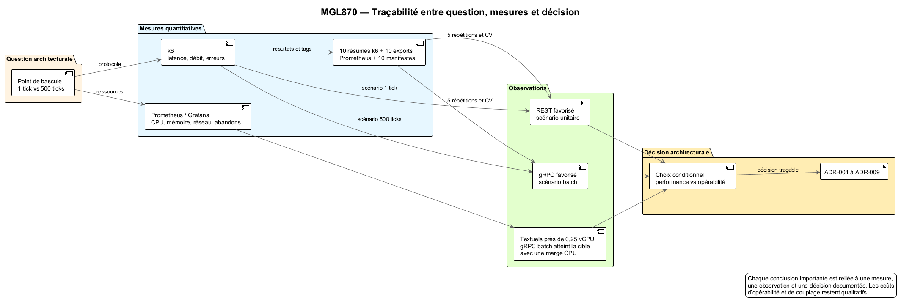

**Figure 14 —** Traçabilité entre la question architecturale, les mesures k6 et Prometheus/Grafana, les observations, puis les ADRs et la décision finale. Cette figure montre que la conclusion ne repose pas sur une préférence technologique isolée : elle relie explicitement la question, les données, les observations et la décision.

### 10.2. Analyse de l’effet de la taille du payload

Le changement de classement entre les deux scénarios est l’observation la plus importante du rapport. Dans le scénario unitaire, le coût fixe de la requête représente une part importante du coût total. La charge utile est trop petite pour que la compacité de Protobuf domine nécessairement l’ensemble du chemin d’exécution. Le transport HTTP/2, la gestion de l’appel RPC et les étapes propres à la pile gRPC peuvent alors peser relativement lourd par rapport au décodage d’un seul tick.

Dans le scénario batch, ces coûts fixes sont amortis sur 500 objets. Le serveur doit analyser et convertir une structure beaucoup plus grande pour les variantes JSON, tandis que gRPC décode un message binaire structuré. Les captures montrent que cette différence devient visible lorsque les conteneurs sont limités à `0,25` vCPU. L’explication par le coût de parsing est cohérente avec l’architecture des implémentations et avec l’amélioration observée de gRPC, mais le benchmark ne mesure pas séparément le temps de parsing, le temps de transport et le temps de traitement. Il faut donc la présenter comme l’interprétation la plus plausible, non comme une décomposition causale directement observée.

### 10.3. Analyse de la contrainte CPU

Dans le scénario unitaire, les quatre services atteignent la zone correspondant à leur limite de `0,25` vCPU. En batch, GraphQL, JSON-RPC et REST approchent également cette limite, tandis que gRPC maintient la cadence maximale avec une utilisation plutôt autour de `0,20` vCPU. Le dispositif ne compare donc pas seulement quatre services tous bloqués au même plafond : il montre aussi que gRPC conserve une marge dans le scénario où les protocoles textuels saturent.

L’affirmation défendable est donc : **gRPC offre le meilleur rendement de la capacité CPU dans le scénario de lots étudié**. Elle ne doit pas devenir « gRPC consomme toujours moins de CPU » : dans le scénario unitaire, gRPC atteint lui aussi la limite et obtient un résultat inférieur à REST.

### 10.4. Analyse des protocoles textuels

REST obtient le meilleur résultat parmi les protocoles étudiés pour le scénario unitaire et demeure compétitif dans le scénario batch. Cette performance est cohérente avec son rôle de baseline simple : la requête contient directement la représentation JSON attendue, sans enveloppe RPC complexe ni document de requête dynamique. La simplicité du chemin peut être avantageuse lorsque le payload est petit.

JSON-RPC conserve la lisibilité du JSON, mais ajoute une enveloppe contenant la version, la méthode, les paramètres et l’identifiant. Dans les résultats batch, il se situe entre REST et GraphQL. Cette position est cohérente avec un coût textuel supérieur à la baseline REST, mais inférieur au coût structurel du traitement GraphQL dans le scénario retenu.

GraphQL obtient les résultats les moins favorables dans le scénario batch. La requête contient une mutation, des variables et une structure que le moteur doit analyser avant d’exécuter le résolveur. Le protocole apporte une flexibilité qui n’est pas nécessaire pour cette opération d’ingestion fixe. Le résultat ne condamne pas GraphQL pour les usages où la sélection dynamique des données compense ce coût; il montre plutôt que cette flexibilité est difficile à justifier pour un chemin d’ingestion répétitif et fortement contraint.

### 10.5. Vérification des hypothèses

| Hypothèse | Évaluation | Justification |
| --- | --- | --- |
| H1 — coût des micro-messages | Soutenue dans le scénario étudié | REST domine les captures unitaires malgré l’absence de sérialisation binaire |
| H2 — effet de la taille | Soutenue | Le classement s’inverse pour les lots de 500 ticks et gRPC domine le débit de ticks |
| H3 — saturation | Soutenue avec réserve | Les serveurs textuels saturent en batch et les percentiles se dégradent; gRPC atteint la cible avec une marge CPU, mais la causalité précise n’est pas isolée |
| H4 — compromis architectural | Soutenue | gRPC gagne en performance batch, mais la décision dépend de la valeur accordée à l’opérabilité et au couplage |

Les hypothèses sont donc confirmées dans les conditions du benchmark, mais aucune ne doit être reformulée comme une loi générale. Les cinq répétitions renforcent la stabilité de la tendance; elles ne suppriment pas les menaces liées à l’environnement, à l’implémentation et aux deux seules tailles de payload.

### 10.6. Signification des itérations abandonnées

Les itérations abandonnées atteignent en moyenne 16,72 % en unitaire et 32,60 % en batch. Elles indiquent que k6 n’a pas pu démarrer toutes les itérations prévues avec les VUs disponibles. Elles ne constituent pas des réponses HTTP ou gRPC en échec : les checks applicatifs restent à zéro échec et les taux d’erreur restent nuls. En batch, les séries d’abandon concernent GraphQL, JSON-RPC et REST dans les cinq runs; gRPC exécute toute la cadence demandée.

Cette distinction est essentielle. Les résultats répondent à une question de capacité sous charge, et la saturation fait partie du phénomène observé. Les itérations abandonnées empêchent toutefois d’interpréter la cible comme un débit effectivement servi. Les p95 et p99 de plusieurs secondes décrivent ce régime de surcharge et ne doivent pas être présentées comme des SLO acceptables en production.

### 10.7. Compromis décisionnel résultant des données

Les mesures ne justifient pas une migration générale vers gRPC. Elles soutiennent plutôt une stratégie de décision par scénario :

- choisir REST lorsque les messages sont petits, que l’interopérabilité et le diagnostic rapide dominent, et que le débit unitaire observé est suffisant;
- considérer JSON-RPC lorsque l’orientation appel de procédure est utile sans accepter un contrat binaire;
- réserver GraphQL aux situations où sa flexibilité de requêtage apporte une valeur réelle, et non à une ingestion fixe où son coût devient visible;
- choisir gRPC pour les échanges internes fortement volumineux et répétitifs lorsque le gain de débit et de latence justifie l’outillage spécialisé et la gestion stricte du contrat.

Ces règles ne remplacent pas une mesure dans le contexte cible. Elles constituent des heuristiques transférables dérivées de la comparaison observée, et non des prescriptions indépendantes des charges de travail.

### 10.8. Ce que les données ne permettent pas d’affirmer

Les données ne permettent pas d’affirmer que gRPC est toujours plus efficace, que GraphQL est toujours inadéquat pour l’ingestion, ni que REST est toujours préférable pour les messages courts. Elles ne permettent pas non plus d’identifier la contribution exacte de HTTP/2, de Protocol Buffers, du parsing JSON ou du moteur GraphQL sans instrumentation plus fine.

Elles permettent néanmoins d’affirmer trois résultats importants : le traitement applicatif de succès est resté fiable pour les quatre protocoles; le comportement change nettement lorsque le payload passe d’un tick à 500 ticks; et ce changement est répété dans cinq runs unitaires et cinq runs batch. C’est cette combinaison de résultats, de répétitions et de limites explicites qui rend la conclusion architecturale défendable.

## 11. Compromis architecturaux

### 11.1. Nature du compromis

Les résultats montrent qu’une décision de protocole ne peut pas être réduite à un classement de latence. REST domine le scénario unitaire observé, tandis que gRPC domine le scénario par lots. Cette inversion indique que la performance dépend de la charge de travail, mais elle ne suffit pas à décider seule de l’architecture. Un protocole est aussi une interface de développement, un contrat entre équipes et un composant d’exploitation.

Dans cette section, les performances sont donc considérées comme des preuves expérimentales, tandis que l’opérabilité, la flexibilité et le couplage sont analysés qualitativement à partir des propriétés des technologies, de la documentation de référence et des décisions ADR. Le benchmark ne mesure pas directement le temps nécessaire pour diagnostiquer un incident ou modifier un contrat. Il serait donc incorrect de présenter les coûts opérationnels comme des valeurs quantitatives équivalentes aux p95 mesurés.

### 11.2. Performance contre opérabilité

L’opérabilité désigne ici la facilité avec laquelle une équipe peut déployer, observer, diagnostiquer, tester et maintenir la communication en production. Elle comprend notamment la visibilité du trafic, la disponibilité des outils, la simplicité de reproduction d’un appel et la capacité à comprendre une erreur sans connaître toute la pile technique.

REST bénéficie d’une opérabilité élevée dans le contexte général de l’étude. Les requêtes HTTP et les payloads JSON peuvent être inspectés avec des outils génériques, enregistrés dans des journaux lisibles et rejoués avec des clients largement disponibles. Cette propriété ne garantit pas une meilleure performance, mais elle réduit le coût de diagnostic pour les micro-messages, domaine où REST obtient déjà le meilleur résultat observé.

JSON-RPC conserve une grande partie de cette lisibilité tout en exprimant explicitement une opération et ses paramètres. Son enveloppe ajoute de la structure et un contrat de méthode, mais les messages restent inspectables comme JSON. Il constitue ainsi un compromis entre le modèle orienté ressource de REST et un appel de procédure plus explicite.

GraphQL dispose d’un écosystème d’outils riche, mais l’observation d’une requête demande de comprendre le schéma, la mutation, les variables et le chemin d’exécution du résolveur. Cette complexité peut être justifiée lorsqu’elle permet aux clients de contrôler précisément les données demandées. Dans le scénario d’ingestion fixe étudié ici, cette flexibilité apporte peu de valeur et son coût d’exécution devient visible dans les résultats batch.

gRPC apporte des outils spécialisés, la génération de code et un contrat de service explicite, mais le trafic binaire n’est pas immédiatement lisible dans un proxy ou un journal HTTP ordinaire. L’équipe doit disposer d’outils capables de charger le contrat `.proto`, d’interpréter les messages et de comprendre HTTP/2. La documentation officielle de gRPC décrit ces mécanismes et leurs outils [4]; elle soutient l’analyse de cette dépendance à une chaîne d’outillage spécialisée, sans fournir une mesure du coût opérationnel dans l’organisation étudiée.

### 11.3. Flexibilité contre coût de traitement

GraphQL maximise la flexibilité de la forme de la requête. Cette flexibilité est pertinente lorsqu’un même service doit répondre à des besoins de lecture variables ou éviter une multiplication d’endpoints spécialisés. Elle est moins pertinente pour une opération d’ingestion répétitive dont le schéma est connu à l’avance. Dans le benchmark, les quatre scénarios utilisent des opérations fixes; GraphQL conserve donc le coût de son analyse dynamique sans que son principal bénéfice fonctionnel soit sollicité.

REST offre une interface plus explicite et moins dynamique pour le scénario retenu. JSON-RPC formalise l’action sans introduire un langage de requête. gRPC formalise également l’action, mais à travers un contrat fortement typé et des artefacts générés. Le choix entre ces alternatives doit donc tenir compte de la variabilité des consommateurs : plus les besoins de requête sont dynamiques, plus GraphQL peut justifier sa complexité; plus le schéma est stable et le volume élevé, plus un contrat RPC efficace peut être avantageux.

### 11.4. Couplage contractuel et modifiabilité

Le couplage contractuel décrit ici la dépendance entre le client et le serveur pour comprendre, générer et faire évoluer l’interface. Il ne faut pas confondre couplage fort avec mauvaise architecture : un contrat explicite peut réduire les ambiguïtés et détecter des incompatibilités avant l’exécution. En contrepartie, il exige une gouvernance de versionnement et une coordination plus rigoureuse.

Avec gRPC, le fichier `.proto` constitue une source contractuelle partagée. La génération de code améliore la cohérence des types et rend les opérations disponibles plus explicites, mais une évolution du contrat doit respecter les règles de compatibilité de Protocol Buffers et être propagée aux consommateurs concernés [5]. Le couplage est donc visible et outillé, mais il devient une responsabilité architecturale à gérer.

REST peut aussi être couplé à un schéma ou à des conventions, mais son format JSON et ses outils génériques permettent souvent une évolution plus tolérante au niveau de la représentation. Cette souplesse peut réduire la coordination initiale, mais elle peut aussi déplacer les erreurs vers l’exécution lorsque le contrat est implicite ou insuffisamment documenté. JSON-RPC se trouve entre les deux : les noms de méthodes et les paramètres forment un contrat, mais la représentation demeure dynamique et textuelle.

GraphQL centralise une partie du contrat dans le schéma. Le schéma explicite les opérations et les types, tout en permettant des requêtes variables à l’intérieur de cet espace. Il réduit certains problèmes de sur- ou sous-récupération, mais introduit une gouvernance du schéma et des enjeux de compatibilité liés à l’évolution des champs et des résolveurs.

### 11.5. Matrice qualitative des compromis

Les évaluations suivantes sont qualitatives et servent à rendre les décisions explicites; elles ne constituent pas des mesures expérimentales. Elles synthétisent les propriétés documentées et les conséquences observées dans le banc d’essai.

| Protocole | Performance unitaire observée | Performance batch observée | Opérabilité | Couplage contractuel | Flexibilité | Coût architectural dominant |
| --- | --- | --- | --- | --- | --- | --- |
| REST | Meilleure dans le scénario étudié | Compétitive, derrière gRPC | Élevée | Faible à modéré | Modérée | Parsing JSON et conventions à gouverner |
| JSON-RPC | Intermédiaire | Inférieure à REST et gRPC | Élevée à modérée | Modéré | Modérée | Enveloppe RPC et parsing textuel |
| GraphQL | Inférieure dans le scénario étudié | La moins favorable | Modérée | Modéré à élevé via le schéma | Élevée | Parsing et exécution dynamique |
| gRPC | Inférieure à REST dans le scénario étudié | Meilleure dans le scénario étudié | Modérée à faible sans outillage spécialisé | Élevé et explicite | Faible à modérée | Contrats `.proto`, génération et diagnostic binaire |

La matrice doit être lue conjointement avec les résultats. « Élevée » en opérabilité ne signifie pas « meilleure dans tous les systèmes », et « élevé » en couplage ne signifie pas « mauvais ». Il s’agit de coûts et de bénéfices qui prennent une valeur différente selon les contraintes du système.

### 11.6. Quand le gain de gRPC justifie-t-il sa complexité?

Les cinq runs batch fournissent le cas le plus favorable à gRPC : le débit de ticks est nettement supérieur et la latence p99 est beaucoup plus faible que pour les protocoles textuels sous la même contrainte CPU. Dans un service interne où le volume est élevé, où les consommateurs sont connus et où la performance est un attribut critique, ce gain peut justifier la gestion des contrats `.proto`, la génération de code et l’outillage d’observation.

Le choix est moins évident pour les micro-messages. Les cinq runs unitaires montrent que REST domine la performance dans la configuration étudiée, tout en offrant une inspection plus simple. Adopter gRPC dans ce cas imposerait le coût de son contrat et de sa chaîne d’exploitation sans bénéfice mesuré dans ce benchmark. La décision gRPC ne devient raisonnable que si d’autres exigences non évaluées, par exemple la compatibilité avec un écosystème gRPC existant ou des besoins de streaming, compensent ce résultat.

Le point de bascule doit donc être défini comme une décision économique et opérationnelle, pas uniquement comme une taille de payload. La taille est le facteur manipulé dans l’expérience; la justification finale dépend aussi de la criticité du débit, du nombre d’équipes, de la stabilité du contrat, de la maturité des outils et du coût acceptable d’un diagnostic.

### 11.7. Règle de décision proposée

Une équipe devrait commencer par caractériser le scénario réel : taille et fréquence des messages, criticité de la latence, nombre de consommateurs, fréquence des changements de contrat et capacité des équipes à exploiter des outils spécialisés. Elle devrait ensuite reproduire une mesure représentative, car les résultats de ce projet ne remplacent pas une mesure dans le contexte cible.

L’arbre de décision PlantUML correspondant est disponible dans [`docs/figures/decision-tradeoffs.puml`](figures/decision-tradeoffs.puml) et présenté en Figure 15. Il formalise les règles suivantes :

1. pour un payload petit et une forte priorité donnée à la lisibilité, commencer par REST;
2. pour un appel de procédure textuel et inspectable, considérer JSON-RPC;
3. pour des besoins de requêtage réellement dynamiques, considérer GraphQL après mesure du coût d’exécution;
4. pour un volume élevé, un contrat stable et une contrainte CPU forte, évaluer gRPC;
5. adopter gRPC seulement si le gain mesuré compense le coût d’opérabilité et de couplage dans l’organisation cible.

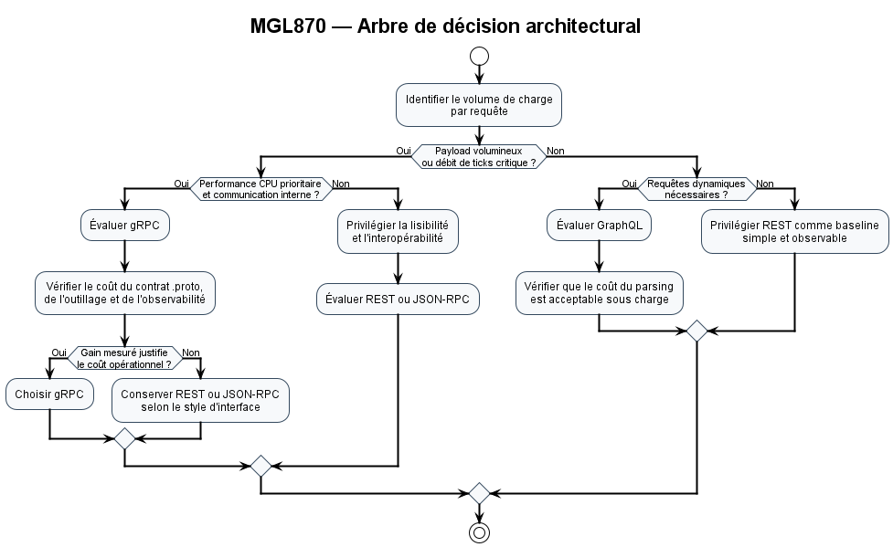

**Figure 15 —** Règle de décision qualitative dérivée des résultats. Elle ne remplace pas une mesure dans le contexte cible et ne transforme pas le benchmark en seuil universel.

### 11.8. Limite de cette analyse

L’opérabilité et le couplage n’ont pas été mesurés par une étude d’utilisateurs, une analyse de tickets d’incident, un suivi du temps de maintenance ou une comparaison du nombre de changements de contrat. Les conclusions de cette section sont donc des implications architecturales argumentées, non des résultats quantitatifs supplémentaires.

Cette limite ne réduit pas leur pertinence; elle définit leur statut épistémique. Les mesures expérimentales répondent à la dimension performance et efficacité matérielle. Les sources techniques, les ADRs et la structure des interfaces soutiennent l’analyse qualitative des coûts. Une étude future pourrait compléter cette analyse par des scénarios de modification, des exercices de diagnostic et une mesure du coût d’exploitation dans plusieurs équipes.

## 12. Menaces à la validité et limites

Une expérimentation de performance ne produit pas une vérité indépendante de son environnement. Elle produit des observations dans un protocole donné, avec une implémentation donnée et une charge de travail donnée. Cette section explicite les menaces qui peuvent limiter la portée des conclusions. La distinction entre validité interne, validité de construit, validité externe et validité des conclusions suit une pratique courante des études expérimentales en génie logiciel [7].

### 12.1. Validité interne

La validité interne concerne la possibilité d’attribuer les différences observées aux facteurs étudiés plutôt qu’à une autre cause.

**Différences d’implémentation.** Les quatre variantes utilisent le même langage, le même modèle de données et un traitement métier minimal, mais elles n’utilisent pas exactement la même bibliothèque ni exactement le même chemin d’exécution. Axum, async-graphql, jsonrpsee et tonic ont chacun leurs propres mécanismes internes. Les résultats portent donc sur la combinaison protocole, bibliothèque et configuration testée, et non sur une implémentation abstraite de chaque standard.

**Contamination entre exécutions.** Les services sont séparés et les quatre processus serveurs sont redémarrés avant chaque run. Prometheus et Grafana restent actifs pour conserver les séries, isolées par `testid`. Cela réduit la contamination par l’état applicatif, mais ne supprime pas les effets du cache Docker, de la température ou des autres processus Windows. L’alternance unitaire/batch et les cinq répétitions répartissent cette variabilité sans l’éliminer.

**Générateur de charge partagé.** Les quatre scénarios sont exécutés simultanément par k6. Cette décision garantit une pression temporelle comparable, mais elle crée une ressource partagée : CPU, mémoire, connexions et VUs. k6 atteint jusqu’à 6,1 cœurs et 9,4 GiB en unitaire, puis 8,7 cœurs et 5,8 GiB en batch. Ces valeurs restent sous les 12 processeurs logiques et 34 GiB de l’hôte, et gRPC batch maintient toute la cible, mais l’injecteur ne peut pas être considéré comme parfaitement neutre.

**Ordre et concurrence des scénarios.** Les protocoles sont sollicités dans une même exécution, mais les variations de planification peuvent ne pas être parfaitement identiques entre les séries temporelles. Une étude complémentaire pourrait exécuter chaque protocole séparément avec exactement le même profil, au prix d’une comparabilité temporelle moins directe. La présente étude limite ce risque par cinq répétitions et par l’utilisation d’une configuration identique.

**Saturation réseau ou CPU.** La limite de `0,25` vCPU vise à faire apparaître la contrainte de calcul, mais Windows/WSL2/Hyper-V peut aussi introduire un plafond réseau. Les quatre serveurs saturent en unitaire; les variantes textuelles saturent en batch alors que gRPC atteint la cible autour de `0,20` vCPU. Cette convergence CPU/débit soutient l’interprétation computationnelle sans prouver que le réseau n’a jamais contribué.

### 12.2. Validité de construit

La validité de construit concerne la correspondance entre les concepts étudiés et les mesures utilisées.

**Performance.** La latence, le débit et le taux d’erreur sont des indicateurs pertinents pour l’ingestion à haute fréquence. Le p50 décrit le comportement central, tandis que le p95 et le p99 rendent visibles les files d’attente et les dégradations de la queue. Le débit de ticks est plus pertinent que le seul débit de requêtes pour le scénario batch, car chaque requête contient 500 objets.

**Efficacité matérielle.** L’utilisation CPU des conteneurs est un indicateur de pression sur les ressources, mais elle ne constitue pas un profil détaillé du coût de parsing, de sérialisation ou de transport. Le benchmark montre une différence de travail utile sous une même limite CPU; il ne mesure pas directement le nombre de cycles, les allocations, les instructions exécutées ou le temps exact de chaque étape.

**Opérabilité.** L’opérabilité est analysée à partir des propriétés documentées des interfaces et de leur outillage. Elle n’est pas mesurée par des temps de diagnostic, des enquêtes auprès d’équipes ou des données d’incidents. Les affirmations de la section 11 doivent donc rester qualitatives.

**Couplage et modifiabilité.** Le fichier `.proto`, le schéma GraphQL, les méthodes JSON-RPC et les conventions REST matérialisent différents types de contrat. Toutefois, le benchmark ne mesure ni le nombre de changements requis pour faire évoluer ces contrats ni le délai de coordination entre équipes. La comparaison décrit un risque architectural plausible, pas un coût organisationnel universel.

**Métriques et unités.** Les seuils tagués conservent désormais les p50, p95, p99, compteurs et erreurs séparément pour les quatre protocoles dans chaque résumé k6. Les exports Prometheus fournissent les séries temporelles correspondantes. Le risque principal était l’unité : k6 résume en millisecondes, tandis que Prometheus stocke les tendances temporelles en secondes. Un test synthétique, des dashboards corrigés et une unité explicite dans les exports réduisent ce risque de construit.

### 12.3. Validité externe

La validité externe concerne la transférabilité des résultats à d’autres environnements.

**Taille et forme du payload.** L’étude utilise un tick minimal composé de quatre champs et un lot de 500 copies de ce tick. Les résultats peuvent changer avec des chaînes plus longues, des structures imbriquées, des champs optionnels, des données moins répétitives ou des lots de taille intermédiaire. Le seuil observé est donc encadré entre 1 et 500 ticks, et non généralisé à toutes les charges.

**Environnement logiciel.** Les serveurs sont écrits en Rust et exécutés avec les bibliothèques présentes dans ce dépôt. Un autre langage, une autre version de bibliothèque, TLS, un proxy, un service mesh ou une topologie multi-hôtes pourraient modifier le classement.

**Environnement matériel.** La contrainte de `0,25` vCPU est utile pour rendre visibles les différences, mais elle ne représente pas toutes les configurations de production. Avec davantage de CPU, le point de saturation pourrait disparaître ou être déplacé; avec un réseau distant, le coût du transport pourrait devenir dominant.

**Nature de l’application.** Le serveur ne contient ni base de données, ni logique métier, ni validation financière, ni persistance. Les conclusions portent sur la frontière de communication et la désérialisation dans un micro-service minimal. Elles ne prédisent pas directement la performance d’un système financier complet.

**Profil de communication.** Les tests évaluent des appels synchrones d’ingestion. Ils ne couvrent pas le streaming bidirectionnel, les longues connexions, les retries, le contrôle de flux, les erreurs partielles, la sécurité ou la résilience. Une décision pour un système réel doit donc reproduire les scénarios opérationnels pertinents.

### 12.4. Validité des conclusions

Les cinq répétitions par scénario renforcent la crédibilité de la tendance, mais elles ne constituent pas une preuve de significativité statistique générale. Le CV du débit reste entre 0,2 et 4,0 %, ce qui soutient la répétabilité. La p99 gRPC batch varie davantage (161 à 439 ms), mais son pire run reste très éloigné du meilleur run REST (7 121 ms). Aucun intervalle de confiance ni test statistique n’est calculé; les termes « domine » ou « meilleure » restent limités au domaine expérimental.

La métrique agrégée contient aussi des itérations abandonnées. Une itération abandonnée signifie que k6 n’a pas démarré le travail prévu; elle ne représente pas nécessairement une réponse reçue en erreur. Les conclusions de performance privilégient donc les requêtes effectivement observées, les checks applicatifs et les séries temporelles, tout en rapportant la pression exercée sur l’injecteur.

Enfin, les captures Grafana sont représentatives, mais elles ne remplacent pas les données sources. Leur fonction est de montrer le comportement temporel; les résumés k6, exports Prometheus, CSV consolidés et manifestes soutiennent les valeurs quantitatives. Cette distinction empêche qu’un choix de plage ou d’unité d’affichage devienne la seule preuve.

### 12.5. Limites de mesure et de reproductibilité

La reproductibilité logicielle est soutenue par le code, Docker Compose, les scripts d’orchestration et d’analyse, le contrat Protocol Buffers, les dashboards, les dix triplets d’artefacts et les captures. Les images Docker sont figées par digest. Une personne extérieure peut exécuter le pilote puis la campagne avec les commandes du README, mais les valeurs exactes restent conditionnées par l’hôte et la virtualisation.

Les manifestes archivent les heures UTC, le commit Git, l’état du dépôt, Docker `28.0.4`, le système, le CPU, le nombre de processeurs logiques et la mémoire. Ils ne consignent pas la température, la fréquence dynamique du processeur, la configuration interne de Docker Desktop ni toutes les charges Windows; ces variables demeurent résiduelles.

### 12.6. Effet des limites sur la conclusion

Ces menaces ne rendent pas l’étude invalide; elles définissent ce qu’elle permet raisonnablement de conclure. Les preuves soutiennent une inversion de classement entre un message unitaire et un lot de 500 ticks sous contrainte CPU, répétée cinq fois pour chaque scénario. Elles ne soutiennent pas un seuil universel, une supériorité absolue de gRPC ou une mesure quantitative du coût organisationnel.

La conclusion est donc proportionnée aux preuves : les résultats justifient une décision conditionnelle dans un contexte d’ingestion interne similaire, mais une équipe devrait reproduire l’expérience avec ses payloads, ses bibliothèques, son réseau et ses exigences d’exploitation avant de généraliser le choix.

## 13. Implications pour les architectes logiciels

### 13.1. Leçon principale

La principale implication est qu’un protocole de communication doit être choisi en fonction d’un scénario de charge et d’un ensemble d’attributs de qualité, pas en fonction d’un classement technologique général. Dans ce projet, la même architecture obtient deux réponses différentes selon que la requête contient un tick ou 500 ticks. La taille du payload et la contrainte CPU sont donc des variables de décision architecturale, et non de simples détails de benchmark.

La recommandation transférable est la suivante : **mesurer le protocole dans la forme de charge réellement critique, puis comparer le gain de performance au coût d’opérabilité, de couplage et d’évolution du contrat.** Cette règle est cohérente avec l’idée qu’une décision d’architecture doit être justifiée par les qualités prioritaires du système et par des scénarios mesurables [8].

### 13.2. Quand privilégier REST

REST est une décision raisonnable lorsque les payloads sont petits, que les clients sont variés, que l’interopérabilité compte et que les outils HTTP génériques ont une forte valeur opérationnelle. Les résultats unitaires renforcent cette option dans le contexte étudié : REST obtient le meilleur débit de requêtes et la meilleure latence de queue observée.

REST ne doit toutefois pas être choisi uniquement parce qu’il est familier. Pour un volume élevé, le parsing JSON et la taille des messages peuvent devenir un coût mesurable. L’architecte devrait alors vérifier le débit de ticks, la consommation CPU et les p99 dans une charge représentative plutôt que d’extrapoler à partir du scénario unitaire.

### 13.3. Quand considérer JSON-RPC

JSON-RPC est pertinent lorsque le domaine est naturellement exprimé par des appels de procédure et que la lisibilité du JSON reste importante. Il peut constituer un compromis lorsque l’équipe veut un nom de méthode et une enveloppe de paramètres explicites sans adopter immédiatement un contrat binaire.

Les résultats batch montrent cependant que le maintien d’une représentation textuelle conserve un coût sous forte contrainte CPU. JSON-RPC devrait donc être retenu pour sa clarté d’interface ou son interopérabilité, et non comme une optimisation de débit par rapport à une représentation binaire.

### 13.4. Quand considérer GraphQL

GraphQL est adapté lorsque la flexibilité de requêtage est une exigence réelle : plusieurs consommateurs ont des besoins de données différents, la réduction des échanges est importante et l’équipe peut gouverner un schéma partagé. Cette valeur fonctionnelle n’est pas exercée par une mutation d’ingestion fixe comme celle du benchmark.

L’implication n’est pas d’exclure GraphQL des systèmes à forte charge. Elle est de vérifier que la flexibilité justifie le coût du parsing, de l’exécution des résolveurs, de la gouvernance du schéma et de l’observabilité. Pour un chemin d’ingestion répétitif dont le contrat est stable, l’étude fournit un signal défavorable à l’adoption de GraphQL sous contrainte CPU.

### 13.5. Quand considérer gRPC

gRPC devient une option forte lorsque la communication est interne, que les consommateurs sont identifiés, que les contrats sont suffisamment stables et que la performance de lots ou de flux volumineux est critique. Les cinq runs batch montrent que son avantage est particulièrement visible lorsque 500 ticks sont regroupés et que chaque serveur est limité à `0,25` vCPU.

Avant d’adopter gRPC, l’architecte devrait néanmoins prévoir :

- une gouvernance du fichier `.proto` et des règles de compatibilité;
- la génération et la publication des artefacts clients;
- des outils de diagnostic capables de décoder les messages;
- des métriques et traces adaptées aux appels RPC;
- une stratégie de versionnement, de dépréciation et de migration;
- une documentation destinée aux équipes qui ne manipulent pas quotidiennement HTTP/2 et Protocol Buffers.

Le gain de performance ne justifie gRPC que si ces coûts sont acceptables dans l’organisation cible. La documentation officielle de gRPC et de Protocol Buffers décrit les mécanismes techniques [4][5], mais elle ne peut pas déterminer à la place d’une équipe si son coût opérationnel est acceptable.

### 13.6. Procédure de décision recommandée

Une décision réutilisable peut suivre les étapes suivantes :

1. définir le scénario critique : taille du payload, fréquence, débit de données et p99 attendu;
2. identifier les clients, le nombre d’équipes et la fréquence probable des changements de contrat;
3. choisir une baseline lisible, généralement REST ou JSON-RPC, puis mesurer les alternatives;
4. limiter les ressources selon la contrainte réelle du système et surveiller le serveur ainsi que l’injecteur;
5. répéter les mesures et conserver les données brutes;
6. comparer le gain de performance avec les coûts d’outillage, de diagnostic, de versionnement et de migration;
7. consigner la décision et ses conditions de réévaluation dans un ADR.

Cette procédure reprend l’esprit des ADRs du projet : une technologie n’est pas choisie isolément, mais dans un contexte, avec des options, des conséquences et des preuves disponibles.

### 13.7. Implications pour l’observabilité et les SLO

Le choix du protocole doit être lié aux objectifs de service. Un SLO de latence p99 très strict pour un flux volumineux peut justifier un protocole plus spécialisé, tandis qu’un objectif plus modeste peut rendre préférable une interface plus facile à diagnostiquer. Les métriques doivent être étiquetées par protocole, taille de payload et scénario; sinon, une moyenne agrégée peut masquer une dégradation d’une variante particulière.

L’expérience montre aussi qu’il faut surveiller l’injecteur. Un taux d’erreur nul ne signifie pas que toute la charge demandée a été exécutée : les itérations abandonnées peuvent révéler que k6 ou les VUs disponibles ont atteint une limite. Dans une évaluation réelle, l’architecte devrait donc instrumenter à la fois le client de charge, le serveur, le réseau et les ressources de l’hôte.

### 13.8. Portée de la transférabilité

Les leçons sont transférables à des communications internes où les messages et les ressources ressemblent aux scénarios étudiés. Elles sont moins directement transférables à des APIs publiques, à des systèmes multi-régions, à des communications sécurisées par TLS, à des flux asynchrones ou à des applications dominées par la base de données.

La bonne pratique consiste à transférer la méthode de raisonnement plutôt que le classement brut : identifier les attributs prioritaires, établir une baseline, mesurer la charge critique, documenter les compromis et vérifier les hypothèses dans le contexte cible. C’est cette méthode, plus que la préférence pour REST ou gRPC, qui constitue la contribution architecturale principale du projet.

## 14. Conclusion

### 14.1. Ce que cette étude a appris

Cette étude montre que le choix d’un protocole de communication est une décision conditionnelle à la charge de travail. Il n’existe pas, dans le contexte étudié, de protocole dominant simultanément pour les micro-messages et pour les lots volumineux.

Pour l’ingestion d’un tick par requête, REST obtient le meilleur comportement observé : environ 3 164 req/s en moyenne, un pic moyen de 5 551 req/s et une p99 moyenne de 1,025 s. Sa simplicité de transport et son opérabilité plus immédiate sont cohérentes avec un scénario où le contenu du message est faible et où le coût fixe de la pile de communication représente une part importante du travail total.

Pour l’ingestion de lots de 500 ticks, gRPC atteint environ 251 800 ticks/s en pointe et une p99 moyenne de 266 ms. Sous la limite commune de `0,25` vCPU, il atteint toute la charge sans itération abandonnée et conserve une marge CPU, alors que les variantes textuelles saturent. GraphQL présente le coût le plus élevé dans ce scénario, tandis que JSON-RPC conserve une position intermédiaire.

La conclusion ne doit toutefois pas être formulée comme « gRPC est meilleur que REST ». La conclusion défendable est plutôt : **REST est préférable dans le scénario de micro-messages observé, tandis que gRPC est préférable pour les lots volumineux et répétitifs lorsque la performance CPU est prioritaire et que l’organisation peut absorber son coût opérationnel.**

### 14.2. Preuves soutenant la conclusion

La conclusion repose sur plusieurs éléments convergents :

- cinq répétitions du scénario unitaire et cinq répétitions du scénario batch;
- zéro échec dans les checks REST, GraphQL, JSON-RPC et gRPC;
- un taux d’erreur applicatif nul dans les runs conservés;
- une saturation répétée des quatre serveurs en unitaire et des variantes textuelles en batch;
- une inversion du classement entre le scénario d’un tick et celui de 500 ticks;
- un CV de débit compris entre 0,2 et 4,0 % selon le protocole et le scénario;
- des captures Grafana montrant la stabilité temporelle des tendances;
- dix résumés k6, dix exports Prometheus, dix manifestes et un rapport de validation à 75/75;
- une implémentation, une configuration Docker et un protocole d’expérience versionnés dans le dépôt.

Les données encadrent le point de bascule entre 1 et 500 ticks par requête. Elles ne localisent pas le seuil exact à l’intérieur de cet intervalle et ne mesurent pas directement le coût d’opérabilité, de diagnostic ou de gouvernance des contrats. Ces limites font partie de la conclusion plutôt que de l’annuler.

### 14.3. Importance pour l’architecte logiciel

L’importance architecturale de ce résultat est de remplacer une préférence technologique par une règle de décision fondée sur les attributs de qualité. Une équipe qui choisit gRPC uniquement parce qu’il est réputé rapide risque d’ajouter du couplage et de l’outillage sans bénéfice pour ses petits messages. Une équipe qui conserve REST uniquement parce qu’il est simple risque, à l’inverse, de subir un coût CPU important lorsque le volume par requête augmente.

La démarche recommandée est donc de caractériser la charge critique, d’établir une baseline, de mesurer les alternatives dans un environnement représentatif et de documenter les conséquences non fonctionnelles du choix. Le résultat transférable n’est pas un classement universel des protocoles, mais une méthode pour défendre une décision architecturale par des preuves et des hypothèses explicites.

### 14.4. Réponse finale et perspectives

La réponse finale à la question de recherche est la suivante : dans l’environnement et les scénarios étudiés, le gain mécanique de gRPC ne justifie pas son coût supplémentaire pour le micro-message unitaire; il devient défendable pour un lot de 500 ticks sous contrainte CPU, car le gain de débit et de latence est alors nettement visible. Le seuil précis reste à mesurer avec des tailles intermédiaires, par exemple 10, 50, 100 et 250 ticks, si une localisation plus fine est nécessaire.

Une étude future pourrait mesurer des tailles intermédiaires, séparer par profilage les étapes de parsing et de désérialisation, exécuter chaque protocole isolément, comparer plusieurs environnements matériels et évaluer l’opérabilité au moyen de scénarios de diagnostic et d’évolution de contrats. Ces extensions renforceraient la portée des résultats, mais elles ne sont pas nécessaires pour soutenir la conclusion conditionnelle du présent rapport.

## Déclaration d’utilisation de l’IA

Des outils d’intelligence artificielle générative ont été utilisés comme assistants dans ce projet. Leur utilisation a porté sur l’exploration de formulations, la structuration du rapport, la révision linguistique, la génération et la vérification de scripts auxiliaires, ainsi que l’organisation de l’analyse des résultats.

L’IA n’a pas constitué une source de preuve expérimentale. Les mesures présentées dans ce rapport proviennent des exécutions k6, des fichiers JSON conservés dans le dépôt et des métriques/captures Grafana. Les références ont été vérifiées séparément à partir des documents et pages officielles citées. L’auteur demeure responsable du code, du protocole, de l’interprétation des données, des décisions architecturales et de la rédaction finale, et doit être en mesure de défendre chacun de ces éléments.

## 15. Références

[1] Fielding, R. T. (2000). *Architectural Styles and the Design of Network-based Software Architectures*. Doctoral dissertation, University of California, Irvine. https://ics.uci.edu/~fielding/pubs/dissertation/top.htm

[2] JSON-RPC Working Group. (2010). *JSON-RPC 2.0 Specification*. https://www.jsonrpc.org/specification

[3] GraphQL Foundation. (2021). *GraphQL Specification, October 2021 edition*. https://spec.graphql.org/October2021/

[4] gRPC Authors. (s. d.). *Core concepts, architecture and lifecycle*. Documentation officielle de gRPC. Consulté le 14 octobre 2026. https://grpc.io/docs/what-is-grpc/core-concepts/

[5] Protocol Buffers Authors. (s. d.). *Language Guide (proto3)*. Documentation officielle de Protocol Buffers. Consulté le 14 octobre 2026. https://protobuf.dev/programming-guides/proto3/

[6] Kleppmann, M. (2017). *Designing Data-Intensive Applications: The Big Ideas Behind Reliable, Scalable, and Maintainable Systems*. O’Reilly Media. https://dataintensive.net/

[7] Wohlin, C., Runeson, P., Höst, M., Ohlsson, M. C., Regnell, B., & Wesslén, A. (2012). *Experimentation in Software Engineering*. Springer. https://doi.org/10.1007/978-3-642-29044-2

[8] Bass, L., Clements, P., & Kazman, R. (2021). *Software Architecture in Practice* (4th ed.). Addison-Wesley Professional. https://www.informit.com/store/software-architecture-in-practice-9780136886099

[9] Kamiński, Ł., Kozłowski, M., Sporysz, D., Wolska, K., Zaniewski, P., & Roszczyk, R. (2023). “Comparative Review of Selected Internet Communication Protocols.” *Foundations of Computing and Decision Sciences*, 48(1), 39–56. https://doi.org/10.2478/fcds-2023-0003

[10] Bolanowski, M., Żak, K., Paszkiewicz, A., Ganzha, M., Paprzycki, M., Sowiński, P., Lacalle, I., & Palau, C. E. (2022). “Eficiency of REST and gRPC Realizing Communication Tasks in Microservice-Based Ecosystems.” In *New Trends in Intelligent Software Methodologies, Tools and Techniques*, 97–108. https://doi.org/10.3233/FAIA220242

[11] Brito, G., & Valente, M. T. (2020). “REST vs GraphQL: A Controlled Experiment.” In *2020 IEEE International Conference on Software Architecture (ICSA)*, 81–91. https://doi.org/10.1109/ICSA47634.2020.00016

